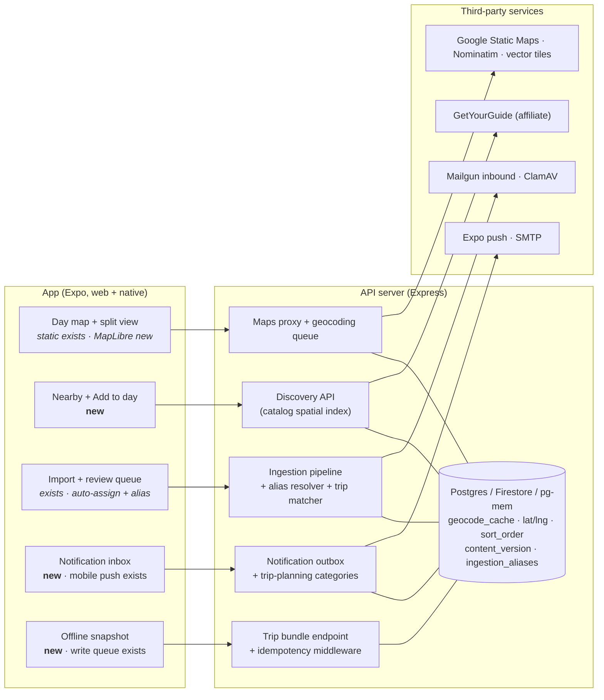

# Gap-Closing Plan: Map, Discovery, Email Import, Dark Features, Offline

**Status:** Proposed — nothing in this document is implemented yet.
**Last updated:** 2026-10-18
**Authors:** assistant, in collaboration with Bryan Duerk
**Builds on:** `implementation-plan-wanderlog-competitive-analysis.md` (§5.1–5.4),
`implementation-plan-trip-day-map.md`, `server/src/ingestion/TECHNICAL_DEBT.md`
**Shared copy:** [Claude Docs version](https://claude.ai/code/artifact/7a9efa83-7a24-458a-854b-be4c8ae71dc0)
(includes rendered architecture and phasing diagrams; this file is the source of truth for the repo).

---

## 0. Summary

This plan covers five gaps found in the Wanderlog/Stippl comparison: (1) in-app map,
(2) place discovery, (3) automatic reservation import, (4) built-but-dark features, and
(6) offline access. Gap 5, public pricing and social proof, is out of scope.

Most of the groundwork already exists: a static day map, an email-import pipeline, a
notification outbox, and an offline write queue. The plan adds **one new shared layer —
address geocoding** — finishes the dark features, and makes email import both **safe**
and **hands-off**.

Two corrections to the comparison:

- **Email import exists.** `server/src/ingestion/` has manual upload, a review queue,
  Mailgun forwarding, and Gmail OAuth. The work is hardening and UX, not a new build.
- **The trip blog is live.** `tripBlog.tsx`, the photo composer, and the public blog page
  all ship, and nearly every `trip_blog_*` flag seeds on.

**One security issue needs fixing before email import is widened** (§3.1): forwarded mail
is attributed to an account by its spoofable `From` address.

### Architecture at a glance

---

## 1. In-app map

Turn on the static day map that already exists, add coordinates so it can draw routes,
then add a keyless interactive map on desktop web.

**Already built:** `GET /api/maps/trip-day` in `server/src/routes/staticMapRoutes.ts` (24 h
content-addressed cache, rate limit, $15/month budget cap) and `app/components/TripDayMap.tsx`
in the Overview day view. Both sit behind `trip_day_map`, which is off only because no
Google Static Maps key is provisioned.

### Steps

1. **Enable it (no code).** Provision a server-only key restricted to the Static Maps API,
   set `GOOGLE_STATIC_MAPS_API_KEY`, flip `trip_day_map`.
2. **Route line.** Once items carry coordinates (§1.1), send `lat`/`lng` instead of
   addresses — `normalizeTripMapPoints` already accepts them — and add Google's `path`
   parameter in visit order.
3. **Travel time between stops.** Show "~12 min walk" between consecutive stops using the
   existing `transferEstimationService`: haversine estimate by default, Directions API only
   where `attractions_transfer_directions_api` already allows it.
4. **Stop order.** Add `sort_order` to activities (Postgres migration, Firestore field,
   pg-mem inherits). Drag-to-reorder on web with `@dnd-kit/core`, per competitive-analysis §5.3.
5. **Optimize day.** Nearest-neighbour + 2-opt on the client over ≤ 12 coordinates,
   starting and ending at the lodging — instant, no API call. Premium can refine with
   Google Routes. Always show before/after with **Revert**.
6. **Interactive map on desktop web.** MapLibre GL JS with keyless vector tiles
   (OpenFreeMap; Protomaps PMTiles on Cloud Storage as the self-hosted fallback). Wide
   screens get a split view: itinerary left, map right; tapping a pin highlights its row
   and opens the existing item dialog. Lazy-load the map library when the map opens.
   Native and narrow screens keep the static image.

### 1.1 Shared geocoding layer (new — also feeds §2, §3.3, §6)

- `geocode_cache` keyed by a hash of the normalized address: `lat`, `lng`, `city`,
  `country_code`, `provider`, `quality`, `created_at`. Shared across users, so each
  address is looked up once, ever.
- Nullable `lat`, `lng`, `geo_city` on lodgings, activities, and car rentals (pickup and
  dropoff). Flights already resolve through the airports table, and catalog attractions
  already carry coordinates, so an activity added from the catalog needs no lookup.
- Geocode when a user saves an item, through a **single-worker queue** off the request
  path. Backfill existing rows once, single-threaded at **4 requests/minute**, as
  Nominatim's bulk rules require.
- Provider: Nominatim, already used by `merchantCategoryLookupService.ts`, behind
  `usageLimiter` and `providerBudgeting`. Its public instance allows **1 request/second for
  the whole app**, requires an identifying User-Agent, and must be switchable off without
  an app update — a fail-closed flag (`geocoding_nominatim`) covers that. Google Places
  stays off, preserving the earlier decision.
- The public instance fits current volume, not growth. Put the provider behind an
  interface, like `FlightParserConfigurator`, so a self-hosted or paid geocoder can
  replace it.
- Side benefits: fills the `LodgingLocation` latitude, longitude, and timezone that are
  `null` today (helps `tripTimezoneService`), and lets the day-card title use `geo_city`
  instead of the comma-splitting `shortenLocationToCity` heuristic in `overview.tsx`.

---

## 2. Place discovery

Recommend places from data the app already caches — the curated attractions catalog,
Wikipedia blurbs, Unsplash photos, public trip blogs — instead of re-enabling Google Places.

**Already built:** attractions catalog with coordinates (`attractionsCatalogService`,
`destinationAttractionAutocompleteService`), Wikipedia enrichment, Unsplash photos, group
traits with `activityTypeInterestWeights`, GetYourGuide affiliate suggestions (flag on),
public trip blogs behind a consent flow, and trip following.

### Steps

1. **"Nearby" panel in the day view.** Catalog places within ~2 km of that day's lodging
   or first stop, ranked by the group's traits. Deterministic, no LLM call. Needs §1.1 for
   the lodging's coordinates. Spatial lookup: an in-memory index per destination, loaded
   at startup like the autocomplete prewarm, so a query costs no database reads.
2. **One-tap "Add to day".** Creates an activity prefilled with name, coordinates, typical
   duration (`attractionDurationEstimationService`), and description.
3. **Bookable options inline.** GetYourGuide matches under a Nearby place when one exists.
   Affiliate revenue offsets per-user cost.
4. **"Trips like this".** On a trip's overview, list public blogs for the same destination.
   "Copy these activities" clones names, coordinates, and durations only — never another
   group's bookings, costs, or notes.
5. **In-app destination page.** One authenticated page per catalog destination: hero
   photo, place cards, Add to trip. Same API as Nearby.
6. **Later: public, crawlable explore pages** — keep competitive-analysis §5.4's SEO spike
   first.

**Guardrails:** browse and copy read only content published under public-sharing consent;
discovery endpoints sit behind `httpRateLimitService`.

---

## 3. Email import: safe, then hands-off

Goal: a user forwards a confirmation, and within a minute it appears **in the right trip**
with a notification — no review screen unless something is genuinely ambiguous. That
requires fixing attribution first, because auto-assignment writes into a trip the whole
group sees.

### What exists today

| Piece | State | Where |
| --- | --- | --- |
| Manual upload → review → assign | Production-ready | `ingestion/intake`, `review_queue`, `assignment` |
| Mailgun forwarding | Flag on; "scaffolded" per `TECHNICAL_DEBT.md` | `intake/mailgun.ts`, `routes/ingestionWebhookRoutes.ts` |
| Webhook HMAC, timestamp window, replay tokens | Done | `validateMailgunWebhookSignature` |
| Single shared address | `travel.docs@wander-bunnies.com` | `INGESTION_DEFAULT_FORWARDING_ADDRESS` |
| User attribution | By `From`/`sender` address | `resolveMailgunWebhookUser` |
| Trip assignment | Always manual, by design | `assignParsedItemToTrip`; "No automatic assignment" in `TECHNICAL_DEBT.md` |
| Assignment tracking | Each assignment gets an `assignment_transaction_id` | `shared/repository.ts` |
| Traveler matching | Names → group member ids | `matchTravelerNamesToGroupMemberIds` |
| Virus scanning | Production provider is a pass-through stub | `ingestion/virusScanProviders` |
| Gmail OAuth import | Flag off; manual-trigger only | `ingestion/gmail`, `gmailPollingService.ts` |

### 3.1 Security fix: stop trusting `From`

**The problem.** `resolveMailgunWebhookUser` takes `body.sender ?? body.from`, looks up an
account by that email, and enqueues the message for that user. The webhook signature only
proves *Mailgun* delivered the request — not who sent the email. Anyone who knows a
Premium user's email address can:

- inject fake "reservations", with phishing links, into that user's review queue — and,
  once §3.3 lands, **directly into a shared trip**;
- burn that user's monthly import quota (it is consumed after attribution);
- trigger LLM extraction spend on attacker-controlled content.

Info logs also record full sender, recipient, and subject for every webhook
(`ingestionWebhookRoutes.ts`), which is PII in logs.

**The fix: a secret per-user address is the credential; the sender check is defense in depth.**

1. **Per-user alias.** Each user gets `u-<token>@in.wander-bunnies.com`, where `<token>`
   is 128 random bits, base32-encoded. Use a dedicated inbound subdomain (`in.`) with its
   own MX pointing at Mailgun, so the main domain's mail is untouched.
   - New table `ingestion_aliases`: `id`, `user_id`, `token_hash` (SHA-256, unique index,
     used for lookup), `address_ciphertext` (AES-256-GCM, the same pattern as
     `pushTokenCrypto.ts`, used only to show the address back to the user), `status`
     (`ACTIVE` | `ROTATED` | `REVOKED`), `created_at`, `grace_until`.
   - **Rotate** in the Import screen: a new alias becomes active, the old one keeps
     working for 7 days (`grace_until`), then is rejected. **Revoke** stops it immediately.
2. **Resolve by recipient, not sender.** Rewrite `resolveMailgunWebhookUser` to parse
   `body.recipient`, hash the token, and look up the alias. Unknown or revoked alias →
   drop with `200` (so Mailgun doesn't retry), log a counter, never reply.
3. **Sender check (defense in depth).** Accept the message straight into the pipeline only
   if the **envelope sender** (Mailgun's `sender` field) or `From`, after stripping
   `+tags`, is one of the user's **verified addresses**: the account email plus any added
   and confirmed on the Import screen. Gmail auto-forwarding keeps the airline in `From`
   but sets the envelope sender to the user's own address with a `+caf_` tag, so stripping
   tags is required — verify with a real auto-forward before shipping. Also require
   Mailgun's SPF or DKIM result to pass (check the exact header names Mailgun adds on
   inbound routes during implementation).
4. **Unrecognized sender → hold, don't reject.** A message to a valid alias from an
   unverified sender goes to a new `HELD_UNVERIFIED_SENDER` job state **before
   normalization and extraction** — no LLM spend on unverified mail. The user sees "1
   message from `trips@spouse.example` — Import once / Always allow / Delete". "Always
   allow" adds a verified sender after a confirmation link is sent to that address.
5. **Quota and rate limits after validation.** Move `assertAndConsumeMonthlyQuota` after
   alias + sender validation, and add a per-alias cap (e.g. 50 messages/day) via
   `httpRateLimitService` or the ingestion quota module.
6. **No backscatter.** Never send an automatic email reply to the `From` of an inbound
   message. Status goes to the account owner in-app and by push (§4), or by email to the
   **account** address only.
7. **Log hygiene.** Log the alias id, a hash of the sender, and message size — not
   addresses or subjects.
8. **Retire the shared address.** For 30 days, mail to `travel.docs@wander-bunnies.com`
   is held as in step 4 (the user must tap "Yes, I sent this"), and the Import screen and
   an email to the account address announce the new personal address. After that, the
   shared address is dropped.
9. **Render safely.** Review and notification screens show normalized text only, never
   raw email HTML. Links in imported notes render as plain text with the domain visible.
10. **Real virus scanning before wide rollout.** Scan attachments only (PDF, images); most
    confirmations are plain bodies. Recommended: ClamAV as its own Cloud Run service scaled
    to zero. Google Web Risk checks URLs, not file contents, so it does not fill this gap;
    VirusTotal's public service is built around sharing submitted samples, so check its
    terms before considering it. Scan before `pdf-parse`/OCR touch the bytes.

### 3.2 Making forwarding easy to set up

1. **Import screen leads with the address.** Large, with Copy, "Add to contacts" (a vCard
   download), and a QR code for setting it up on a phone.
2. **Provider walkthroughs.** Short steps for Gmail (filter → forward), Outlook (rule),
   and Apple Mail, with a "Send a test" button that emails a sample confirmation to the
   alias and shows it arriving.
3. **Gmail auto-forward verification.** Gmail sends a confirmation code to a new
   forwarding address before it will auto-forward. That email arrives at the user's alias.
   Detect it (from `forwarding-noreply@google.com`), skip extraction, and show the code and
   link in the Import screen, so setup completes without the user ever seeing our mailbox.
4. **Tripmates.** Each group member has their own alias; the trip shows "Imported by Tristan".
5. **Share sheet.** Extend the existing mobile share entry points (`trip_blog_mobile_share_*`)
   with "Import to WanderBunnies" for PDFs and screenshots, using the manual-upload source.

### 3.3 Assign to the right trip by default

Today every item waits in the review queue for a manual trip pick. New default: **when one
trip clearly matches on time and place, assign it automatically, tell the user, and offer
Undo.** This reverses the "No automatic assignment" decision in `TECHNICAL_DEBT.md`
deliberately; update that file when this ships.

**Gate:** auto-assignment ships only after §3.1 steps 1–4. Without them, a spoofed email
would write straight into a group's trip.

#### Candidate trips

Trips from `listTrips(userId)` where the user is an active group member (not followed
trips), the trip is not deleted, and the trip end date is no more than 30 days in the past.

#### Signals

| Signal | How it's computed | Weight |
| --- | --- | --- |
| **Date fit** | Item's local start/end (from `startDateTimeUtc`, `endDateTimeUtc`, `originalTimezone`) falls within trip `startDate − 1 day` … `endDate + 1 day`. The slack covers overnight outbound and return flights. Trips with only `startMonth`/`startYear` get a weak month fit. | Required for auto |
| **Place fit** | Any endpoint of the item matches the trip's places. Item places: flight/rail arrival and departure airport codes → city via the airports table; hotel/activity/car `address`/`location` → `geo_city` via §1.1, or a city-string match before §1.1 lands. Trip places: `destination`, `locationIds` (via `locationServices`), and cities of items already in the trip. Both legs of a round trip count — the return leg departs from the destination. | Strong |
| **Booking continuity** | Same `confirmationNumber` or `providerVendor` + booking reference as an item already assigned to that trip (e.g. the return leg of a booking whose outbound is in the trip). Extends the existing dedupe fingerprint lookup. | Strongest |
| **Traveler fit** | `travelerNames` resolve to members of the trip's group via `matchTravelerNamesToGroupMemberIds`. | Supporting |
| **Extraction confidence** | Item `confidenceScore` ≥ `INGESTION_CONFIDENCE_HIGH` (0.9), not `DUPLICATE_FLAGGED`, `timezoneStatus` ≠ `UNKNOWN` when the item sits on a trip's boundary day. | Required for auto |

A new module `server/src/ingestion/assignment/tripMatcher.ts` scores each candidate and
returns `{ tripId, score, reasons[] }` with human-readable reasons ("Dates Nov 9–21 fit",
"Arrives HND, Tokyo is in this trip", "Same booking as your outbound flight"). It is pure
and deterministic: no LLM, no network, unit-testable from fixtures.

#### Decision

| Outcome | Condition | What the user sees |
| --- | --- | --- |
| **Auto-assign** | Exactly one candidate has date fit and (place fit or booking continuity); confidence gate passes; user setting on | Item is added; notification "Added Delta DL167 to *Japan 2026* · Undo"; activity-feed entry for tripmates |
| **Suggest** | Several trips fit, or only date fit, or confidence 0.7–0.9 | Review queue with the trip pre-selected and reasons shown; one-tap Confirm; "Confirm all suggestions" bulk action |
| **No match** | No candidate fits | Review queue with "Create a trip from this", which opens the Quick Start wizard prefilled with destination and dates (no automatic trip creation) |

#### Undo and safety

- **Undo** from the notification or the item for 7 days. Each assignment already has an
  `assignment_transaction_id`; undo deletes exactly the rows that transaction created and
  returns the item to the review queue. Verify that the transaction record covers every
  created row, including the expense from `syncAssignedFlightExpense`, before relying on it.
- Auto-assigned items carry a small "Imported" badge with the reasons, in the item dialog.
- **Setting:** "Add confident matches to trips automatically", **on by default**, per user,
  on the Import screen.
- Never auto-assign into a trip where the item would duplicate an existing item; the
  existing `ASSIGNED_MATCH` disposition routes it to review instead.

#### Data model

- `parsed_items`: add `suggested_trip_id`, `match_score`, `match_reasons` (JSON),
  `assignment_mode` (`MANUAL` | `SUGGESTED` | `AUTO`), `undo_expires_at`.
- `import_jobs`: new state `HELD_UNVERIFIED_SENDER`.
- New tables: `ingestion_aliases` (§3.1), `ingestion_verified_senders` (`user_id`, `email`,
  `verified_at`, `verification_token_hash`).
- User preference: `ingestion_auto_assign` (boolean, default true).
- All three adapters (`db.postgres.ts` bootstrap/migration, `db.firebase.ts`, pg-mem via
  postgres), with Firestore composite indexes for `(user_id, status, suggested_trip_id)`
  and `(token_hash)` added to `firestore.indexes.json` in the same PR.

#### Metrics to watch

Auto-assign rate, **undo rate** (above ~5% means thresholds are too loose), suggestion
acceptance rate, held-sender rate, and median time from email received to item in trip.
Add these to the existing ingestion admin observability widgets.

### 3.4 Cheaper, unified extraction

1. **Cheapest extractor first.** Every import runs static extraction plus two LLM parsers
   today (`ingestion_dual_llm_consensus`). Tier it: `.ics` attachment or high-confidence
   static/learned result → 0 LLM calls; medium → 1; low → 2 with consensus. Cache by
   content hash so repeated airline templates stay free.
2. **One parser stack.** Route the Transfers tab's "Paste Info" text through ingestion
   extraction as a manual-text source, retiring the separate `flightParserLLM` path.
3. **Defer Gmail import.** Restricted Gmail scopes require a CASA security assessment and
   re-assessment every 12 months. Forwarding covers the main case without it.

### 3.5 Tests

- `tripMatcher` unit tests from fixture trips: single match, two overlapping trips, return
  leg by booking continuity, overnight flight on the boundary day, unknown timezone, and
  undated (month-only) trips.
- Supertest integration tests posting signed Mailgun webhooks: spoofed `From` to the shared
  address is held; valid alias + verified sender is queued; valid alias + unknown sender is
  held without extraction; revoked alias is dropped; quota is untouched by rejected mail.
- Auto-assign → undo round trip restores the trip exactly, including expenses.
- Run against `DB_PROVIDER=memory` and the Firestore emulator.

---

## 4. Finish built-but-dark features

By seed default in `server/config/feature-flags.yaml` (production values may differ —
step 1 checks):

| Feature | Flag | What's missing |
| --- | --- | --- |
| Day map | `trip_day_map` | An API key (§1) |
| In-app notification inbox | `notifications_in_app` | No inbox UI |
| Mobile push | `notifications_push` | Delivery is wired; needs a staged rollout |
| Web push | `notifications_web_push` | Seeds on, but no service worker or VAPID keys exist, so it does nothing |
| Activity recap prompt | `activity_recap` | Server pieces only, no UI |
| Gmail import | `feature_ingest_gmail_import` | Deferred (§3.4) |

### Steps

1. **Flag audit.** An admin-panel view of every flag: production value, seed default, and
   whether any UI reads it. Add a test that every flag the client reads through
   `GET /blog/capabilities` is in that route's `featureKeys` list — a missing key has
   silently hidden finished features before.
2. **Notification inbox.** A bell with unread count in the top bar, updated over the
   existing Socket.IO connection instead of polling.
3. **Trip-planning notifications.** Every `NotificationCategory` today is blog-related.
   Add: free-cancellation or refund deadline within 48 hours (`freeCancelBy` on activities,
   `refund_by` on lodging), **import results** ("Added to *Japan 2026* · Undo",
   "2 reservations need a trip", "Held: message from an unknown sender"), AI itinerary
   finished, and a daily digest of tripmates' changes. Per-category preferences; digest
   by default.
4. **Push rollout.** Flags are global switches with no admin bypass, so add an optional
   user allowlist to flag evaluation and enable push for the two admin accounts first.
   Prune tokens Expo reports as `DeviceNotRegistered`.
5. **Web push.** Turn `notifications_web_push` off now; build it later on the §6 service worker.
6. **Activity recap.** After an activity's end time, prompt the group to rate it and add a
   blog note or photo, through the inbox and push.

---

## 6. Offline access

Make every trip readable offline and let expenses be added offline.

**Already built:** `app/hooks/usePendingWrites.ts` (persisted write queue with replay and a
retry cap), `app/hooks/useConnectionState.ts`, `app/utils/persistentStorage.ts`, the blog's
seven-day offline authoring queue, and `Idempotency-Key` enforcement in
`blogEngagementRoutes.ts`.

### Steps

1. **Trip bundle endpoint.** `GET /api/trips/:id/bundle` returns trip, transfers, lodging,
   activities, car rentals, itinerary days, and expenses in one response. A
   `content_version` counter on the trip, bumped on any child write, is the ETag; an
   unchanged trip returns `304`, cutting requests and Firestore reads for online users too.
2. **Local snapshot.** IndexedDB on web (localStorage is synchronous and capped at a few
   MB); a file or SQLite on native. Save automatically for trips within 3 days of travel;
   an "Available offline" toggle covers the rest. Include day-map images already fetched
   as blobs.
3. **App shell offline on web.** A service worker caches HTML, JS, and assets so the app
   opens without a connection. The same worker is what real web push needs (§4).
4. **Offline expenses first.** Extend `usePendingWrites` to expense creation; queued items
   show a "pending sync" badge.
5. **Safe replay.** Generalize the blog's `Idempotency-Key` handling into shared middleware
   and send a key with every queued write. If the server copy changed after the snapshot,
   ask which version to keep instead of overwriting.
6. **Expired sessions.** Sessions last 12 hours by default. Keep queued writes past expiry
   and replay after re-login.
7. **Keep it free.** Stippl puts offline behind Pro. Read-only offline lowers server load.

**Security:** the local copy is keyed by user id and wiped on logout (`session.ts`); it
holds only what that user can already see.

---

## 7. Security, performance, and cost per user

| Gap | Security | Performance | Cost per user |
| --- | --- | --- | --- |
| Map | Keys never reach the client; tiles need no key; the geocoder gets only an address string, never user or trip ids | Geocoding off the request path; map library lazy-loaded | Static map ~$2 per 1,000 loads (per the trip-day-map plan), cached 24 h by content; tiles $0; each address geocoded once |
| Discovery | Browse/copy read only public, consented content; rate-limited | In-memory spatial index, no DB reads per query | ~$0; affiliate revenue offsets |
| Import | Secret per-user alias, verified senders, SPF/DKIM, hold-before-extract, real attachment scanning, text-only rendering | Existing async worker queue; matcher is pure and in-process | 0–2 LLM calls per import by confidence instead of 2 always; no LLM spend on held mail |
| Notifications | No booking details in push text (lock screens) | Socket.IO events instead of polling | Expo push is free; email defaults to a daily digest |
| Offline | Local copy scoped to the user, wiped on logout; idempotent replay | One bundle request with 304s | Fewer reads; storage on device |

**Rules for every slice**

- New paid calls go through `reserveApiUsageOrThrow` and `recordProviderRequestCost`, with
  a monthly budget and 80% alert in `server/config/api-limits.yaml`.
- Flags for anything that calls a paid provider or contacts a person are fail-closed
  (`FAIL_CLOSED_FLAGS` in `entitlementService.ts`).
- Each schema change lands in the Postgres, Firebase, and memory adapters in one PR, with
  Firestore composite indexes in `firestore.indexes.json` in that same PR.
- Add Nominatim/OpenStreetMap and the tile host to the privacy policy as processors, and
  show the OpenStreetMap attribution the tile terms require.

---

## 8. Phasing

Four lanes run in parallel; work runs left to right within each lane.

| Lane | Step 1 | Step 2 | Step 3 | Step 4 |
| --- | --- | --- | --- | --- |
| Map + discovery | Turn on day map (key + flag) | **Geocoding layer** (cache, lat/lng, backfill) | Map v2 (route line, times, reorder, split view) | Discovery (Nearby, add to day, trips like this) |
| Import | **Security fix** §3.1 steps 1–8 | Real virus scan; forwarding UX §3.2 | **Auto-assign** §3.3 | Tiered extraction, Paste Info merged §3.4 |
| Notifications | Flag audit, capabilities test, web push flag off | Inbox + trip and import alerts | Push rollout (admin allowlist first) | Activity recap |
| Offline | Trip bundle + ETag | Local snapshot | Service worker (+ web push) | Offline expenses + idempotency |

Cross-lane dependencies: Nearby needs the geocoding layer; auto-assign needs the security
fix and works better with geocoded places; import notifications need the inbox; web push
needs the service worker.

**Later:** public SEO explore pages · Gmail import (security assessment) · native
interactive map (EAS rebuild).

---

## 9. Open questions

1. Is OpenFreeMap's free, no-SLA public instance acceptable to start, or self-host tiles
   from day one?
2. Should "Optimize day" stay free with the client-side optimizer, with only Google-refined
   routing as Premium?
3. Which geocoder replaces Nominatim's public instance at scale — self-hosted, or a paid
   provider whose terms allow storing results?
4. Auto-assign undo window: is 7 days right, or should undo stay available until the trip
   starts?
5. Should auto-assigned items notify the whole group, or only the person who forwarded them?
6. After expenses, which offline edit comes next: activities or notes?

## Sources

- [Nominatim usage policy](https://operations.osmfoundation.org/policies/nominatim/) — 1 req/s, bulk rules, switch-off requirement
- [OpenFreeMap](https://openfreemap.org/) — free, keyless tiles; no SLA; attribution required
- [Google restricted scope verification](https://developers.google.com/identity/protocols/oauth2/production-readiness/restricted-scope-verification) — CASA assessment, 12-month re-assessment
- [Google Web Risk overview](https://docs.cloud.google.com/web-risk/docs/overview) — checks URLs against threat lists
