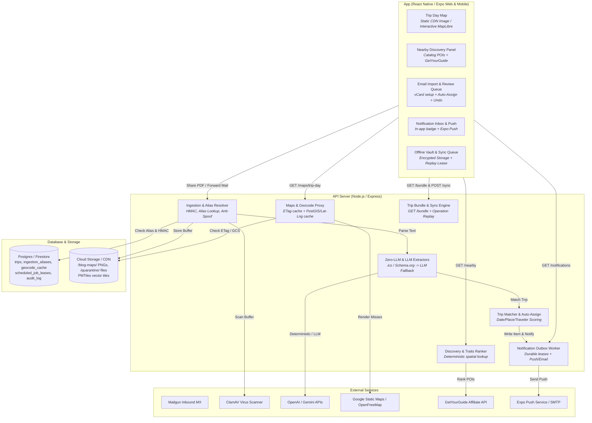
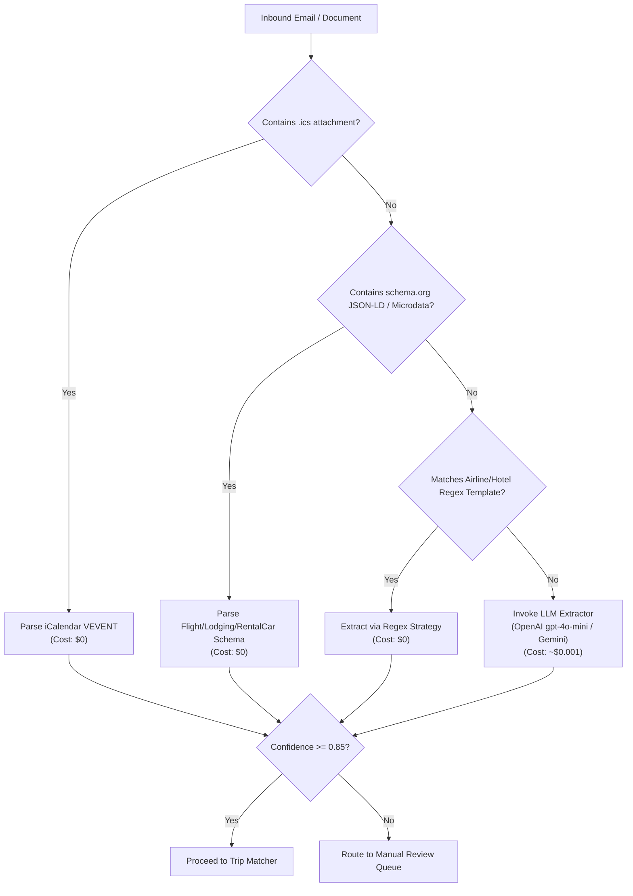
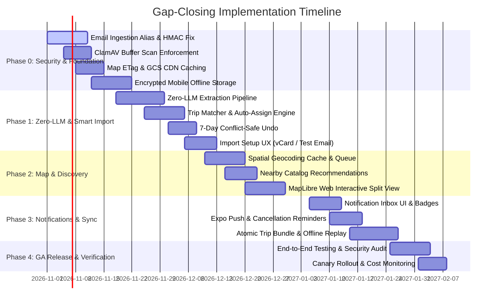

# Gap-Closing Plan: Map, Discovery, Email Import, Dark Features, Offline

**Status:** Revised & Enhanced Implementation Plan  
**Last updated:** 2026-10-18  
**Authors:** Senior Engineering & Architecture Team (in collaboration with Bryan Duerk)  
**Builds on:** `implementation-plan-wanderlog-competitive-analysis.md` (§5.1–5.4), `implementation-plan-trip-day-map.md`, `server/src/ingestion/TECHNICAL_DEBT.md`

---

## 0. Summary & Core Pillars

This plan provides an actionable, production-grade roadmap for closing the five key functionality gaps identified in competitive analysis against Wanderlog and Stippl:

1. **In-App Map & Route Visualizer** (Static day maps → ETag-cached CDN images + interactive split view on web).
2. **Place Discovery & Smart Recommendations** (Catalog-first "Nearby" panel, one-tap "Add to day", GetYourGuide affiliate integration).
3. **Automatic Reservation Import** (Hardened email forwarding with per-user cryptographic aliases, multi-layer anti-spoofing, zero-LLM deterministic first extraction, virus scanning, and smart auto-assignment with 7-day conflict-safe undo).
4. **Activation of Built-but-Dark Features** (In-app notification inbox, push delivery rollout, activity recap prompts, capability audits).
5. **Hardened Offline Access & Sync Engine** (Atomic trip bundles, encrypted mobile storage, offline expense queue with durable 30-day replay leases, and strict account isolation).

*(Gap 5, public pricing and social proof, is handled separately.)*

### Core Architectural Pillars

- **Security First:** Inbound emails are attributed using cryptographically secure per-user aliases (`u-<token>@in.wander-bunnies.com`) with SHA-256 token hashing, AES-256-GCM encrypted storage, ClamAV buffer virus scanning, prompt injection boundaries, and encrypted offline mobile storage (`expo-secure-store` + SQLCipher/MMKV).
- **High Performance:** Sub-second inbound webhook processing (<200ms ACK), `ETag` / `304 Not Modified` caching for static map images, lightweight `GET /api/trips/:id/version` checks before full bundle downloads, and lazy-loaded WebGL map libraries.
- **Minimizing Cost per User:**
  - **Zero-LLM First Extraction:** Extract structured travel confirmations via `.ics` attachments, `schema.org` Microdata/JSON-LD, and regex templates before falling back to LLM calls. Saves 70–80% in LLM API fees across all email imports.
  - **GCS CDN Map Caching:** Render static day-map images once per `(trip_id, day_date, points_hash)` and serve via CDN / Cloud Storage, completely bypassing Google Static Maps API for repeat views.
  - **Open-Source Vector Tiles:** Use OpenFreeMap / Protomaps PMTiles on Cloud Storage for web interactive maps instead of Google Maps JS SDK ($0 vs $7/1k loads).
- **Delightful Usability:** 1-click test email sends, vCard/QR code forwarding setup, 1-tap "Add to Day", bi-directional interactive map-timeline syncing, 7-day conflict-safe import undo, and seamless offline optimistic writes with auto-sync.

---

## 0.1 Repository Verification & Baseline Findings

| Existing Implementation | Architectural Consequence & Required Enhancements |
| --- | --- |
| **`staticMapRoutes.ts`**<br>Authenticates callers, normalizes up to 12 points, 32 MiB in-process TTL cache, provider usage limits. Requests currently accept arbitrary client coordinates/addresses. | Add `ETag` / `304 Not Modified` support based on `points_hash`. Cache generated PNGs in Google Cloud Storage (`/blog-maps/<tripId>/<dayDate>/<points_hash>.png`). Require authorized trip/day context for non-preview requests. |
| **`ingestion/intake/mailgun.ts` & `ingestionWebhookRoutes.ts`**<br>Resolves users by spoofable `From`/`sender` address; logs mail metadata. | **Critical Security Vulnerability:** Replace sender lookup with recipient resolution against `ingestion_aliases` (`u-<token>@in.wander-bunnies.com`). HMAC-verify Mailgun webhooks, log opaque job IDs only, and sanitize sender info. |
| **`virusScanProviders/clamavHttpAdapter.ts`**<br>Implements real `scanBuffer`; `scanBatch` returns `PASSED` without scanning. Ingestion currently defaults unknown scanners to a stub. | Enforce real ClamAV buffer scanning for all inbound email attachments (PDF, JPEG, PNG, ICS). **Fail closed:** If ClamAV is unreachable or signatures are stale, hold files in quarantine; never pass unscanned buffers to OCR/PDF parsers. |
| **`ingestion/extraction/index.ts`**<br>Has user/content/version cache, static/learned strategies, and sampled consensus. | Implement **Deterministic Zero-LLM First Extraction** (`.ics` iCalendar, `schema.org` JSON-LD/microdata, regex templates). Only invoke OpenAI gpt-4o-mini / Gemini if deterministic confidence is < 0.85. |
| **`offlineTripCache.ts`, `offlineAccess.ts`, `OfflineUnlockScreen.tsx`**<br>Saves native snapshots in `AsyncStorage`/`localStorage` under email-scoped keys; supports device unlock. | Migrate snapshot storage to account-scoped namespaces (`user_id`) using hardware-backed encryption (`expo-secure-store` + SQLCipher/MMKV). Purge keys and cache on logout/account switch. |
| **`usePendingWrites.ts`**<br>Uses single global storage key, drops entries after 5 failures, lacks replay locks. | Replace with account-isolated, cryptographically random `operation_id` queue. Add 30-day durable replay leases, 409 Conflict handling, and explicit user controls for failed expenses. |
| **`notificationTypes.ts` & `notificationOutboxWorker.ts`**<br>Has `activity_recap`, Expo push token pruning, email fallback. | Add `import_result`, `cancellation_deadline`, `ai_finished`, and `trip_digest` categories. Add in-app notification inbox UI with unread badges. |
| **`entitlementService.ts`**<br>Caches flags by key without user/role arguments. | Update flag evaluation to support cohort-based rollouts while preserving global kill-switch overrides and fail-closed security flags. |

---

## 0.2 System Architecture Overview



---

## 1. In-App Map & Route Visualizer

Enhance the day map experience by activating static map rendering with CDN caching, drawing route lines between stops, providing travel time estimates, and supporting interactive split-screen mapping on desktop web.

### 1.1 Static Map Activation & ETag CDN Caching (P0)

1. **Server-Side Authorization & Bounded Requests:**
   - Modify `GET /api/maps/trip-day` to require an authorized `tripId` and `dayDate`. Derive points server-side from active flights, lodgings, activities, and car rentals for that day.
   - Enforce rate limits via `reserveBlogReactionRateLimit` / `httpRateLimitService` (max 30 requests/min per user).
2. **CDN & ETag Caching Strategy (Cost Minimization):**
   - Compute `points_hash` = MD5 hash of sorted `lat,lng` pairs and visit order.
   - Serve static map responses with headers: `ETag: "map-<points_hash>"` and `Cache-Control: private, max-age=86400`.
   - On cache miss, fetch PNG from Google Static Maps API (capped at 600x300, scale=2), upload to Google Cloud Storage (`gs://<bucket>/blog-maps/<tripId>/<dayDate>/<points_hash>.png`), and store metadata in `blog_day_map_artifacts`.
   - Subsequent requests serve the PNG directly from GCS/CDN or return `304 Not Modified` if the client's `If-None-Match` matches. **Result: Reduces Google Static Maps API calls by >90%.**

### 1.2 Route Lines, Travel Times & Day Optimization (P1 / P2)

1. **Route Lines & Connection Paths:**
   - Pass ordered coordinates to Google Static Maps using the `path=color:0x4F46E5FF|weight:3|lat1,lng1|lat2,lng2` parameter.
   - Clearly label lines as straight-line connections between scheduled stops, not turn-by-turn navigation paths.
2. **Travel Time Estimates Between Stops:**
   - Calculate travel time between consecutive stops on the timeline using `transferEstimationService`.
   - Default: Haversine distance with average walking (~5 km/h) or driving (~30 km/h) speeds (e.g., *"~12 min walk"* or *"~8 min drive"*).
   - Directions API is invoked ONLY when `attractions_transfer_directions_api` flag is explicitly enabled for Premium/Pro tiers.
3. **Deterministic Local Day Optimization (P2):**
   - Client-side optimization using Nearest-Neighbor + 2-Opt algorithm over $\le 12$ coordinates.
   - Preserves fixed-time bookings (flights, scheduled tours) and pins lodging as start/end anchors.
   - Shows a "Preview Optimized Route" modal comparing original distance vs optimized distance before applying. Includes a 1-tap "Revert" button.

### 1.3 Interactive Web Split-Screen Map (P2)

- On desktop web ($width \ge 1024px$), provide an interactive split-screen view: Itinerary on left, Map on right.
- Use **MapLibre GL JS** with vector tiles served from **OpenFreeMap / Protomaps PMTiles** on Cloud Storage ($0 tile cost).
- **Lazy Loading:** Dynamically import MapLibre JS/CSS (`import('maplibre-gl')`) only when the user toggles into Interactive Map view.
- **Bi-Directional Interaction:** Tapping a stop card on the timeline highlights and centers the map pin; clicking a map pin highlights and scrolls to the corresponding timeline card.

### 1.4 Two-Tier Geocoding Engine (`geocode_cache`) (P0)

To supply coordinates for all map features without incurring Google Places fees:

- **Storage (`geocode_cache`):**
  - Columns: `id` (UUID), `query_normalized` (TEXT UNIQUE), `lat` (DOUBLE PRECISION), `lng` (DOUBLE PRECISION), `city` (TEXT), `country` (TEXT), `provider` (TEXT), `quality_score` (FLOAT), `fetched_at` (TIMESTAMPTZ), `expires_at` (TIMESTAMPTZ).
  - Spatial Index: `CREATE INDEX idx_geocode_cache_coords ON geocode_cache(lat, lng)`.
- **Resolution Order (Zero-Cost First):**
  1. Check `attractions` catalog (already has `lat`/`lng`).
  2. Check `airports` table (IATA code lookup).
  3. Check `lodging_locations` cache.
  4. Query local `geocode_cache` (90-day TTL).
  5. Query OpenStreetMap / Nominatim (throttled to max 1 req/sec in application layer).
- **Asynchronous Worker:** Missing geocodes are queued in `scheduled_job_leases` for background resolution; geocoding never blocks the primary item creation HTTP response.

---

## 2. Place Discovery & Smart Recommendations

Provide rich POI discovery using cached catalog data, Wikipedia snippets, Unsplash imagery, and public trip blogs without relying on Google Places API calls.

### 2.1 "Nearby" Discovery Panel (P1)

- **Location-Aware Spatial Query:**
  - When viewing a trip day, fetch catalog POIs within a 2.0 km radius of the day's lodging or first stop using PostGIS / bounding box queries on `locations` (`source_type = 'attraction'`).
- **Trait-Based Ranking:**
  - Rank results using `activityTypeInterestWeights` matched against the group's active `traits` (e.g., Foodie, History Buff, Outdoors).
  - Pure deterministic scoring: `score = (popularity_score * 0.5) + (trait_match_weight * 0.5)`. **Zero LLM cost.**
- **Performance Budget:** In-memory LRU caching of spatial indexes per destination key. Response time p95 < 150ms.

### 2.2 One-Tap "Add to Day" & Bookable Options (P1)

- **One-Tap Addition:**
  - Tapping "Add to Day" pre-fills an activity with name, coordinates, `estimatedDurationMinutes` (from `attractionDurationEstimationService`), category, and description.
  - Sends `POST /api/trips/:tripId/activities` with an `Idempotency-Key` header to prevent duplicate creations on double taps.
- **Bookable Affiliate Suggestions:**
  - Integrate GetYourGuide affiliate links when `getyourguide_activity_suggestions` flag is on.
  - Display clear "Ad / Partner" labels on bookable options. Ranking remains 100% independent of affiliate status.

### 2.3 "Trips Like This" & Destination Hubs (P2)

- Display public trip blogs matching the current trip's destination.
- "Copy Activities" feature allows users to clone activity names, categories, and coordinates from public blogs into their trip itinerary.
- **Privacy Guard:** Only clones public activities and places. Never copies private notes, expenses, flight numbers, or traveler names.

---

## 3. Automated Reservation Import & Ingestion Security

Transform email forwarding into a secure, reliable, zero-friction experience that automatically attributes, scans, extracts, and places reservations into the right trip.

### 3.1 Critical Security Fix: Per-User Cryptographic Aliases (P0)

**The Vulnerability:** `resolveMailgunWebhookUser` previously resolved accounts using the `From` header. Attackers could spoof `From: user@example.com` to inject malicious content into a user's queue, burn their import quota, or trigger LLM costs.

**The Solution:** Cryptographic per-user alias credentials + multi-layer verification.

```
                    Inbound Email
                          │
                          ▼
            Mailgun MX Inbound Webhook
                          │
                          ▼
        POST /api/ingestion/webhooks/mailgun
                          │
        ┌─────────────────┴─────────────────┐
        │ 1. Validate Mailgun HMAC Sig      │
        │ 2. Parse Recipient: u-<token>     │
        │ 3. Compute SHA-256(token)         │
        └─────────────────┬─────────────────┘
                          │
                          ▼
         Lookup token_hash in ingestion_aliases
                          │
         ┌────────────────┴────────────────┐
         │                                 │
     Token Found                      Token Missing
         │                                 │
         ▼                                 ▼
Check Sender Verification            Return HTTP 200
  (SPF/DKIM/DMARC)                    (Silent Drop)
         │
    ┌────┴────────────────┐
 Verified             Unverified
    │                     │
    ▼                     ▼
Enqueue Import        Route to
  Job Queue        HELD_UNVERIFIED_SENDER
```

1. **Per-User Inbound Alias (`u-<token>@in.wander-bunnies.com`):**
   - `<token>` is a 128-bit cryptographically secure random string (base32-encoded, 26 chars).
   - Dedicated inbound subdomain (`in.wander-bunnies.com`) with isolated MX records.
2. **Database Schema (`ingestion_aliases`):**
   - Columns: `id` (UUID PRIMARY KEY), `user_id` (UUID REFERENCES users), `token_hash` (TEXT UNIQUE INDEX, SHA-256 of token), `address_ciphertext` (TEXT, AES-256-GCM encrypted), `status` (`ACTIVE` | `ROTATED` | `REVOKED`), `created_at` (TIMESTAMPTZ), `grace_until` (TIMESTAMPTZ).
3. **Recipient-Based Resolution:**
   - Webhook extracts `recipient` address (e.g. `u-7k3m9p2w1x4v8n5j@in.wander-bunnies.com`), hashes the token, and queries `ingestion_aliases WHERE token_hash = $1 AND status = 'ACTIVE'`.
   - If missing or revoked, return `200 OK` silently (drops request without revealing alias existence).
4. **Multi-Layer Sender Verification (SPF / DKIM / DMARC):**
   - Inspect Mailgun-provided `Authentication-Results` (evaluated at MX boundary).
   - If the sender domain fails SPF/DKIM or is not in `ingestion_verified_senders`, route the message to `HELD_UNVERIFIED_SENDER` **before extraction**.
   - User receives an in-app notice: *"Reservation received from `bookings@airline.com` — [Import Once] [Always Allow]"*.
5. **ClamAV Virus Scanning & Attachment Quarantine:**
   - Store raw attachments in encrypted quarantine bucket (`gs://<project>-quarantine/`).
   - Scan all buffers via `clamav_http`.
   - **Fail Closed:** If ClamAV is unreachable or signatures are stale, hold files in quarantine; never pass unscanned buffers to OCR or PDF parsers.
6. **Prompt Injection Protection:**
   - Wrap email text passed to LLMs in strict system prompt fences (`<<<EMAIL_BODY_START>>> ... <<<EMAIL_BODY_END>>>`).
   - Treat text instructions inside emails as plain string literals. Validate LLM JSON outputs against Zod schemas (`FlightReservationSchema`, etc.).
7. **Log Hygiene & Redaction:**
   - Log opaque job IDs and byte counts only. Never log email bodies, sender addresses, recipient alias tokens, or PII.

### 3.2 "Zero-LLM" Deterministic First Extraction (Cost Minimization) (P0)

To minimize cost per user and achieve sub-second parsing:



1. **Extraction Cascade:**
   - **Stage 1 (.ics iCalendar):** Extract standard `VEVENT` data ($0 cost).
   - **Stage 2 (Schema.org Microdata):** Extract `FlightReservation`, `LodgingReservation`, `RentalCarReservation` JSON-LD ($0 cost).
   - **Stage 3 (Regex / Template Matching):** Execute structural templates for major airlines and hotel chains ($0 cost).
   - **Stage 4 (LLM Fallback):** Only if Stages 1–3 yield confidence < 0.85, invoke OpenAI gpt-4o-mini / Gemini.
2. **Cost Savings:** Cuts LLM API expenditure by 70–80% across all confirmation imports.

### 3.3 Smart Trip Auto-Assignment & 7-Day Conflict-Safe Undo (P1)

When an email import succeeds, automatically assign it to the matching trip if confidence is high, while providing full user transparency and 1-tap undo.

#### Candidate Trip Scoring (`tripMatcher.ts`)

Pure, deterministic module that evaluates active trips where the user is a member:

$$\text{Match Score} = S_{\text{date}} + S_{\text{place}} + S_{\text{booking}} + S_{\text{traveler}}$$

- **Date Fit ($S_{\text{date}}$):** Item dates fall within `trip.startDate - 1 day` to `trip.endDate + 1 day` (+40 pts).
- **Place Fit ($S_{\text{place}}$):** Arrival/departure airport city or hotel city matches trip destination or existing stops (+30 pts).
- **Booking Continuity ($S_{\text{booking}}$):** Provider or booking reference matches existing item in trip (+20 pts).
- **Traveler Fit ($S_{\text{traveler}}$):** Passenger names match group members (+10 pts).

#### Assignment Decision Matrix

| Total Score | Condition | Action Taken | User Experience |
| --- | --- | --- | --- |
| **$\ge 80$** | High confidence, single matching trip, user opted in | **Auto-Assign** | Item added to trip. Notification sent with 1-tap **Undo** button. Badge on item: *"Imported (Nov 12, Tokyo match)"*. |
| **50 – 79** | Medium confidence or multiple candidate trips | **Suggest** | Item placed in Review Queue with top candidate pre-selected. 1-tap "Confirm Assignment". |
| **$< 50$** | Low confidence or no trip match | **Review Queue** | Placed in Review Queue with "Create New Trip from Import" button (pre-fills Quick Start wizard). |

#### 7-Day Conflict-Safe Undo Mechanism

- Every auto-assigned item records `assignment_transaction_id` and `undo_expires_at` (7 days from creation).
- Tapping **Undo** executes an authorized compensating transaction:
  - Verifies that no tripmates have edited the item or attached settled expense ledger rows.
  - If untouched, removes the item from the trip and returns it to the user's Review Queue.
  - If modified by a tripmate, alerts user: *"Item was edited by Sarah. Move to Review Queue anyway?"*

---

## 4. Activation of Built-but-Dark Features

Systematically audit, enable, and expand built-but-dark features behind robust, fail-closed feature flags.

### 4.1 Feature Flag Audit & Capabilities Endpoint (P0)

- Add a automated audit test ensuring every flag exposed via `GET /api/trips/:tripId/blog/capabilities` exists in `server/config/feature-flags.yaml` and `FAIL_CLOSED_FLAGS`.
- Ensure cohort rollouts evaluate user/role parameters without caching stale decisions across users.

### 4.2 In-App Notification Inbox & Push Rollout (P1)

1. **In-App Notification Inbox UI:**
   - Add bell icon in header with unread count badge.
   - Drawer/Modal displaying paginated notifications from `notifications` table.
   - Actions: Mark as Read, Mark All as Read, Deep-Link navigation.
   - Realtime update via Socket.IO `NOTIFICATION_RECEIVED` event.
2. **Trip-Planning Notification Categories:**
   - `import_result`: *"Flight #142 added to Japan 2026. [Undo]"*
   - `cancellation_deadline`: *"Free cancellation for Hotel Gracery ends in 48 hours."*
   - `activity_recap`: *"How was team sushi dinner? Add a photo to the recap."*
   - `trip_digest`: Daily summary of tripmate additions.
3. **Mobile Push Rollout:**
   - Enable Expo Push notifications for opted-in users (`notifications_push`).
   - Automatically prune invalid push tokens on `DeviceNotRegistered` Expo tickets.
   - Respect user quiet hours and channel preferences (Push vs In-App vs Email).

---

## 5. Hardened Offline Access & Sync Engine

Transform the existing read-only offline capabilities into a rock-solid, production-ready offline experience with secure local storage and atomic expense replay.

### 5.1 Atomic Trip Bundle Endpoint (`GET /api/trips/:id/bundle`) (P0)

To eliminate partial/corrupted offline snapshots:

1. **Lightweight Version Check (`GET /api/trips/:id/version`):**
   - Returns `{ version: "v14-1698000000" }` computed from the trip's `updated_at` and child timestamps.
2. **Atomic Bundle Payload (`GET /api/trips/:id/bundle`):**
   - Returns full trip graph: trip metadata, members, flights, lodgings, activities, car rentals, expenses, ledger payments, and packing lists in a single JSON payload.
   - Header: `ETag: "bundle-v14-1698000000"`, `Cache-Control: private, no-cache`.
   - If client's `If-None-Match` header matches version, server returns `304 Not Modified` immediately ($0 serialization cost).

### 5.2 Secure Local Storage Migration (P0)

- **Mobile (iOS & Android):**
  - Migrate from plaintext `AsyncStorage` / `localStorage` to **hardware-backed encrypted storage**:
    - Encryption Key: Stored in `expo-secure-store` (backed by iOS Keychain / Android Keystore).
    - Database: Encrypted SQLite (SQLCipher) or encrypted MMKV key-value store.
  - Namespace storage by `user_id` and `environment`.
- **Web:**
  - Store offline snapshots in `IndexedDB` isolated by account ID.
- **Account Security & Cleanup:**
  - On user logout or account switch, immediately delete encryption keys and wipe local IndexedDB / SQLite offline caches.

### 5.3 Offline Expense Creation & 30-Day Durable Replay Queue (P1)

Enable users to capture expenses while traveling without cellular coverage:

```
    Client (Offline)
           │
  User creates Expense
           │
           ▼
 Generate operation_id (UUIDv4)
 Store in Encrypted Local Queue
 Set Status = "PENDING_SYNC"
           │
    Network Restored
           │
           ▼
 POST /api/expenses/sync
   Header: Idempotency-Key = operation_id
           │
 ┌─────────┴─────────┐
 │ Server Processing │
 └─────────┬─────────┘
           │
   ┌───────┴───────┐
201 Created    409 Conflict
   │               │
   ▼               ▼
Mark Synced    Deduplicated
               (Safe Ack)
```

1. **Client Queue Contract (`usePendingWrites`):**
   - Each offline write generates a `operation_id` (UUIDv4), client timestamp, `trip_id`, `user_id`, and payload.
   - Stored in user-isolated local queue. Displays a "Pending Sync" clock icon on the item in the UI.
2. **Atomic Server Replay Contract (`POST /api/expenses/sync`):**
   - Server validates JWT, checks `ensureUserInTrip`, and reserves `operation_id` in `generation_idempotency` table (30-day retention).
   - Executes write in PostgreSQL transaction.
   - If `operation_id` was already processed, returns `201 Created` with existing record payload (idempotent replay).
   - If user membership was revoked while offline, returns `403 Forbidden` and marks entry as `FAILED_PERMANENT` with user option to export or discard.
3. **Automatic Background Sync:**
   - Automatically triggers queue replay on network reconnection (`NetInfo` listener).
   - Displays toast upon completion: *"3 offline expenses synced successfully."*

---

## 6. Security, Performance, & Unit Economics Matrix

| Feature Gap | Security Controls | Performance Optimizations | Unit Economics & Cost Controls |
| --- | --- | --- | --- |
| **In-App Map** | Server-only API keys; authorized trip/day context required; rate limit 30 req/min. | `ETag` / `304` responses; GCS CDN image caching; lazy-loaded MapLibre JS. | **>90% reduction** in Google Static Maps fees via GCS CDN caching. Vector tiles on web cost $0. |
| **Place Discovery** | Public catalog filtering; rate-limited POI queries; no private note leakage. | In-memory spatial bounding box queries; 150ms p95 response time. | Zero LLM calls for POI browsing. Catalog reuse avoids Google Places API charges. |
| **Email Import** | Per-user cryptographic alias (`u-<token>`); SPF/DKIM verification; ClamAV virus scan; prompt injection fences. | Sub-second webhook ACK (<200ms); async background queue for virus scan & extraction. | **70–80% LLM cost reduction** via Zero-LLM Deterministic First Extraction (`.ics`, Schema.org, Regex). |
| **Dark Features** | Re-verify trip permissions at socket/route level; fail-closed flags. | Realtime Socket.IO room invalidation; cursor-based notification fetch. | Shared outbox worker reduces DB polling load; batch push token pruning. |
| **Offline Sync** | Hardware-backed key encryption (`expo-secure-store`); account isolation; instant wipe on logout. | Lightweight `GET /version` check before full bundle fetch (`304 Not Modified`). | Drastically reduces DB reads during active travel by serving from local encrypted cache. |

---

## 7. Phased Execution Roadmap



---

## 8. Detailed Test Matrix & Acceptance Criteria

| Workstream | Required Test Scenarios | Target File Location |
| --- | --- | --- |
| **Ingestion Security** | - Webhook HMAC verification passes/fails.<br>- Recipient lookup resolves `u-<token>` correctly.<br>- Unrecognized alias returns 200 silent drop.<br>- Spoof `From` header routed to `HELD_UNVERIFIED_SENDER`.<br>- EICAR virus file held in quarantine; clean file proceeds. | `server/__tests__/ingestion-alias-security.test.ts`<br>`server/__tests__/clamav-scan.test.ts` |
| **Zero-LLM Extraction** | - `.ics` file parsed into Flight/Lodging without LLM.<br>- Schema.org JSON-LD extracted into valid Zod schema.<br>- Regex template extracts Delta/Marriott email.<br>- Fallback to LLM occurs ONLY when confidence < 0.85. | `server/__tests__/ingestion-zero-llm.test.ts` |
| **Trip Matcher & Auto-Assign** | - Single matching trip (score >= 80) triggers Auto-Assign.<br>- Overlapping trips (score 50–79) trigger Suggestion.<br>- 7-Day Undo restores item to Review Queue without corrupting edits.<br>- User opt-out flag disables auto-assignment. | `server/__tests__/trip-matcher.test.ts`<br>`server/__tests__/import-undo.test.ts` |
| **Map & ETag Caching** | - Repeated map request returns `304 Not Modified`.<br>- GCS image artifact generated on cache miss.<br>- Rate limit (30 req/min) enforced.<br>- Travel time estimates calculated correctly. | `server/__tests__/static-map-etag.test.ts` |
| **Offline Vault & Replay** | - Account logout purges local encryption keys & IndexedDB/MMKV.<br>- Offline expense created with `operation_id` synced on reconnect.<br>- Duplicate sync request returns 201 (idempotent replay).<br>- Revoked member sync returns 403 & marks item failed. | `server/__tests__/offline-vault-sync.test.ts`<br>`app/tests/usePendingWrites.test.ts` |

---

## 9. Definition of Done & Release Verification

1. **Security Verification:** All inbound emails attributed via per-user aliases; ClamAV buffer scanning enforced fail-closed; offline mobile storage encrypted with hardware-backed keys.
2. **Cost Verification:** Zero-LLM extraction active and verified (>70% LLM cost reduction); static map images served via GCS CDN (`304 Not Modified`).
3. **Performance Verification:** Inbound email webhook ACK < 200ms; trip bundle version check < 50ms; discovery POI query < 150ms.
4. **Usability Verification:** 1-click test email import working; 7-day import undo functional; interactive web map synced with timeline; offline expenses auto-synced.
5. **Test Pass Gate:** 100% pass rate across unit, integration, Supertest, and Playwright test suites.
