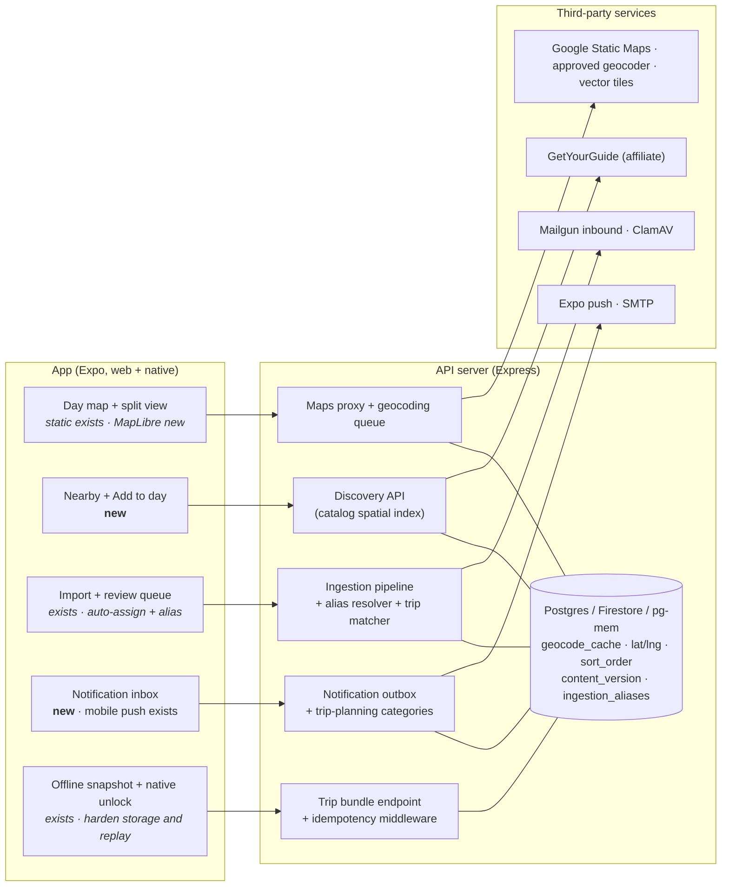

# Gap-Closing Plan: Map, Discovery, Email Import, Dark Features, Offline

**Status:** Revised proposal — extends existing functionality; production configuration is unverified.
**Last updated:** 2026-10-18
**Authors:** assistant, in collaboration with Bryan Duerk
**Builds on:** `implementation-plan-wanderlog-competitive-analysis.md` (§5.1–5.4),
`implementation-plan-trip-day-map.md`, `server/src/ingestion/TECHNICAL_DEBT.md`
**Shared copy:** [Claude Docs version](https://claude.ai/code/artifact/7a9efa83-7a24-458a-854b-be4c8ae71dc0)
(includes rendered architecture and phasing diagrams; this file is the source of truth for the repo).

---

## 0. Summary

This plan covers five gaps found in the Wanderlog/Stippl comparison: (1) in-app map,
(2) place discovery, (3) automatic reservation import, (4) built-but-dark features, and
(6) offline access. Gap 5, public pricing and social proof, is out of scope.

Most of the groundwork already exists: a static day map, an email-import pipeline, a
notification outbox, native offline trip snapshots/unlock, and an offline write queue.
Extend those components rather than building competing stacks. Prioritize import
attribution and reliable offline storage before expanding automation or provider spend.

Two corrections to the comparison:

- **Email import exists.** `server/src/ingestion/` has manual upload, a review queue,
  Mailgun forwarding, and Gmail OAuth. The work is hardening and UX, not a new build.
- **The trip blog is live.** `tripBlog.tsx`, the photo composer, and the public blog page
  all ship, and nearly every `trip_blog_*` flag seeds on.

**One security issue needs fixing before email import is widened** (§3.1): forwarded mail
is attributed to an account by its spoofable `From` address.

### Verification against the repository (2026-10-18)

These are source-code findings, not evidence of deployed settings or live provider behavior.

| Existing implementation | Consequence for this plan |
| --- | --- |
| `staticMapRoutes.ts` authenticates callers, normalizes up to 12 points, and uses a 32 MiB in-process TTL cache plus provider accounting. Requests accept arbitrary client coordinates/addresses rather than a trip id. | A cache miss after restart/scale-out still costs money. Audit effective HTTP rate limits, timeouts, response bounds, and paid-call abuse before enabling; a key alone is insufficient. |
| `ingestion/intake/mailgun.ts` resolves users by sender; `ingestionWebhookRoutes.ts` consumes quota before constructing/deduplicating jobs and logs mail metadata. | Alias attribution, log minimization, durable admission, and retry-safe quota accounting are prerequisites. |
| `virusScanProviders/clamavHttpAdapter.ts` implements real `scanBuffer`; its `scanBatch` returns `PASSED` without scanning. Intake currently calls the per-buffer path when available. Provider selection defaults unknown values to the stub. | Reuse and validate the adapter; remove false-success paths and fail closed on invalid production configuration. Do not describe scanning as an entirely new integration. |
| `ingestion/extraction/index.ts` already has a user/content/version cache, static/learned strategies, and production-only sampled consensus. The sample default is 100%. | Tune the existing policy and measure quality; not every environment or cache hit makes two LLM calls. |
| `offlineTripCache.ts`, `offlineAccess.ts`, `OfflineUnlockScreen.tsx`, and `App.tsx` already save native snapshots and support device-authenticated read-only unlock. Snapshots include members, payments, and coverage. | Improve the current implementation; do not lose those fields in a replacement bundle. Snapshot storage currently uses localStorage/AsyncStorage and email-scoped keys. |
| `session.ts` and offline cache use a 30-day window; `App.tsx` clears trip snapshots on logout. `usePendingWrites.ts` uses one global storage key, drops entries after five failures, and has no replay lock. | The old 12-hour claim is stale. Expense replay requires account isolation, durable failures, and concurrency protection first. |
| `notificationTypes.ts` already includes `activity_recap`; `notificationOutboxWorker.ts` already removes devices on Expo ticket `DeviceNotRegistered` errors and falls back from push to email. | Extend categories and delivery behavior; verify later receipts and email preferences rather than rebuilding token pruning. |
| `entitlementService.ts` caches flags by key and currently ignores optional user/role arguments. | A cohort rollout requires cache-safe evaluation changes; passing a user id alone does nothing. |

### Scope and priority

**P0:** import attribution/admission, scan enforcement, queue account isolation and no data
loss. **P1:** reliable native snapshots, notification inbox, catalog discovery, bounded map
rollout. **P2:** interactive maps, reorder/optimization, opt-in auto-assignment, offline
expenses. **Later:** web push, Gmail scheduling, public explore pages, paid route refinement.
This document authorizes planning only; provisioning, flag flips, and rollout are separate implementation tasks.

### Architecture at a glance

---

## 1. In-app map

Turn on the static day map that already exists, add coordinates so it can draw routes,
then evaluate an interactive map on desktop web as a later enhancement.

**Already built:** `GET /api/maps/trip-day` in `server/src/routes/staticMapRoutes.ts` (24 h
process-local content-addressed cache, provider usage limits, configured $15/month budget)
and `app/components/TripDayMap.tsx`
in the Overview day view. The flag seeds off. Source inspection cannot establish whether
production has a usable key or whether that is the only deployment blocker.

### Steps

1. **Bounded activation.** Audit authorization and effective per-user/IP/provider limits,
   key restrictions, image-cache terms, fetch timeouts/size limits, and budget exhaustion UX
   before provisioning or enabling. Keep keys server-only; redact provider URLs in logs.
   Prefer an authorized trip/day request that derives points server-side; retain a strictly
   limited preview route only where needed. Quota exhaustion leaves the itinerary and
   external-map links usable. Restrict style/size options to prevent cache-key abuse.
2. **Route line.** Once items carry coordinates (§1.1), send `lat`/`lng` instead of
   addresses — `normalizeTripMapPoints` already accepts them — and add Google's `path`
   parameter in visit order. Label it a connection between stops, not a navigable road
   route; haversine estimates do not account for rivers, crossings, or accessibility.
3. **Travel time between stops.** Show "~12 min walk" between consecutive stops using the
   existing `transferEstimationService`: haversine estimate by default, Directions API only
   where `attractions_transfer_directions_api` already allows it.
4. **Stop order.** Confirm existing ordering fields first, then persist stable per-day
   activity order through an authorized, atomic bulk mutation with an expected version.
   A global activity order must not reorder other days. Preserve timed bookings/transfers.
   Provide keyboard and Move up/down controls alongside drag; test React Native Web
   compatibility before adopting a drag library.
5. **Optimize day.** Nearest-neighbour + 2-opt on the client over ≤ 12 coordinates,
   with optional lodging endpoints — no API call. Respect fixed times, opening hours when
   known, and user-pinned stops; missing coordinates produce an explicit partial result.
   Describe the objective as reduced straight-line distance. Preview before applying;
   Revert must detect intervening collaborators' edits. Defer paid routing until measured demand.
6. **Interactive map on desktop web.** MapLibre GL JS with keyless vector tiles
   (OpenFreeMap; Protomaps PMTiles on Cloud Storage as the self-hosted fallback). Wide
   screens get a split view: itinerary left, map right; tapping a pin highlights its row
   and opens the existing item dialog. Lazy-load the map library when the map opens.
   Native and narrow screens keep the static image. Handle WebGL failure, reduced motion,
   screen readers, and missing pins with the same usable itinerary list. Tile/style/glyph
   endpoints require CSP and attribution review; third-party tiles reveal IP and viewport.
   Keyless service does not imply a contractual availability guarantee or zero total cost.

### 1.1 Shared geocoding layer (new — also feeds §2, §3.3, §6)

- Prefer coordinates from the catalog, airports, and existing item metadata. Missing
  coordinates must never block saving or viewing an item.
- `geocode_cache`: normalized query plus country/locality/language context, provider and
  normalization version; result coordinates, quality, provenance, expiry, and negative-result
  TTL. Reuse public POIs across users where permitted; isolate sensitive/private addresses.
  A plain address hash is guessable and is not anonymization. Never share reservation text.
  Refresh stale results and invalidate item coordinates when the address changes.
- Nullable `lat`, `lng`, `geo_city` on lodgings, activities, and car rentals (pickup and
  dropoff). Flights already resolve through the airports table, and catalog attractions
  already carry coordinates, so an activity added from the catalog needs no lookup.
- Use a durable, leased queue with idempotent jobs, retry/backoff, a dead-letter state,
  bounded backlog, and stale-address checks before committing results. An in-process
  single worker is insufficient across Cloud Run instances or restarts.
- **Provider decision remains gated.** Existing `merchantCategoryLookupService.ts` uses
  public Nominatim with process-local scheduling; consolidate all consumers if retained.
  Its [usage policy](https://operations.osmfoundation.org/policies/nominatim/) limits the
  whole application to 1 request/second, requires identification, attribution and caching,
  restricts eligible bulk work to one thread/machine (4/minute for recurring or day-long
  scripts), and prohibits submitting confidential or personal data. These limits do not
  automatically authorize a production backfill. No autocomplete, systematic POI harvest,
  or private-address submission. Document developer approval and permitted inputs first;
  otherwise leave external geocoding off. Google Places remains off.
- Keep a provider interface and server-controlled fail-closed flag. Evaluate alternatives
  only when needed, including storage rights, privacy, fixed operational cost, and load.
- Coordinates do not establish timezone by themselves. Use a separate offline timezone
  lookup with provenance; allow correction of ambiguous geocodes. Use `geo_city` for display
  only when quality is sufficient; retain the original location as fallback.

---

## 2. Place discovery

Recommend places from data the app already caches — the curated attractions catalog,
Wikipedia blurbs, Unsplash photos, public trip blogs — instead of re-enabling Google Places.

**Already built:** attractions catalog with coordinates (`attractionsCatalogService`,
`destinationAttractionAutocompleteService`), Wikipedia enrichment, Unsplash photos, group
traits with `activityTypeInterestWeights`, GetYourGuide affiliate suggestions (flag on),
public trip blogs behind a consent flow, and trip following.

### Steps

1. **"Nearby" panel in the day view.** Catalog places within ~2 km of that day's lodging
   or first stop, ranked by the group's traits. Deterministic, no LLM call. Start with
   catalog coordinates or a manually selected destination; external geocoding is optional.
   Reuse catalog loading/ranking helpers. Bound lazy per-destination indexes by memory and
   TTL/version, deduplicate concurrent loads, and avoid full-catalog work on every cold start.
   Warm lookups can avoid catalog DB reads; authorization/limits and index refresh still cost.
2. **One-tap "Add to day".** Creates an activity prefilled with name, coordinates, typical
   duration (`attractionDurationEstimationService`), and description. Confirm trip/day,
   validate membership and traveler limits server-side, and use an idempotency key so
   double taps/retries create one item. Show source, estimated duration, and duplicate warning.
3. **Bookable options inline.** GetYourGuide matches under a Nearby place when one exists.
   Label affiliate links and keep ranking independent of commission. No paid enrichment per
   card; revenue is uncertain and must not subsidize the budget model until measured.
4. **"Trips like this".** On a trip's overview, list public blogs for the same destination.
   "Copy these activities" clones names, coordinates, and durations only — never another
   group's bookings, costs, or notes.
5. **In-app destination page.** One authenticated page per catalog destination: hero
   photo, place cards, Add to trip. Same API as Nearby.
6. **Later: public, crawlable explore pages** — keep competitive-analysis §5.4's SEO spike
   first.

**Guardrails:** browse and copy read only content published under public-sharing consent;
discovery endpoints sit behind `httpRateLimitService`.
Use an explicit public projection, recheck visibility when copying, and invalidate discovery
caches on unpublish/delete. No booking references, travelers, precise private lodging,
costs, or notes. Bound result count/radius and offer list-only, empty-state, and accessible
filters; do not imply live opening hours or booking availability from cached descriptions.

---

## 3. Email import: safe, then hands-off

Goal: a user forwards a confirmation and quickly sees receipt, progress, and a suggested
trip. After measured rollout, opted-in users can receive confident imports automatically.
Processing latency is a measured target, not a one-minute guarantee during cold starts. That
requires fixing attribution first, because auto-assignment writes into a trip the whole
group sees.

### What exists today

| Piece | State | Where |
| --- | --- | --- |
| Manual upload → review → assign | Implemented; technical-debt record calls it production-ready, deployment not verified in this review | `ingestion/intake`, `review_queue`, `assignment` |
| Mailgun forwarding | Flag on; "scaffolded" per `TECHNICAL_DEBT.md` | `intake/mailgun.ts`, `routes/ingestionWebhookRoutes.ts` |
| Webhook HMAC, timestamp window, replay tokens | Done | `validateMailgunWebhookSignature` |
| Single shared address | `travel.docs@wander-bunnies.com` | `INGESTION_DEFAULT_FORWARDING_ADDRESS` |
| User attribution | By `From`/`sender` address | `resolveMailgunWebhookUser` |
| Trip assignment | Always manual, by design | `assignParsedItemToTrip`; "No automatic assignment" in `TECHNICAL_DEBT.md` |
| Assignment tracking | Each assignment gets an `assignment_transaction_id` | `shared/repository.ts` |
| Traveler matching | Names → group member ids | `matchTravelerNamesToGroupMemberIds` |
| Virus scanning | Real `clamav_http` buffer adapter exists; defaults/legacy paths can still use a stub or batch false-success | `ingestion/virusScanProviders`, `intake/index.ts` |
| Gmail OAuth import | Flag off; manual-trigger only | `ingestion/gmail`, `gmailPollingService.ts` |

### 3.1 Security fix: stop trusting `From`

**The problem.** `resolveMailgunWebhookUser` takes `body.sender ?? body.from`, looks up an
account by that email, and enqueues the message for that user. The webhook signature only
proves *Mailgun* delivered the request — not who sent the email. Anyone who knows a
Premium user's email address can:

- inject fake "reservations", with phishing links, into that user's review queue — and,
  once §3.3 lands, **directly into a shared trip**;
- burn that user's monthly import quota (it is consumed after attribution);
- trigger LLM extraction spend on attacker-controlled content.

Info logs also record full sender, recipient, and subject for every webhook
(`ingestionWebhookRoutes.ts`), which is PII in logs.

**The fix: a secret per-user address is the credential; the sender check is defense in depth.**

1. **Per-user alias.** Each user gets `u-<token>@in.wander-bunnies.com`, where `<token>`
   is 128 random bits, base32-encoded. Use a dedicated inbound subdomain (`in.`) with its
   own MX pointing at Mailgun, so the main domain's mail is untouched.
   - New table `ingestion_aliases`: `id`, `user_id`, `token_hash` (SHA-256, unique index,
     used for lookup), `address_ciphertext` (AES-256-GCM, the same pattern as
     `pushTokenCrypto.ts`, used only to show the address back to the user), `status`
     (`ACTIVE` | `ROTATED` | `REVOKED`), `created_at`, `grace_until`.
   - **Rotate** in the Import screen: new alias active immediately; optional 7-day grace
     only for routine rotation. Suspected compromise revokes the old alias immediately.
     Bound active aliases per user; support key versioning, authenticated encryption with
     user/alias id as associated data, and account-deletion cleanup. Never log alias tokens
     or include them in analytics, public vCards, URLs, crash reports, or notifications.
2. **Resolve by recipient, not sender.** Rewrite `resolveMailgunWebhookUser` to parse
   `body.recipient`, hash the token, and look up the alias. Unknown or revoked alias →
   drop with `200` (so Mailgun doesn't retry), log a counter, never reply.
3. **Sender check (defense in depth).** Domain authentication alone does not prove mailbox
   ownership. Use only receiver-generated authentication results from a documented trusted
   boundary, with identity/domain alignment; ignore forged `Authentication-Results` in
   original mail. Verify added sender addresses with expiring, single-use tokens, and do
   not treat an unverified account email as verified. Match normalized domains and exact
   mailbox identities; no universal `+tag` stripping or assumptions about Gmail envelope
   rewriting. Test real manual and automatic forwards for Gmail, Outlook, and Apple paths.
   SPF may break on forwarding, and DKIM/ARC handling needs fixtures. An authentication
   failure or uncertainty goes to hold, not auto-assignment. Verification gives permission
   to import, never permission for an inbound email to modify settings or execute commands.
4. **Unrecognized sender → hold, don't reject.** A message to a valid alias from an
   unverified sender goes to a new `HELD_UNVERIFIED_SENDER` job state **before
   normalization and extraction** — no LLM spend on unverified mail. The user sees "1
   message from `trips@spouse.example` — Import once / Always allow / Delete". "Always
   allow" adds a verified sender after a confirmation link is sent to that address.
5. **Two admission budgets.** Enforce global/IP transport limits and aggregate multipart
   bytes/parts/fields/timeouts before buffering; the current 20-file per-file cap is not an
   aggregate cap. Then cap held mail by alias/account (initial proposal: 20 messages or
   25 MiB, seven-day TTL), with coalesced alerts so a leaked alias cannot flood the inbox.
   No parsing, OCR, scan-service calls, or LLM calls for held content. Store raw bytes in
   private quarantine without preview. Consume the user import quota only on accepted
   extraction work, once per message, with separate attachment/token bounds. Atomically
   dedupe/reserve before enqueue; retries must not consume quota again. Budget checks and
   storage failures fail closed and produce a recoverable status rather than losing mail.
6. **No backscatter.** Never send an automatic email reply to the `From` of an inbound
   message. Status goes to the account owner in-app and by push (§4), or by email to the
   **account** address only.
7. **Log hygiene.** Log opaque job/alias ids, outcome, and byte counts. If sender correlation
   is necessary, use a rotating keyed HMAC, not a dictionary-searchable email hash. Apply
   this to error objects, filenames, provider errors, analytics, and parsing diagnostics too.
8. **Retire the shared address.** Stop sender-based attribution immediately; a spoofed
   sender must not select whose hold queue receives content. Announce migration in-app and
   optionally to the verified account address under existing notification preferences.
   Drop legacy-address mail with a successful acknowledgement; offer manual upload for
   recovery. A grace period requires an authenticated claim mechanism, not a sender lookup.
9. **Render safely.** Review and notification screens show normalized text only, never
   raw email HTML. Links in imported notes render as plain text with the domain visible.
10. **Enforce real attachment scanning before wide rollout.** Reuse `clamav_http` and test
    actual bytes reach it on manual, Mailgun, and Gmail paths. Unknown provider, unavailable
    scanner, stale signatures, malformed response, and unscanned batch must not mean clean.
    Authenticate the private scan service, restrict its URL/egress, cap concurrency, and
    benchmark memory, cold-start latency, signature refresh and idle cost before choosing
    scale-to-zero. Scan before PDF/OCR; isolate parsers with byte/page/pixel/time limits,
    reject unsupported archives and MIME mismatches. Antivirus is only one layer. Treat
    plain text/HTML as untrusted input even where attachment scanning is skipped.
11. **Durable receipt and retries.** Verify signature/timestamp/replay protection, then
    persist a delivery record and all required payload references before acknowledging.
    Current replay-token claiming precedes persistence: test retry after a crash at each
    boundary so a token cannot make recoverable mail permanently unprocessable. Separate
    transport replay prevention from business idempotency. Do not trust `Message-Id` alone
    for dedupe; include account/content identity. Return provider-appropriate success for
    already-committed deliveries; transient persistence/queue failures remain retryable.
    Do not scan synchronously in the webhook request. Quarantined bytes must be durable
    across worker instances/restarts, encrypted, access-controlled, and lifecycle-deleted.
12. **Prompt and data boundaries.** Email content is data, not instructions: schema-validate
    extractor output, constrain lengths/types, disable tools/URL fetching and external-image
    loads, and never execute embedded instructions. No automatic changes/cancellations of
    existing bookings, payments, reminders, or group membership. Document source/text/model
    capture retention; default raw quarantine/held TTL seven days, purge after successful
    processing when no longer needed, and provide deletion across objects and derived rows.

### 3.2 Making forwarding easy to set up

1. **Import screen leads with the address.** Large, with Copy, "Add to contacts" (a vCard
   download), and a QR code for setting it up on a phone. Mark the alias as private and
   explain rotation; the vCard/QR must never be published or silently shared.
2. **Provider walkthroughs.** Short steps for Gmail (filter → forward), Outlook (rule),
   and Apple Mail, with a "Send a test" button that emails a sample confirmation to the
   alias and shows it arriving. Require an authenticated action, rate-limit test sends,
   mark them synthetic, bypass booking/quota side effects, and prevent outbound loops.
3. **Gmail auto-forward verification.** Gmail sends a confirmation code to a new
   forwarding address before it will auto-forward. That email arrives at the user's alias.
   Recognize it only from authenticated, validated provider fixtures, skip extraction,
   and display sanitized code/text to the authenticated alias owner. Do not auto-follow or
   auto-approve links; validate any offered HTTPS verification host. Never surface the code
   in a push notification or grant confirmation mail special trust based on `From` alone.
4. **Tripmates.** Each group member has their own alias; the trip shows "Imported by Tristan".
5. **Share sheet.** Extend the existing mobile share entry points (`trip_blog_mobile_share_*`)
   with "Import to WanderBunnies" for PDFs and screenshots, using the manual-upload source.
   Verify native extension/build requirements instead of assuming blog flags provide a
   generic file importer. Reuse the same quotas, scanning, and owner checks.

### 3.3 Assign to the right trip by default

Today every item waits in the review queue for a manual trip pick. New default: **when one
trip clearly matches on time and place, assign it automatically, tell the user, and offer
Undo.** This reverses the "No automatic assignment" decision in `TECHNICAL_DEBT.md`
deliberately; update that file when this ships.

**Gate:** all §3.1 security/admission controls, atomic assignment/dedupe, safe undo,
server-side membership rechecks, and a measured suggestion-only pilot pass first. Start
auto-assignment opt-in and per-cohort fail-closed; consider a default change only after
quality evidence and explicit product review. Mail can be genuine yet contain false data.

#### Candidate trips

Trips from `listTrips(userId)` where the user is an active group member (not followed
trips), the trip is not deleted, and the trip end date is no more than 30 days in the past.

#### Signals

| Signal | How it's computed | Weight |
| --- | --- | --- |
| **Date fit** | Item's local start/end (from `startDateTimeUtc`, `endDateTimeUtc`, `originalTimezone`) falls within trip `startDate − 1 day` … `endDate + 1 day`. The slack covers overnight outbound and return flights. Trips with only `startMonth`/`startYear` get a weak month fit. | Required for auto |
| **Place fit** | Any endpoint of the item matches the trip's places. Item places: flight/rail arrival and departure airport codes → city via the airports table; hotel/activity/car `address`/`location` → `geo_city` via §1.1, or a city-string match before §1.1 lands. Trip places: `destination`, `locationIds` (via `locationServices`), and cities of items already in the trip. Both legs of a round trip count — the return leg departs from the destination. | Strong |
| **Booking continuity** | Exact provider + normalized booking reference within an authorized candidate trip; never global reference lookup. Require compatible dates/item type and distinguish revisions or cancellations from new reservations. Booking codes are not globally unique. | Strong, supporting date fit |
| **Traveler fit** | `travelerNames` resolve to members of the trip's group via `matchTravelerNamesToGroupMemberIds`. | Supporting |
| **Extraction confidence** | Item `confidenceScore` ≥ `INGESTION_CONFIDENCE_HIGH` (0.9), not `DUPLICATE_FLAGGED`, `timezoneStatus` ≠ `UNKNOWN` when the item sits on a trip's boundary day. | Required for auto |

A new module `server/src/ingestion/assignment/tripMatcher.ts` scores each candidate and
returns `{ tripId, score, reasons[] }` with human-readable reasons ("Dates Nov 9–21 fit",
"Arrives HND, Tokyo is in this trip", "Same booking as your outbound flight"). It is pure
and deterministic: no LLM, no network, unit-testable from fixtures.

#### Decision

| Outcome | Condition | What the user sees |
| --- | --- | --- |
| **Auto-assign** | Exactly one candidate has strong day-level date fit and (unambiguous destination fit or scoped booking continuity); calibrated extraction gate passes; user opted in; no conflicting candidate | Item is added; private inbox gives trip and Undo; generic push says an import is ready; trip feed records attribution |
| **Suggest** | Several trips fit, or only date fit, or confidence 0.7–0.9 | Review queue with the trip pre-selected and reasons shown; one-tap Confirm; "Confirm all suggestions" bulk action |
| **No match** | No candidate fits | Review queue with "Create a trip from this", which opens the Quick Start wizard prefilled with destination and dates (no automatic trip creation) |

#### Undo and safety

- **Undo** from inbox/item for 7 days, as an authorized compensating transaction. Track
  every created row and its version, including `syncAssignedFlightExpense`, with the
  assignment id. Delete only unchanged rows owned by that transaction. If a tripmate
  edited the item or linked/settled an expense, show a conflict and preserve their work.
  Repeated undo is idempotent; revoked membership cannot authorize a trip mutation.
- Auto-assigned items carry a small "Imported" badge with the reasons, in the item dialog.
- **Setting:** "Add confident matches to trips automatically", **off by default**, per user,
  on the Import screen.
- Never auto-assign into a trip where the item would duplicate an existing item; the
  existing `ASSIGNED_MATCH` disposition routes it to review instead.

#### Data model

- `parsed_items`: add `suggested_trip_id`, `match_score`, `match_reasons` (JSON),
  `assignment_mode` (`MANUAL` | `SUGGESTED` | `AUTO`), `undo_expires_at`.
- `import_jobs`: new state `HELD_UNVERIFIED_SENDER`.
- New tables: `ingestion_aliases` (§3.1), `ingestion_verified_senders` (`user_id`, `email`,
  `verified_at`, `verification_token_hash`).
- User preference: `ingestion_auto_assign` (boolean, default false).
- Implement through the existing ingestion repositories and DB adapters (`db.postgres.ts`
  bootstrap/migration, `db.firebase.ts`, pg-mem via postgres). Document query shapes before
  choosing Firestore composite indexes. Firestore single-field token-hash lookup is not a
  uniqueness constraint: reserve a deterministic hash document transactionally. Only add
  necessary composite indexes; account for Firestore write and index storage cost.

#### Metrics to watch

Auto-assign rate, wrong-trip reports, **undo rate**, suggestion acceptance, held-sender
rate, and p50/p95 time from durable receipt to review/assignment. Undo alone misses
unnoticed mistakes; use consented, redacted fixtures and a manually checked pilot sample.
Month-only dates, unknown/ambiguous timezone on boundary days, origin-only city matches,
cancellation/change notices, unsupported item types, and weak geocodes remain suggestions.
Add these to the existing ingestion admin observability widgets.

### 3.4 Cheaper, unified extraction

1. **Cheapest validated extractor first.** Extend the existing policy: deterministic
   calendar/static/learned parsing first; schema-valid complete results can use zero LLM
   calls; bounded escalation uses one, then a second only when evidence supports it.
   Very low-quality/adversarial inputs go to manual review rather than always spending more.
   Verify `.ics` support before adding it (no remote calendar/attachment retrieval).
   Keep deterministic consensus sampling for quality audits. Version the existing
   user-scoped exact-content cache by parser/schema/model policy; repeated *identical
   documents* can hit it, different bookings sharing a template cannot reuse personal
   fields. Learn templates separately. Reserve total job cost atomically before parallel
   calls, including retries, OCR, shadow parsing, and capture retention.
2. **One parser stack.** Route the Transfers tab's "Paste Info" text through ingestion
   extraction as a manual-text source, retiring the separate `flightParserLLM` path.
3. **Defer Gmail expansion.** For the proposed public, server-processing use of restricted
   Gmail data, plan for scope verification and annual security assessment unless a
   documented exception applies. Forwarding avoids adding Gmail OAuth scopes; existing
   deployed OAuth usage still needs its own compliance check.

### 3.5 Tests

- `tripMatcher` unit tests from fixture trips: single match, two overlapping trips, return
  leg by booking continuity, overnight flight on the boundary day, unknown timezone, and
  undated (month-only) trips.
- Supertest integration tests posting signed Mailgun webhooks: spoofed `From` to the shared
  address is held; valid alias + verified sender is queued; valid alias + unknown sender is
  held without extraction; revoked alias is dropped; quota is untouched by rejected mail.
- Auto-assign → undo restores unchanged created rows/expenses; collaborator edits, settled
  costs, concurrent assignment, revoked membership, repeated undo, and provider retries
  preserve invariants. Test receipt crashes before/after durable commit and quota reservation.
- Test aggregate upload/hold caps, MIME mismatch, oversized images/PDFs, scanner outage and
  EICAR fixture, forged authentication headers, alias compromise/revocation, prompt injection,
  raw-content deletion, cross-account dedupe isolation, and no raw payloads in logs.
- Run against `DB_PROVIDER=memory` and the Firestore emulator.

---

## 4. Finish built-but-dark features

By seed default in `server/config/feature-flags.yaml` (production values may differ —
step 1 checks):

| Feature | Flag | What's missing |
| --- | --- | --- |
| Day map | `trip_day_map` | Deployment audit, provider terms, abuse limits, key and staged enablement (§1) |
| In-app notification inbox | `notifications_in_app` | No inbox UI |
| Mobile push | `notifications_push` | Delivery is wired; needs a staged rollout |
| Web push | `notifications_web_push` | Seeds on, but no service worker or VAPID keys exist, so it does nothing |
| Activity recap prompt | `activity_recap` | Server pieces only, no UI |
| Gmail import | `feature_ingest_gmail_import` | Deferred (§3.4) |

### Steps

1. **Flag audit.** An admin-panel view of every flag: production value, seed default, and
   whether any UI reads it. Add a test that every flag the client reads through
   `GET /blog/capabilities` is in that route's `featureKeys` list — a missing key has
   silently hidden finished features before.
2. **Notification inbox.** A bell with unread count, paginated history, mark-read and
   accessible actions. Reuse the existing notification API/repository. Socket.IO signals
   invalidate data; the database remains authoritative. Authenticate user rooms, recheck
   access to deep-link targets, and fetch missed notifications on reconnect/app resume
   with a cursor. Avoid high-frequency polling and cross-user unread-count leakage.
3. **Trip-planning notifications.** Most existing categories are blog-related;
   `activity_recap` already exists.
   Add: free-cancellation or refund deadline within 48 hours (`freeCancelBy` on activities,
   `refund_by` on lodging), **import results** ("Added to *Japan 2026* · Undo",
   "2 reservations need a trip", "Held: message from an unknown sender"), AI itinerary
   finished, and a daily digest of tripmates' changes. Per-category preferences; digest
   by default. Keep booking references, names, locations and trip titles out of lock-screen
   payloads by default. Inbox details require authentication; reminder times use explicit
   IANA timezone/DST policy and are recomputed/cancelled on booking edits/deletion.
   Persist due work; do not depend on a process-local timer while Cloud Run is idle.
4. **Push rollout.** Flags are global switches with no admin bypass, so add an optional
   user cohort evaluated *after* the global switch. A globally disabled flag denies every
   user, including cohort members and admins; missing cohort membership denies rollout
   access. Stage with consenting test accounts before a small cohort. Keep global config
   caching separate from user eligibility to avoid a key-only cache leaking decisions.
   Existing ticket-error token pruning stays; add delayed receipt handling and tests.
   Push permission is requested in context, never required to use planning features.
   The current push-to-email fallback must honor independent email opt-in, quiet hours,
   frequency caps and digest preferences; disabling push must not silently increase email.
5. **Web push.** Propose a separate reviewed configuration change to turn the unused flag
   off; this document does not change production. Build browser push later on the §6 worker.
6. **Activity recap.** After an activity's end time, prompt the group to rate it and add a
   blog note or photo, through the inbox and optional push. Reuse existing recap services,
   dedupe by user/activity/version, allow dismissal, and never prompt repeatedly or publish
   notes/photos without consent. Notification outbox claims/retries also need durable
   scheduling, provider idempotency where supported, and a crash-after-send duplicate policy.

---

## 6. Offline access

Harden the existing native read-only experience, add deliberate offline downloads on web,
and support reliable expense creation only after replay safety is proven.

**Already built:** native snapshots/unlock in `offlineTripCache.ts`, `offlineAccess.ts`,
`OfflineUnlockScreen.tsx`, and `App.tsx`; the pending-write and connection hooks;
`persistentStorage.ts`; the blog's offline authoring queue and route-specific idempotency.
The current prefetch fans out to many endpoints, maps failures to empty collections, and
can overwrite a useful snapshot with incomplete data. Fix this before expanding prefetch.

### Steps

1. **Snapshot correctness first.** Retain the last complete snapshot on failed/partial
   fetches; never turn a timeout into an empty list. Validate a shared typed/versioned
   bundle, commit locally atomically, and surface storage failure instead of claiming
   "Available offline". Reuse in-memory data before refetching it. Maintain current
   payments, group-member and coverage fields subject to existing permission rules.
2. **Trip bundle endpoint.** `GET /api/trips/:id/bundle` checks membership and field-level
   entitlements before serving or returning `304`. Followers do not gain member data.
   An ETag must include schema/projection/permission revisions as well as content version;
   never reuse one across different authorized representations. Check a cheap version
   record before loading children, use `Cache-Control: private, no-cache` and `Vary:
   Authorization`, and prevent shared-CDN caching. A `304` still incurs auth/version reads.
   Update version atomically with every child mutation, delete, assignment/undo, payment,
   coverage, and membership change. Firestore transactions need a bounded consistency
   strategy; reject/retry a mixed-version bundle rather than caching it. Benchmark version
   document contention and added write/index costs before adopting a counter everywhere.
   Bound bundle bytes/items; stage large trips and switch the saved snapshot only after
   completion. The normal UI must remain usable without downloading an entire large trip.
3. **Local storage migration.** Move from email-scoped blobs to immutable user-id namespaces
   plus environment/schema version. IndexedDB on web; a transactional native store with
   vetted encryption and device-backed key storage for private travel/financial data.
   Device authentication alone does not encrypt AsyncStorage. Validate/migrate legacy data
   once; purge only after a successful commit. Bound bytes/trips with LRU eviction, preserve
   pending mutations, and offer Wi-Fi-only download, progress, last-synced time, size, remove,
   and retry. Preserve active-trip caching; offer opt-in pretravel downloads instead of
   silently multiplying reads for every upcoming trip. Exclude raw mail, secrets and
   unnecessary sensitive fields. Defer offline provider imagery until storage rights are
   established; text/coordinates and external-map links remain useful without map tiles.
4. **App shell offline on web.** Versioned service worker caches same-origin build assets;
   use a network-first navigation strategy with offline fallback and atomic build upgrades.
   Exclude auth, API responses and provider URLs from generic caching; private snapshots
   live in the account store. Verify worker scope, CSP and Expo deployment compatibility,
   update recovery and cache cleanup. Web offline unlock/privacy requires an explicit UX
   decision; do not claim it inherits native biometric protection.
5. **Expense creation only after queue hardening.** Replace the global pending-write key
   with account/environment scope, cryptographically random stable operation ids, durable
   acknowledgement of enqueue, and one replay lease across tabs/app resumes. Fix native
   hydration/enqueue races. Queue entries carry schema version, trip and owner ids, base
   version where needed, attempts, next retry time and a visible status. Never silently
   drop financial entries at a retry cap: retain a failed state with Retry/Edit/Discard.
   Offline amounts/currency/splits get the same validation as online. Show pending expenses
   distinctly and reconcile by operation id so totals do not count optimistic rows twice.
6. **Server replay contract.** Shared middleware alone is insufficient: reserve the
   idempotency key and commit expense/result atomically in the adapter. Scope by authenticated
   user + operation/route; bind to a canonical request hash; same key with different data
   returns `409`. Concurrent retries create one expense, including timeout after commit.
   Retain completed keys at least as long as the maximum replay age (initially 30 days),
   reject older operations for explicit recovery, and clean up with TTL. Recheck membership,
   entitlements and referenced travelers at replay. Pause on `401` for same-account login;
   `403/402` requires action; transient failures use jittered backoff. Expense updates/deletes
   remain later scope and require conditional versions, never silent last-write-wins.
7. **Access expiry and logout.** Preserve the implemented 30-day native offline access
   window until a separate auth change is approved. Expired online sessions do not authorize
   replay. Account switches must never replay another account's writes. Logout locks/clears
   private snapshots, encryption keys, worker caches and queue visibility; if writes are
   pending, explicitly offer sync, protected same-account retention, or discard. Test deletion
   and logout racing with prefetch/hydration so data cannot reappear after cleanup. Offline
   revocation cannot be instantaneous; state the access window and revalidate on reconnect.
8. **Keep basic offline reading free.** Treat lower server load as a hypothesis: measure
   avoided reads against snapshot refresh, version writes, storage and scheduling overhead.

**Security gate:** prove account isolation, explicit logout/deletion cleanup and native
encryption. Current snapshots use email keys, and cleanup is orchestrated by `App.tsx`,
not `session.ts` alone. The globally keyed pending-write hook must not be extended to
financial writes without these changes.

---

## 7. Security, performance, and cost per user

| Gap | Security | Performance | Cost per user |
| --- | --- | --- | --- |
| Map | Server-only key; authorized bounded requests; approved geocoding inputs; attribution and cache rights | Lazy map library; coordinate reuse; bounded durable background queue | Measure paid cache misses including restarts, tile/egress and hosting costs; no fixed-price or zero-cost assumption |
| Discovery | Public projection, visibility recheck on copy, authorized destination trip | Bounded warm spatial index and paginated cards; lazy images | Catalog reuse avoids generation calls; include load/refresh, photo, auth and memory costs; exclude forecast affiliate revenue |
| Import | Alias, tested sender trust, bounded hold, real scans, text-only rendering and constrained extraction | Durable queue, async scanning, pure matcher | Measure tokens, attachments, retries, shadow parsing, scanner idle cost, quarantine storage and retention per accepted import |
| Notifications | Generic lock-screen text; private inbox; independent channel consent | Events plus cursor catch-up; scheduled/deduplicated digest work | Include outbox DB reads/writes, wakeups, email, receipts and connection overhead even if push provider delivery is free |
| Offline | Encrypted native data; user-isolated queue; safe logout and atomic replay | Reuse existing snapshots, cheap version check, bounded downloads | Net reads saved minus version writes, refreshes and background work; one HTTP request can still fan out to many DB reads |

### Unit economics and initial acceptance targets

Instrument costs by feature, tier and time window using low-cardinality labels; keep
per-user attribution in access-controlled aggregates, not raw addresses or metrics labels.
Record cache misses, tokens, scan bytes, DB reads/writes, object byte-days, egress, worker
runtime and retry amplification. Reconcile estimated charges with billing exports.

`feature cost / active user = (variable provider + DB/storage/egress + allocated fixed
runtime cost) / monthly active users using that feature`.
Also report total infrastructure cost/all active users and cost per **successful** import
or offline sync; otherwise rejected abuse and idle workers disappear from the denominator.
Use measured cold/warm workloads at 100, 1,000 and 10,000 active users before widening.
Do not add a shared cache, paid routing, or always-on scanner solely on assumed savings.

Initial engineering targets (proposals to validate on representative hardware/load):

| Area | Acceptance target / guardrail |
| --- | --- |
| Nearby | Warm API p95 < 300 ms at declared test concurrency; <= 20 cards/page; zero LLM calls on browse; report cold-start/index bytes separately |
| Map | No map-library bytes in initial planning bundle; one in-flight fetch per identical map per process; provider timeout and response cap; usable list on 403/429/503 |
| Import | Durable webhook receipt p95 < 2 s within bounded payload limits; processing p95 < 60 s for benchmark plain-text fixtures, report PDF/OCR/cold scans separately |
| Assignment | 100% ownership/date/security fixtures pass; audited pilot precision >= 99% across at least 200 representative supported items before opt-in automation; undo > 2% or confirmed cross-trip disclosure pauses expansion |
| Offline | Zero duplicate expenses or lost entries in retry/crash tests; complete cached small trip opens within 2 s after unlock on the named test phone; storage-full never reports download success |
| Budget | Operator chooses an absolute monthly feature cap and per-active-user target before rollout; 80% alert and tested hard stop, including concurrent calls and retries |

These are release targets, not claims about current measurements. Track false holds,
task-completion rate, accessible control coverage, notification opt-outs and storage failure
rate alongside latency/cost; an inexpensive feature that loses data is not acceptable.

**Rules for every slice**

- New paid calls go through `reserveApiUsageOrThrow` and `recordProviderRequestCost`, with
  a monthly budget and 80% alert in `server/config/api-limits.yaml`.
- New paid-provider, external-contact and automatic-write flags must be explicitly added
  to `FAIL_CLOSED_FLAGS` and covered by missing-row tests. This is an implementation task,
  not a property guaranteed for every existing flag. Preserve current fail-open behavior
  of unrelated legacy entitlements. Global flags have no admin/cohort bypass.
- Each schema change lands in Postgres (migration/bootstrap), Firebase and memory behavior
  in one PR, including ingestion/notification-specific repositories where applicable.
  Add only query-required Firestore indexes, with emulator tests and schema changelog.
  Use expand/backfill/contract changes with bounded resumable backfills; flags off must
  preserve manual import, existing trip rendering, and old clients during rollout.
- Review provider data flows, roles, location privacy and terms rather than automatically
  classifying every third party as a processor. Record approved caching/offline use and
  attribution; do not persist Google imagery or provider-derived coordinates under another
  provider's license. Update disclosures before introducing a new data flow.
- Run cheap payload/authorization checks before database-backed limits and paid work;
  keep authoritative global budget reservations atomic across instances. Rate-limit DB
  writes themselves have cost, so reject oversized/untrusted traffic at the edge where possible.

---

## 8. Phasing

The workstreams below describe dependencies, not permission to bypass release gates.
Each slice extends an existing component and ships behind a default-off flag where it
adds provider spend, external contact, or automatic writes.

| Lane | Step 1 | Step 2 | Step 3 | Step 4 |
| --- | --- | --- | --- | --- |
| Map + discovery | Abuse/terms audit; catalog-only Nearby + idempotent Add to day | Coordinate provenance and optional approved geocoding; bounded map activation | Accessible per-day reorder and constrained optimization | Lazy split map, consent-safe public discovery |
| Import | Alias/trust, bounded durable admission, scan enforcement and log cleanup | Suggestion-only matcher and forwarding setup; benchmark extraction/cost policy | Safe assignment/undo and opt-in pilot | Paste Info reuse, broader supported providers after fixture gates |
| Notifications | Flag/cohort/cache audit and capability tests | Inbox + catch-up + generic import status | Independent channel preferences, durable scheduling, small-cohort push | Deadline digest and recap through existing services |
| Offline | Snapshot completeness, scoped queue, storage errors and logout races | Typed bundle/version contract and encrypted native-store migration | Controlled downloads, web snapshot UX and app-shell worker | Atomic idempotent expense creation and durable recovery |

Cross-lane dependencies: catalog Nearby can ship without external geocoding. Automation
needs all import security, quality and undo gates; delivery uses the inbox without requiring
push. Expense replay needs queue/storage/idempotency gates. Web push stays separate from
the app-shell release. External geocoding and paid routing are optional enhancements.

### Required verification and rollback per slice

| Slice | Evidence before enablement | Rollback behavior |
| --- | --- | --- |
| Admission/scanning | Signed webhook fixtures; forged sender/auth headers; duplicate delivery; crash at commit; quota once; EICAR and scanner outage; bounded memory | Disable mailbox admission with documented provider response/retry policy; preserve private manual review; never fall back to unscanned parsing |
| Geocoding/maps/discovery | Negative/ambiguous cache, stale item update, multi-instance throttling/budget test; authorization and unpublish tests; missing-provider and WebGL/keyboard tests | Stop external work; retain original locations, catalog browse, list and external-map links |
| Assignment/undo | Pure timezone/date/overlap fixtures; changed reservations; concurrent assign/undo; financial side effects and membership revocation; pilot quality report | Turn off auto-assignment, keep review/manual confirmation; preserve transaction history and conflict-safe recovery |
| Inbox/delivery | Cross-user room isolation; lost event/reconnect; edited deadline/DST; duplicate tick/crash; receipt failures; independent channel consent | Stop provider delivery while keeping authorized history and pending state; no surprise email fallback |
| Offline/expenses | Named-device airplane-mode test; interrupted download; corrupt/full storage; expiry; logout/prefetch race; account switch; two-tab replay; timeout after commit; 401/402/403/409 | Disable new enqueue/replay as needed, retain recoverable same-account pending entries; keep last complete readable snapshot |

Use focused Jest/Supertest tests, actual Postgres integration where transactional semantics
matter (pg-mem alone is insufficient), and Firestore emulator parity tests. Include web
keyboard/screen-reader checks and native device authentication tests; mocks cannot prove
encryption, real mail forwarding, scanner readiness or device receipt behavior. Record
commands, fixtures, measurements, migration/backfill status and production config audit in
each implementation PR. No claim of production readiness until these artifacts exist.

**Later:** public SEO explore pages · Gmail import (security assessment) · native
interactive map (EAS rebuild).

---

## 9. Open questions

Defaults for implementation: catalog-first discovery; basic offline reading and local
optimization free; no paid route refinement; automation opt-in; private import notifications
plus an attributed trip feed entry; seven-day conflict-safe undo. These can be changed with
evidence without delaying the safe foundation.

Decisions still required before the affected slice ships:

1. Named geocoding/tile data flows with approved privacy/cache terms, measured demand and
   fallback; public Nominatim is not the unconditional production default.
2. Absolute feature budgets and tier-level cost-per-active-user targets, with billing owner.
3. Native encrypted-store/key lifecycle and web offline access policy on shared devices.
4. Tested inbound forwarding authentication behavior and provider retry semantics; scanner
   deployment/readiness strategy and quarantine cleanup owner.
5. Whether later offline updates cover activities or notes; neither is part of expense-create MVP.

## Sources

- [Nominatim usage policy](https://operations.osmfoundation.org/policies/nominatim/) — 1 req/s, bulk rules, switch-off requirement
- [OpenFreeMap](https://openfreemap.org/) — candidate from the original proposal; verify service terms/availability before implementation
- [Google restricted scope verification](https://developers.google.com/identity/protocols/oauth2/production-readiness/restricted-scope-verification) — CASA assessment, 12-month re-assessment
- [Google Web Risk overview](https://docs.cloud.google.com/web-risk/docs/overview) — checks URLs against threat lists
- [Mailgun webhook security](https://documentation.mailgun.com/docs/mailgun/user-manual/webhooks/securing-webhooks) — HMAC timestamp/token format; not sender ownership
- [Mailgun route actions](https://documentation.mailgun.com/docs/mailgun/user-manual/receive-forward-store/receive-http) — inbound fields and acknowledgement/retry contract
- [Maps Static API overview](https://developers.google.com/maps/documentation/maps-static/overview) — follow linked current pricing/terms before activation; this plan does not assert caching rights or a current unit price

Repository paths in the verification table and feature sections are the implementation
evidence reviewed. Provider policies were checked on 2026-10-18 where cited; service pricing,
production flags, real forwarding behavior and deployment readiness remain unverified.
