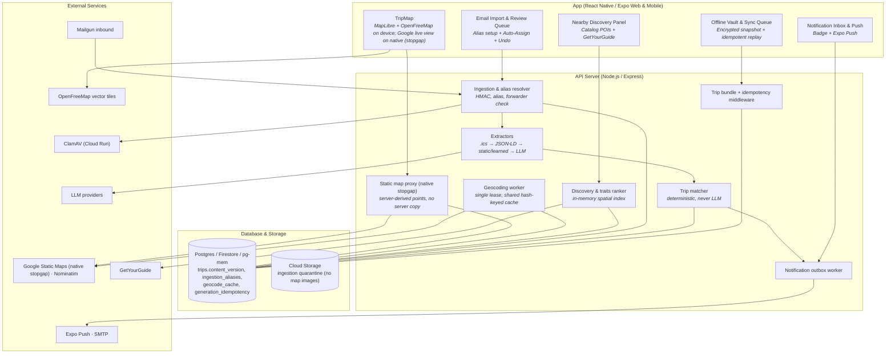
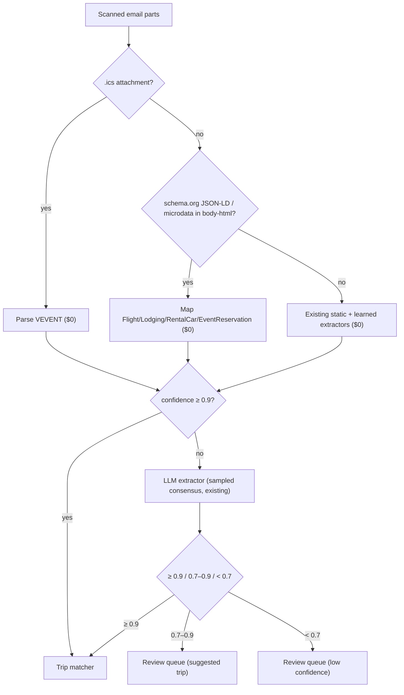
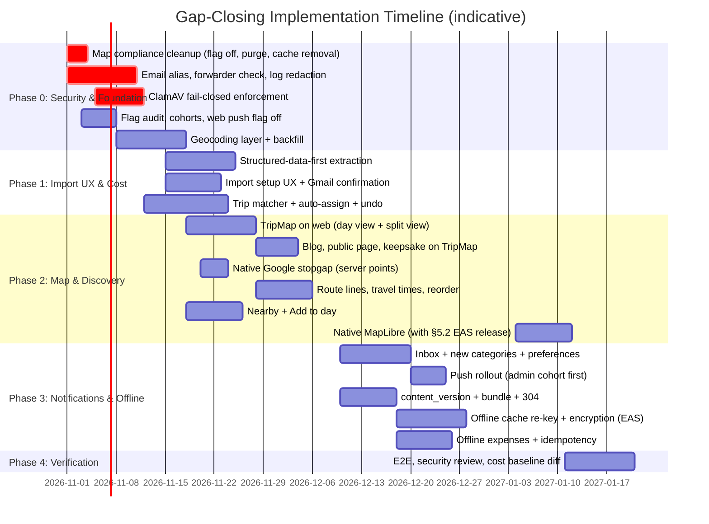

# Gap-Closing Plan: Map, Discovery, Email Import, Dark Features, Offline

**Status:** Revised & Enhanced Implementation Plan — verified against the codebase 2026-10-18 (see §0.3)
**Last updated:** 2026-10-18
**Authors:** Senior Engineering & Architecture Team (in collaboration with Bryan Duerk)
**Builds on:** `implementation-plan-wanderlog-competitive-analysis.md` (§5.1–5.4), `implementation-plan-trip-day-map.md`, `server/src/ingestion/TECHNICAL_DEBT.md`

---

## 0. Summary & Core Pillars

This plan closes five functionality gaps found in the competitive analysis against Wanderlog and Stippl, building on code that already exists wherever possible:

1. **In-App Map & Route Visualizer** — one open map engine (MapLibre + OpenFreeMap) drawn on the device from stored coordinates, on every web surface: day view, blog, public pages, keepsake. Google Static Maps survives only as a live-view stopgap in the native app until its next EAS build, and stored Google images are removed.
2. **Place Discovery** — a catalog-first "Nearby" panel, one-tap "Add to day", and GetYourGuide affiliate options.
3. **Automatic Reservation Import** — per-user secret aliases (fixing a spoofable-sender hole), structured-data-first extraction, mandatory attachment scanning, and auto-assignment to the right trip with conflict-safe undo.
4. **Built-but-Dark Features** — notification inbox, staged push rollout, trip-planning notifications, activity recap, and a flag audit.
5. **Offline Access & Sync** (comparison gap 6) — harden the existing offline trip cache, add a versioned trip bundle, and support offline expense creation with idempotent replay.

*(Comparison gap 5, public pricing and social proof, is handled separately.)*

### Core Architectural Pillars

- **Security first:** inbound email is attributed by a secret per-user alias, never by `From`. Attachments are scanned fail-closed before any parser touches them. LLM output can never choose which trip an item lands in. Offline data is account-scoped and wiped on logout.
- **Performance:** the webhook does only validation and an enqueue, with no parsing inline. Trip bundles revalidate with one counter read (`304`). Map libraries are lazy-loaded, and spatial lookups run in memory.
- **Low cost per user:**
  - Structured data first: `.ics` attachments and schema.org JSON-LD are parsed at $0, then the existing static/learned extractors, then an LLM only below the existing confidence threshold.
  - No map images are stored or rendered server-side: the device draws maps from coordinates, on keyless vector tiles ($0). Geocoding is shared across users and done once per address. No Google Places.
  - Savings are measured from `usage_metering` and provider cost records, not assumed.
- **Usability:** a one-tap "Send a test" during setup, Gmail auto-forward verification surfaced in-app, and trip auto-assignment with readable reasons and Undo. Also one-tap "Add to day", map–timeline sync, and offline expenses that sync themselves.

---

## 0.1 Repository Verification & Baseline Findings

Every row below was checked against the code on 2026-10-18.

| Existing implementation | Consequence & required enhancement |
| --- | --- |
| **`routes/staticMapRoutes.ts`** — authenticated Google Static Maps proxy, ≤ 12 points, provider usage limits and budget. **Keeps Google PNGs in a 24 h in-process `mapCache`.** Accepts arbitrary client-supplied addresses/coordinates. | Remove the server-side cache of Google images (§1.1). For the native stopgap, derive points **server-side** from an authorized `tripId` + `dayDate` so the endpoint can't be an open proxy on our key (§1.5). Retire the route after the native MapLibre release. |
| **`services/blogBackgroundWorker.ts` + `blogDayFactsService.ts`** — a background job downloads Google Static Maps PNGs of each blog day's photo geotags and **saves them to Cloud Storage** (`blog_day_map_artifacts`). `trip_blog_day_map_render` seeds **on**. The day-facts service returns a signed URL to the stored PNG. | **Compliance issue today:** turn the flag off and purge stored Google PNGs (§1.1). Return the points instead and draw them with `TripMap` on the device (§1.3). |
| **`ingestion/intake/mailgun.ts` + `routes/ingestionWebhookRoutes.ts`** — HMAC signature, 5-minute timestamp window, and replay tokens are implemented. **User is resolved from the spoofable `sender`/`From` address.** Info logs record sender, recipient, and subject. Body: uses `stripped-text`, and HTML only when there is no text part. | **Critical:** resolve by recipient alias (§3.1). Redact logs. Pass the **unstripped `body-html`** to extraction as well, or schema.org JSON-LD never reaches the parser (§3.2). |
| **`ingestion/virusScanProviders/`** — `clamavHttpAdapter.scanBuffer` really scans; `scanBatch` is a documented no-op `PASSED`. Unknown or unset provider config **defaults to the stub**. | Production must select `clamav_http` and **fail closed**: startup check + per-file scan before normalization; unreachable scanner → hold, never pass. |
| **`ingestion/extraction/index.ts`** — extraction cache keyed by `userId + contentHash + logicVersion`; static/learned extractors (`sourceDetection`, `hotelFieldExtractors`, `learnedExtractor`); dual-LLM consensus is **sampled** (`parser_consensus_sample_rate_percent`), not on every import. No `.ics` or JSON-LD parsing exists. | Add `.ics` and JSON-LD stages in front of the existing static/learned stages (§3.2). Measure the current per-import LLM cost from `usage_metering` before setting savings targets. |
| **`ingestion/config.ts`** — `INGESTION_CONFIDENCE_HIGH = 0.9`, `INGESTION_CONFIDENCE_REVIEW_READY = 0.7`, `INGESTION_SIGNED_URL_TTL_SECONDS = 900`. | Reuse these thresholds everywhere in this plan. Don't introduce a parallel 0.85. |
| **`ingestion/shared/repository.ts`** — `assignParsedItemToTrip` records an `assignment_transaction_id`; Postgres commits first, then calls `syncAssignedFlightExpense` **outside** that transaction. | Undo must also remove the expense synced by source (`upsertExpenseForSource`, `sourceType`/`sourceId`), not only the transaction's rows (§3.3). |
| **`app/utils/offlineTripCache.ts`, `offlineAccess.ts`, `components/OfflineUnlockScreen.tsx`** — read-only trip snapshots in `localStorage`/`AsyncStorage`, keyed by **email**, 30-day access window, biometric/device-PIN unlock; used by `App.tsx`, `tripBlog.tsx`, `tripReminderNotifications.ts`. | Re-key by `user_id`, move to encrypted storage on native, wipe on logout/account switch, feed from the versioned bundle (§5). |
| **`app/hooks/usePendingWrites.ts`** — single global key `stp.pending-writes`, drops an entry after 5 failed attempts, no cross-tab lock. `useConnectionState` (expo-network + Socket.IO) exists. | Account-scope the queue, never silently drop a user's expense, add a replay lock, and send an `Idempotency-Key` per operation (§5.3). |
| **`generation_idempotency` table** (both adapters) — `key`, `user_id`, `trip_id`, `status`, `response_body`, `expires_at`; used for AI generation. `blogEngagementRoutes.ts` enforces `Idempotency-Key` for comments. | Generalize into shared idempotency middleware; add `request_hash` so a reused key with a different payload is rejected (§5.3). |
| **`services/entitlementService.ts`** — `isFeatureEnabled(key, _userId, _role)` ignores user/role; 60 s cache per flag key; `FAIL_CLOSED_FLAGS` list. | Add cohort/allowlist evaluation **after** the cached flag lookup (cache the flag row + cohort, evaluate membership per call), preserving global kill switches (§4.1). |
| **`services/notificationTypes.ts`, `notificationOutboxWorker.ts`** — categories are all blog-related plus `activity_recap`; Expo push with token pruning; email fallback. No quiet-hours or per-category preference support. | New categories (§4.2). Quiet hours and preferences are **new work**, not existing. |
| **`locations` table** — catalog stored as JSON `payload` by `source_type`, indexed by `destinationKey`. No PostGIS. Production runs on **Firestore**. | Spatial queries must be an in-memory index (or geohash), not PostGIS (§2.1). |
| **`routes/activityRoutes.ts`** — mounted at `/api/activities`. | Discovery adds activities through the existing route (§2.2). |

---

## 0.2 System Architecture Overview



---

## 0.3 Verification log: what changed in this revision

| Area | Previous text | Correction | Why |
| --- | --- | --- | --- |
| Map engine | Google stored PNGs via CDN; later a "dual engine" (Google live + server-side MapLibre Native renders stored in GCS) | One engine drawn on the device: MapLibre + OpenFreeMap for every web surface, keepsake snapshots on the device, Google live-only on native until the next EAS build | Delivers the interactive map (the real gap) at $0 API, storage, and compute; server-side MapLibre Native would add native GL dependencies and memory pressure to a service that already has an OOM plan |
| Stored Google images | Plan to store Google PNGs (CDN, then GCS) | Remove: purge `blog_day_map_artifacts` Google PNGs, turn off `trip_blog_day_map_render`, remove `staticMapRoutes.ts`'s 24 h server cache | Google's terms restrict storing map content; `blogBackgroundWorker.ts` already does this today |
| Google pricing | "$200/mo free credit ≈ 100,000 views" | Static Maps is Essentials: 10,000 free calls/month, then $2.00 per 1,000 up to 100k (verified on Google's pricing page) | The $200 credit was retired on 2025-03-01 |
| Static Maps caching | "May cache up to 30 days"; "Google sends `max-age=21600`" | Pass Google's `Cache-Control` through; no server cache; don't rely on 30 days | The current 30-day allowance covers coordinates, not Static Maps images; the header value is unverified until a keyed request is made |
| Attribution | "© OpenStreetMap contributors" | On-screen MapLibre attribution kept visible; exports carry OpenFreeMap, OpenMapTiles, and OpenStreetMap credits | OpenFreeMap's terms for printed or exported use |
| Terms citations | Specific section numbers (3.2.4(a), 3.2.4(b), 3.2.3) | Link the live terms instead | Section numbers couldn't be verified against the current text |
| Geocoding throttle | "1 req/s in application layer" | One worker under `scheduledJobLease`; backfill 4 req/min; kill-switch flag | Cloud Run runs several instances, so a per-process throttle doesn't enforce Nominatim's app-wide limit |
| Geocode cache | Stores normalized address text | Store only a hash of the normalized query | A shared cache shouldn't retain other users' addresses |
| Discovery query | PostGIS on `locations` | In-memory index per destination | No PostGIS; production is Firestore |
| Sender check | Hold mail whose sender *domain* isn't verified | Verify the **forwarding user** (envelope sender, `+tag` stripped); airline DKIM is only a confidence signal | Otherwise every new airline or hotel is held — the opposite of hands-off |
| Extraction | New regex stage; LLM below 0.85; "70–80% savings" | Static/learned stages already exist; add `.ics` + JSON-LD; reuse 0.9/0.7 thresholds; capture unstripped HTML; measure from `usage_metering` | Consensus is already sampled; JSON-LD is dropped today by the stripped-text path |
| Trip matcher | Additive points, auto at ≥ 80 | Required gates + uniqueness margin; booking continuity strongest | Additive points let "date + traveler + weak place" auto-assign and made the strongest signal non-decisive |
| Undo | Removes the item | Also removes the source-synced expense | `syncAssignedFlightExpense` runs outside the assignment transaction |
| Version endpoint | Computed from child timestamps | `trips.content_version` counter | Computing from children reads every child — on Firestore that's billed per document, defeating the 304 |
| Offline sync | New `POST /api/expenses/sync`; 409 meant "dedup" | Existing `POST /api/expenses` + `Idempotency-Key`; replay returns the original response; 409 only for key reuse with a different payload | Less new surface; the diagram and text contradicted each other |
| Connectivity | `NetInfo` listener | Existing `useConnectionState` | NetInfo isn't used in the app |
| Routes | `POST /api/trips/:tripId/activities` | `POST /api/activities` | Actual mount in `app.ts` |
| Restored | — | Shared-address migration, per-alias rate limit, quota after validation, no backscatter, Gmail forwarding confirmation, web-push flag fix, activity recap, open questions, sources | Dropped in the previous rewrite |

---

## 1. In-App Map & Route Visualizer

**Decision: store coordinates, not map images.** Maps are drawn on the device with MapLibre and OpenFreeMap tiles. Google Static Maps is only a live-view stopgap in the native app until its next EAS build.

This is both the lowest-cost and the highest-impact option:

- **Impact:** it delivers an interactive map, which is the actual gap against Wanderlog — a stored PNG doesn't close it.
- **Cost:** $0 in API fees, storage, and server compute.
- **Compliance:** it avoids Google's restrictions on storing map content.

### 1.0 Map engine by surface

| Surface | Engine | Image stored? | Cost |
| --- | --- | --- | --- |
| Day view, web | MapLibre GL JS + OpenFreeMap, drawn in the browser from stored coordinates | No | $0 |
| Blog day map, public blog page, recap (web) | Same `TripMap` component | No | $0 |
| Keepsake / print export | Snapshot of the MapLibre canvas inside the existing on-device keepsake renderer (`app/utils/keepsake.ts`) | Only in the user's exported file | $0 |
| Day view, native app (until the next EAS build) | Google Static Maps, streamed live through the proxy, no server-side copy | No | Static Maps is an Essentials SKU: 10,000 free calls/month, then $2.00 per 1,000 (to 100k). Native-only live views should stay inside the free allowance |
| Native app, after the next EAS build | MapLibre React Native + OpenFreeMap | No | $0; Google key retired |
| Images with no browser (email digests, link-preview images) | **Deferred.** If ever needed: a separate scale-to-zero service rendering OpenFreeMap tiles — never inside the API service, which already has a Cloud Run OOM remediation plan | Yes, OpenStreetMap-based only | Compute only |

### 1.1 Compliance cleanup (P0 — do now)

1. **Stop storing Google images.** `services/blogBackgroundWorker.ts` (render job at lines ~346–377 and ~620+) downloads Google Static Maps PNGs and saves them to Cloud Storage. Its flag, `trip_blog_day_map_render`, seeds **on**.
   - Turn the flag off.
   - Check production for `blog_day_map_artifacts` rows and objects under that bucket prefix; delete both.
2. **Remove the server-side Google image cache.** `routes/staticMapRoutes.ts` holds Google PNGs in a 24-hour in-process `mapCache` for both `/static` and `/trip-day`. Remove it, so responses stream straight through.
   - **Pass Google's own `Cache-Control` header through unchanged** instead of setting our own (today's code sends `private, max-age=86400`). The client cache then follows exactly what Google allows for that image, with no terms interpretation on our side. Send `private` only if Google's header is missing.
   - Don't rely on the 30-day caching allowance: the current Service Specific Terms grant it for coordinates (Directions, Geocoding, Geolocation), not for Static Maps images.
   - The existing per-caller daily caps and $15/month budget stay in place. Once web moves to MapLibre, only native live views reach Google.
3. **Keep Google content off the open map.** Never draw Google Directions geometry or Google geocodes on MapLibre. Map coordinates come only from the airports table, the attractions catalog, Nominatim (§1.4), and photo EXIF. Travel times shown as text use the haversine estimate (§1.6).
4. **Attribution.**
   - Keep MapLibre's on-screen attribution control visible (never hidden by CSS).
   - Exported or printed images carry "© OpenFreeMap © OpenMapTiles © OpenStreetMap contributors" in the image itself, as OpenFreeMap's terms require for non-interactive use.
   - Google images keep Google's logo; never crop it.
5. **Citations.** Link the live Google Maps Platform Terms in code comments and docs rather than section numbers that weren't verified against the current text.

### 1.2 Day map on web: MapLibre (P1)

- **One `TripMap` component** on MapLibre GL JS with the OpenFreeMap style. Pins are colored by kind (reusing `TripDayMap`'s legend colors) and lettered in visit order, with a straight-line route layer between stops labelled "connections, not directions".
- **Lazy-loaded** with `import('maplibre-gl')` the first time a map scrolls into view. If Metro web doesn't split the bundle, load MapLibre from a pinned CDN URL instead.
- **No new endpoint.** The day view already has the trip's items (and later the §5.1 bundle). The client builds points from item `lat`/`lng` (§1.4) and airport coordinates. Items without coordinates yet are listed under the map as "Not on the map yet".
- **Layout:** at widths ≥ 1024 px, a split view — itinerary left, map right. Selecting a card centers its pin; clicking a pin scrolls to its card. Narrower web screens get a collapsible map above the list.
- **Failure mode:** OpenFreeMap has no SLA. If tiles fail, show the list with "Map unavailable"; there is deliberately no Google fallback on web, so there's one engine to maintain.
- **Accessibility:** the list stays the primary view. Pins are keyboard-focusable with text labels, and every fact on the map is also in the list.

### 1.3 Blog, public blog page, recap, keepsake (P1)

- Change the blog `dayMap` fact in `services/blogDayFactsService.ts` to return the day's points (media geotags) instead of a signed PNG URL. `tripBlog.tsx` and the public blog page render them with `TripMap`.
- **Privacy:** these points are photo GPS locations. Show a public page's map only when the photos it plots are visible to that audience, and coarsen public coordinates (e.g. to ~100 m) so a home or hotel isn't pinpointed.
- **Keepsake:** when the keepsake includes a day map, snapshot the MapLibre canvas on the device (`preserveDrawingBuffer: true`) and embed it with the attribution line. No server job.
- **Retire** the render job, `trip_blog_day_map_render`, and `blog_day_map_artifacts` once nothing reads them (all three adapters).

### 1.4 Geocoding layer (P0 — feeds §1.2, §1.6, §2, §3.4)

- **Resolution order, cheapest first:** catalog entries (coordinates in `locations.payload`) → airports table (IATA) → existing `LodgingLocation` records → `geocode_cache` → Nominatim.
- **`geocode_cache`:** `query_hash` (SHA-256 of the normalized query, unique), `lat`, `lng`, `city`, `country_code`, `provider`, `quality_score`, `fetched_at`, `expires_at` (90 days). No address text is stored in the shared cache.
- **Item columns:** nullable `lat`, `lng`, `geo_city` on lodgings, activities, and car rentals (pickup and dropoff), in all three adapters.
- **Worker:** saves enqueue a geocode job; exactly one worker runs it under the existing `scheduledJobLease`, so Nominatim's limit of **1 request/second for the whole app** holds across Cloud Run instances.
  - One-off backfill runs single-threaded at **4 requests/minute** (Nominatim's bulk rule).
  - Identify with a real User-Agent, and add a fail-closed `geocoding_nominatim` flag so the service can be switched off without a deploy, as the policy requires.
- **Provider interface** (like `FlightParserConfigurator`), so a self-hosted or paid geocoder can replace Nominatim's public instance when volume grows. A Google geocoder must not be chosen: its results couldn't be shown on the MapLibre map (§1.1 item 3).
- **Side benefits:** fills `LodgingLocation` lat/lng/timezone (null today), improving `tripTimezoneService`. Lets the day-card title use `geo_city` instead of the `shortenLocationToCity` comma heuristic in `overview.tsx`.

### 1.5 Native app (P1 stopgap → P2)

1. **Stopgap — Google live view only.** Provision a server-only key restricted to the Maps Static API, set `GOOGLE_STATIC_MAPS_API_KEY`, and flip `trip_day_map` for native.
   - Change `GET /api/maps/trip-day` to take `tripId` + `dayDate`, check `ensureUserCanReadTrip`, and derive points server-side, so clients can't run arbitrary addresses through our key.
   - Stream Google's image with no server copy (§1.1). Add a `reserveMapRenderRateLimit` per user in `httpRateLimitService`.
   - The single-address preview in `LodgingDetailsDialog` (`GET /api/maps/static`) follows the same rules; on web it switches to `TripMap`.
2. **Next EAS build — MapLibre React Native.** Add `@maplibre/maplibre-react-native` with the same OpenFreeMap style, switch native to `TripMap`, and retire the Google key and `staticMapRoutes.ts`. Ship it in the same native release as §5.2's encrypted storage, which also needs an EAS build.

### 1.6 Route lines, travel times, day optimization (P1 / P2)

1. **Route line:** a MapLibre line layer in visit order. On the native Google stopgap, the `path` parameter, which needs `lat`/`lng` from §1.4.
2. **Travel time between stops** via the existing `transferEstimationService`: haversine with walking (~5 km/h) or driving (~30 km/h) speeds, shown as "~12 min walk".
   - The Directions API is used only when `attractions_transfer_directions_api` is on **and** `assertCanUseFeature` passes for the user's tier — a flag alone is global, not per tier.
   - Directions results appear only as text, never as geometry on the map.
3. **Stop order.** Add `sort_order` to activities (Postgres migration, Firestore field, pg-mem inherits). Drag-to-reorder on web with `@dnd-kit/core`.
4. **Optimize day (P2).** Nearest-neighbour + 2-opt on the client over ≤ 12 coordinates.
   - Fixed-time bookings stay put; lodging anchors the start and end.
   - Preview original vs optimized distance; one-tap Revert.
   - Free. Google Routes refinement can be a Premium extra, shown as text only.

---

## 2. Place Discovery & Smart Recommendations

### 2.1 "Nearby" panel (P1)

- Catalog places within 2 km of the day's lodging or first stop.
- **Spatial lookup:** an in-memory index per `destinationKey`, built from the catalog the server already loads (same pattern as the autocomplete prewarm). It is a bounding-box prefilter, then a haversine distance check. No database reads per query; target p95 < 150 ms.
- **Ranking:** deterministic — trait match from `activityTypeInterestWeights` against the group's traits, plus a popularity signal where the catalog has one (Wikipedia pageviews), minus distance. No LLM.

### 2.2 One-tap "Add to day" & bookable options (P1)

- "Add to day" calls the existing `POST /api/activities`, prefilled with name, coordinates (so no geocode is needed), `attractionDurationEstimationService` duration, category, and description.
- It sends an `Idempotency-Key` through the shared middleware (§5.3), so a double tap can't create two activities.
- GetYourGuide options appear when `getyourguide_activity_suggestions` is on, labelled "Partner". Ranking ignores affiliate status.

### 2.3 "Trips like this" & destination pages (P2)

- Public trip blogs for the same destination. "Copy activities" clones names, categories, coordinates, and durations, and credits the source blog.
- Only content published under the public-sharing consent is eligible. Never notes, costs, bookings, flight numbers, or traveler names.
- Public, crawlable explore pages stay behind the SEO spike in competitive-analysis §5.4.

---

## 3. Automated Reservation Import & Ingestion Security

Goal: a user forwards a confirmation, and within a minute it is in the right trip with a notification. Review is needed only when something is genuinely ambiguous. Auto-assignment writes into a trip the whole group sees, so attribution must be fixed first.

### 3.1 Critical security fix: per-user aliases (P0)

**The vulnerability (current code).** `resolveMailgunWebhookUser` takes `body.sender ?? body.from`, looks up the account with that email, and enqueues the message. The webhook HMAC proves *Mailgun* sent the request, not who wrote the email. Anyone who knows a Premium user's address can:

- inject fake reservations with phishing links into that user's queue (and, after §3.3, into a shared trip);
- burn the user's monthly import quota (it's consumed after attribution);
- trigger extraction and LLM spend on attacker content.

```
Inbound email → Mailgun MX → POST /api/ingestion/webhooks/mailgun
  1. Verify HMAC, timestamp window, replay token        (exists)
  2. Parse recipient u-<token>@in.wander-bunnies.com      (new)
  3. SHA-256(token) → ingestion_aliases (ACTIVE or within grace)
       └─ not found / revoked → 200, drop, counter only
  4. Forwarder check: envelope sender or From (+tags stripped)
     is one of the user's verified addresses
       ├─ yes → per-alias rate limit → quota → enqueue
       └─ no  → HELD_UNVERIFIED_SENDER (no scan, no parse, no LLM)
```

1. **Alias.** `u-<token>@in.wander-bunnies.com`, where `<token>` is 128 random bits, base32 (26 characters). It lives on a dedicated inbound subdomain with its own MX, so the main domain's mail is untouched.
2. **`ingestion_aliases`:** `id`, `user_id`, `token_hash` (SHA-256, unique), `address_ciphertext` (AES-256-GCM, same pattern as `pushTokenCrypto.ts`, only for showing the address back), `status` (`ACTIVE` | `ROTATED` | `REVOKED`), `created_at`, `grace_until`. **Rotate:** the old alias keeps working for 7 days. **Revoke:** stops it immediately.
3. **Forwarder check — verify the person forwarding, not the airline.** Accept if the envelope sender (Mailgun's `sender`) or `From`, after stripping `+tags`, is a verified address of the alias owner: the account email plus any added and confirmed on the Import screen (`ingestion_verified_senders`).
   - Manual forwards carry the user in `From`.
   - Gmail auto-forwarding keeps the airline in `From` and sets the envelope sender to the user's address with a `+caf_` tag — confirm with a real auto-forward during implementation.
   - SPF/DKIM results (exact Mailgun header names to confirm) and the airline's own DKIM pass raise extraction confidence. They are **not** a gate, so a new airline is never held.
4. **Hold, don't reject.** A message to a valid alias from an unverified forwarder goes to `HELD_UNVERIFIED_SENDER` **before** scanning, normalization, or extraction. The Import screen and inbox show "1 message from `spouse@example.com` — Import once · Always allow · Delete". "Always allow" sends a confirmation link to that address first.
5. **Quota and rate limits after validation.** Move `assertAndConsumeMonthlyQuota` after steps 3–4, and add a per-alias cap (e.g. 50 messages/day) in `httpRateLimitService`.
6. **No backscatter.** Never auto-reply to an inbound sender. Results go to the alias owner in-app, by push (§4.2), or by email to the **account** address only.
7. **Retire the shared address.** For 30 days, mail to `travel.docs@wander-bunnies.com` is held (step 4) until the user taps "Yes, I sent this". The Import screen and an email to the account address announce the personal address. Afterwards the shared address is dropped.
8. **Attachment scanning, fail closed.** Store raw attachments in a private quarantine prefix. Scan each buffer with `clamav_http` before `pdf-parse`, OCR, or `.ics` parsing.
   - Production startup refuses to run forwarded-mailbox ingestion with the stub selected.
   - Scanner unreachable → keep the file held and retry with backoff (existing retry config); never pass unscanned bytes.
   - Run ClamAV as its own Cloud Run service scaled to zero. Most confirmations have no attachments, so most messages never wake it.
   - Google Web Risk checks URLs, not files, so it doesn't fill this role.
9. **LLM boundaries.** Fence email text in the prompt and validate every LLM response against a Zod schema per item type. Fences reduce prompt-injection risk; they are not a security boundary. The real controls:
   - the LLM gets no tools and no links are fetched;
   - its output can't set `trip_id`, user, or status — the deterministic matcher decides (§3.3);
   - imported links render as plain text with the domain visible.
10. **Log hygiene.** Log alias id, job id, a hash of the sender, and byte counts — never addresses, subjects, alias tokens, or bodies. Today's info logs in `ingestionWebhookRoutes.ts` print all three of sender, recipient, and subject.

### 3.2 Easy setup (P1)

1. **Import screen leads with the address:** Copy, QR code, "Add to contacts" (vCard), Rotate.
2. **"Send a test":** emails a sample confirmation to the user's alias and shows it arriving, end to end.
3. **Provider walkthroughs** for Gmail (filter → forward), Outlook (rule), and Apple Mail.
4. **Gmail forwarding confirmation.** Gmail emails a confirmation code to a new forwarding address before it will auto-forward, and that email arrives at the alias. Detect it (from `forwarding-noreply@google.com`), skip extraction, and show the code and confirm link on the Import screen. Without this, auto-forward setup silently fails.
5. **Tripmates** each have their own alias; imported items show "Imported by Tristan".
6. **Share sheet:** extend the existing mobile share entry points with "Import to WanderBunnies" for PDFs and screenshots (manual-upload source, same scanning).

### 3.3 Structured-data-first extraction (P0 for cost)



1. **Capture structured data.** Pass the unstripped `body-html` as an extraction input alongside `stripped-text`. Today HTML is used only when there is no text part, so embedded JSON-LD is thrown away.
2. **`.ics` stage.** Use a maintained iCalendar parser with limits: file size ≤ the existing 10 MB cap, ≤ 50 `VEVENT`s, and **no `RRULE` expansion** — a recurring rule can expand without bound.
3. **JSON-LD stage.** Bound each `<script type="application/ld+json">` to 256 KB, parse with `JSON.parse` only, and accept a fixed allowlist of `@type`s.
4. **Then the existing stages:** static/learned extractors, then the LLM only below `INGESTION_CONFIDENCE_HIGH` (0.9), keeping today's sampled consensus. Cache results by `contentHash`, as today, so a repeated template stays free.
5. **One parser stack:** route the Transfers tab's "Paste Info" through ingestion extraction as a manual-text source and retire the separate `flightParserLLM` path.
6. **Measure:** record the per-import LLM cost from `usage_metering` for 2 weeks before the change and compare after. Report per-stage hit rates in the existing ingestion admin widgets.
7. **Defer Gmail OAuth import.** Restricted Gmail scopes require a CASA security assessment and re-assessment every 12 months. Forwarding covers the main case without it.

### 3.4 Assign to the right trip by default (P1)

This reverses the deliberate "No automatic assignment" decision in `ingestion/TECHNICAL_DEBT.md`; update that file when it ships.

**Gate:** ships only after §3.1 steps 1–5 and 8 are live. Without them, a spoofed or malicious email would write straight into a group's trip.

#### Candidate trips

Trips from `listTrips(userId)` where the alias owner is an active group member — **not** followed trips — and the trip ended no more than 30 days ago.

#### Required gates (all must pass to auto-assign)

1. Extraction confidence ≥ 0.9, item not `DUPLICATE_FLAGGED`, and not an `ASSIGNED_MATCH` duplicate.
2. **Date fit:** the item's local dates (from `startDateTimeUtc`/`endDateTimeUtc` + `originalTimezone`) fall within `startDate − 1 day … endDate + 1 day`. If `timezoneStatus` is `UNKNOWN`, the item must not sit on a boundary day.
3. **Place fit or booking continuity** (below).
4. **Uniqueness:** exactly one candidate passes gates 2–3.

#### Signals (also used to rank suggestions)

| Signal | Computation | Strength |
| --- | --- | --- |
| Booking continuity | Same confirmation number, or vendor + booking reference, as an item already in the trip (e.g. the return leg). Extends the existing dedupe fingerprint lookup. | Strongest |
| Place fit | Any endpoint matches the trip's places. Item: airport codes → city (airports table); hotel/activity/car address → `geo_city` (§1.4), or city-string match before §1.4. Trip: `destination`, `locationIds`, and cities of items already in it. Both legs count — the return departs from the destination. | Strong |
| Date fit | As in gate 2; month-only trips (`startMonth`/`startYear`) give a weak fit that can only suggest | Required |
| Traveler fit | `travelerNames` resolve to group members via `matchTravelerNamesToGroupMemberIds` | Tie-breaker |

`server/src/ingestion/assignment/tripMatcher.ts` is pure and deterministic: no LLM, no network. It returns `{ decision, tripId, reasons[] }` with readable reasons ("Dates Nov 9–21 fit", "Arrives HND — Tokyo is in this trip", "Same booking as your outbound flight").

#### Decision

| Decision | When | User experience |
| --- | --- | --- |
| Auto-assign | All gates pass and the user setting is on | Added to the trip; notification "Added Delta DL167 to *Japan 2026* · Undo"; an "Imported" badge with reasons; an activity-feed entry for tripmates |
| Suggest | Gates 2–3 pass for several trips, or confidence 0.7–0.9, or a month-only fit | Review queue with the top trip pre-selected and reasons shown; one-tap Confirm; "Confirm all suggestions" |
| Review | No trip passes the date gate | Review queue with "Create a trip from this" (Quick Start wizard prefilled — no automatic trip creation) |

#### Conflict-safe Undo (7 days)

- Each auto-assignment stores `assignment_mode = 'AUTO'` and `undo_expires_at`.
- Undo removes the rows that `assignment_transaction_id` created **and** the expense created by `syncAssignedFlightExpense` (by `sourceType`/`sourceId`), then returns the item to the review queue.
- If a tripmate has edited the item, or its expense is part of a settled ledger payment, ask first: "Edited by Sarah — move back to review anyway?"
- **Setting:** "Add confident matches to trips automatically", on by default, per user, on the Import screen.

#### Data model

- `parsed_items`: add `suggested_trip_id`, `match_reasons` (JSON), `assignment_mode` (`MANUAL` | `SUGGESTED` | `AUTO`), `undo_expires_at`.
- `import_jobs`: add state `HELD_UNVERIFIED_SENDER`.
- New tables: `ingestion_aliases`, `ingestion_verified_senders` (`user_id`, `email`, `verified_at`, `verification_token_hash`).
- User preference: `ingestion_auto_assign` (default true).
- All three adapters. Firestore composite indexes (`token_hash`; `user_id` + `status` + `suggested_trip_id`) go in `firestore.indexes.json` in the same PR.

#### Metrics

Auto-assign rate and **undo rate** — above ~5% means the gates are too loose. Also track suggestion acceptance, held-forwarder rate, and median time from email to item in trip.

---

## 4. Activation of Built-but-Dark Features

| Feature | Flag (seed default) | What's missing |
| --- | --- | --- |
| Day map (native stopgap) | `trip_day_map` (off) | An API key and server-derived points (§1.5); web uses `TripMap` instead (§1.2) |
| Blog day-map render | `trip_blog_day_map_render` (**on**) | Stores Google PNGs — turn off now and retire (§1.1, §1.3) |
| Notification inbox | `notifications_in_app` (off) | Inbox UI |
| Mobile push | `notifications_push` (off) | Staged rollout |
| Web push | `notifications_web_push` (**on**) | No service worker or VAPID keys exist, so the flag does nothing — turn it off until §5.4 |
| Activity recap | `activity_recap` (off) | UI |
| Gmail import | `feature_ingest_gmail_import` (off) | Deferred (§3.3) |

Production values may differ from these seed defaults; §4.1 checks them.

### 4.1 Flag audit & cohort rollout (P0)

- **Admin flag report:** production value, seed default, and whether any client or route reads each flag.
- **Capabilities test:** every flag the client reads through the blog capabilities endpoint (`blogRoutes.ts`, `/:tripId/blog/capabilities`) must be listed in that route's `featureKeys`. A missing key has silently hidden finished features before.
- **Cohorts:** allow an optional allowlist (user ids or roles) per flag. Cache the flag row and cohort for 60 s as today, and evaluate membership per call. The global value remains a kill switch, and `FAIL_CLOSED_FLAGS` semantics are unchanged.

### 4.2 Notification inbox & push (P1)

1. **Inbox:** a bell with unread count, a paginated drawer, mark read / mark all, and deep links. Updates arrive over the existing Socket.IO connection, so there is no polling.
2. **New categories:**
   - `import_result` — "Added to *Japan 2026* · Undo", "2 reservations need a trip", "Held: message from an unknown sender"
   - `cancellation_deadline` — `freeCancelBy` on activities, `refund_by` on lodging, 48 hours ahead
   - `ai_finished`
   - `trip_digest` — daily summary of tripmates' changes
3. **Preferences (new):** per category and channel (in-app / push / email), quiet hours, and digest by default.
4. **Push:** enable `notifications_push` for the admin cohort first, then everyone. Prune `DeviceNotRegistered` tokens (exists). Push text never includes confirmation numbers or addresses, since it shows on lock screens.
5. **Activity recap:** after an activity's end time, prompt the group to rate it and add a blog note or photo.

---

## 5. Offline Access & Sync (comparison gap 6)

### 5.1 Versioned trip bundle (P0)

1. **`trips.content_version`** — an integer bumped in the same write as any change to a trip's children (transfers, lodging, activities, car rentals, expenses, ledger payments, packing list, members). Bump it inside the `db.ts` facade functions so no route can forget, and add a test that every mutating facade function bumps it.
2. **`GET /api/trips/:id/version`** reads one trip document and returns `{ version }`. This is one read, not a scan of children.
3. **`GET /api/trips/:id/bundle`** returns the full trip graph with `ETag: "bundle-<version>"` and `Cache-Control: private, no-cache`. `If-None-Match` → `304` after that single read.

### 5.2 Secure local storage (P0)

- **Build on `offlineTripCache.ts`:** keep its 30-day access window and `OfflineUnlockScreen`, re-key from email to `user_id` (one-time migration of existing entries), and populate from the bundle.
- **Native:** encrypt the snapshot with a key held in `expo-secure-store` (Keychain / Keystore), using SQLCipher via `expo-sqlite` or encrypted MMKV. Both need a new EAS build, so schedule this with a native release.
- **Web:** IndexedDB per account (localStorage is synchronous and capped at a few MB). Browsers offer no hardware-backed key, so data minimization and wipe-on-logout are the protection on web.
- **Logout or account switch:** delete keys and wipe snapshots and queues, extending the existing `clearOfflineTripCache`.

### 5.3 Offline expenses with idempotent replay (P1)

1. **Queue:** extend `usePendingWrites`: storage key scoped by `user_id`; each entry gets an `operation_id` (UUIDv4), `trip_id`, payload, and client timestamp. Use a single-replay lock (Web Locks API on web, an in-memory mutex on native). Items show a "Pending sync" icon.
2. **Never silently drop an expense.** Replace the 5-attempt drop with exponential backoff. Permanent failures (`403` membership revoked, `422` validation) go to a "Couldn't sync" list with Retry, Edit, Export, and Discard.
3. **Server:** the existing `POST /api/expenses` with `Idempotency-Key: <operation_id>`, through shared middleware generalized from `generation_idempotency` with a new `request_hash` column and 30-day retention:
   - first request → process, store status + body;
   - same key, same payload → return the stored status + body, with an `Idempotent-Replayed: true` header;
   - same key, different payload → `409`.
4. **Trigger:** replay when `useConnectionState` reports `online`. Toast "3 offline expenses synced".
5. **Keep offline free.** Stippl gates offline behind Pro; read-only offline also lowers server load.

### 5.4 App shell offline on web (P2)

A service worker caches HTML, JS, and assets so the web app opens without a connection. The same worker is what real web push needs (§4).

---

## 6. Security, Performance, & Cost Matrix

| Gap | Security | Performance | Cost per user |
| --- | --- | --- | --- |
| Map | No map images stored; Google key server-only, native stopgap with server-derived points; public blog coordinates coarsened; geocoder receives a query, never user or trip ids | Drawn on the device from data already loaded (no extra request); MapLibre lazy-loaded; geocoding off the request path | $0 tiles, storage, and compute on web; native Google views within the free monthly usage at current volume; geocoding once per address |
| Discovery | Public, consented content only; rate-limited | In-memory spatial index, p95 < 150 ms | $0 marginal; affiliate revenue offsets |
| Import | Alias, verified forwarder, hold-before-parse, fail-closed scanning, schema-validated LLM output that can't pick the trip, redacted logs | Webhook does validation + enqueue only; matcher in-process | Structured stages at $0; LLM only below 0.9; no spend on held or spoofed mail; measured via `usage_metering` |
| Dark features | Cohort flags keep kill switches; no booking details in push text | Socket.IO events instead of polling | Expo push free; email digests by default |
| Offline | Account-scoped, encrypted on native, wiped on logout; idempotent replay with payload check | One-read `304` revalidation | Fewer reads during travel; storage on device |

**Rules for every slice**

- New paid calls go through `reserveApiUsageOrThrow` + `recordProviderRequestCost`, with a monthly budget and 80% alert in `server/config/api-limits.yaml`.
- Flags that call a paid provider or contact a person are fail-closed (`FAIL_CLOSED_FLAGS`).
- Schema changes land in the Postgres, Firebase, and memory adapters in one PR, with Firestore composite indexes in `firestore.indexes.json` in that same PR.
- Add Nominatim/OpenStreetMap and the tile host to the privacy policy as processors; show OpenStreetMap attribution (MapLibre adds it).

---

## 7. Phased Execution Roadmap

Dates are indicative and assume parallel work. The dependency order is what matters:

- map compliance cleanup first, before anything turns on more map rendering;
- the geocoding layer before `TripMap`, place-aware matching, and Nearby;
- native MapLibre ships in the same EAS release as encrypted offline storage;
- aliases and scanning before auto-assign;
- the inbox before import notifications;
- the service worker before web push.



---

## 8. Test Matrix & Acceptance Criteria

| Workstream | Required scenarios | Location |
| --- | --- | --- |
| Ingestion security | HMAC pass/fail; alias resolves; unknown or revoked alias → silent 200 with no quota use; spoofed `From` to the shared address → held; Gmail auto-forward with `+caf_` envelope accepted; **mail from a new airline via a verified forwarder is not held**; per-alias cap enforced; logs carry no addresses or subjects | `server/__tests__/ingestion-alias-security.test.ts` |
| Scanning | EICAR file held; clean file proceeds; scanner unreachable → held and retried; production refuses the stub | `server/__tests__/clamav-scan.test.ts` |
| Extraction | `.ics` parsed without an LLM; `RRULE` not expanded; oversized JSON-LD ignored; JSON-LD read from `body-html` when `stripped-text` exists; LLM called only below 0.9; Zod rejects malformed LLM output | `server/__tests__/ingestion-structured-extraction.test.ts` |
| Trip matcher | Single fit → auto; two overlapping trips → suggest; return leg by booking continuity; overnight flight on a boundary day; unknown timezone on a boundary → suggest; month-only trip → suggest; followed trip never a candidate; LLM output cannot set the trip | `server/__tests__/trip-matcher.test.ts` |
| Undo | Restores the trip exactly **including the synced expense**; tripmate edit → confirmation required; opt-out disables auto | `server/__tests__/import-undo.test.ts` |
| Map — server | Native proxy derives points server-side (client points ignored); unauthorized trip → 403; no Google image is cached server-side or written to storage; the proxy forwards Google's `Cache-Control` header unchanged; `trip_blog_day_map_render` off and no new `blog_day_map_artifacts` rows; blog `dayMap` fact returns points, not a URL; public blog points are coarsened and follow photo audience rules; per-user rate limit enforced | `server/__tests__/static-map-proxy.test.ts`, `server/__tests__/blog-day-facts-map.test.ts` |
| Map — client | `TripMap` builds points from loaded items without an extra request; items without coordinates listed as "Not on the map yet"; MapLibre loads only when a map enters view; tile failure shows the list with "Map unavailable"; attribution control present; keepsake snapshot includes the attribution line | `app/tests/tripMap.test.tsx`, Playwright `app/e2e/trip-map.spec.ts` |
| Offline | Every mutating facade function bumps `content_version`; version endpoint does one read; same-key replay returns the original response; same key + different payload → 409; revoked member → 403 → "Couldn't sync" list, never dropped; logout wipes keys and caches | `server/__tests__/offline-vault-sync.test.ts`, `app/tests/usePendingWrites.test.ts`, `app/tests/offlineTripCache.test.ts` |
| Flags | Cohort member sees the feature, non-member doesn't; global off overrides cohorts; capabilities `featureKeys` covers every client-read flag | `server/__tests__/feature-flag-cohorts.test.ts` |

Run server suites with `DB_PROVIDER=memory` and against the Firestore emulator.

---

## 9. Definition of Done & Release Verification

1. **Security:** all forwarded mail is attributed by alias; the shared address is retired; scanning is fail-closed in production; webhook logs are redacted; offline data is account-scoped and encrypted on native.
2. **Compliance:** no Google map image is stored or cached server-side; previously stored Google PNGs are purged; every web map surface uses `TripMap` (MapLibre + OpenFreeMap) with visible attribution, and exports carry OpenFreeMap, OpenMapTiles, and OpenStreetMap credits; no Google content is drawn on MapLibre; the privacy policy lists all new processors.
3. **Cost:** per-import LLM cost compared against the pre-change `usage_metering` baseline and reported; Google Static Maps calls limited to native live views and within the free monthly usage (`recordProviderRequestCost` report); Nominatim usage stays within policy.
4. **Performance:** webhook ACK < 200 ms p95; version check < 50 ms p95; Nearby < 150 ms p95.
5. **Usability:** "Send a test" works end to end; Gmail auto-forward setup completes in-app; auto-assign undo rate < 5% over the first 2 weeks; offline expenses sync without duplicates.
6. **Tests:** all suites in §8 pass in CI, on both adapters.

---

## 10. Open Questions

1. **Resolved — map engine, cost, and caching:**
   - **Engine:** don't store Google map images. Draw maps on the device with MapLibre + OpenFreeMap; Google Static Maps only for native live views until the next EAS build (§1.0).
   - **Cost:** Static Maps is an Essentials SKU — 10,000 free calls/month, then $2.00 per 1,000.
   - **Client caching:** follows Google's own `Cache-Control` header, passed through by the proxy (§1.1). Once the key is provisioned, record the header Google actually sends (`curl -sI` on one keyed request) in this section.
2. Is OpenFreeMap's free, no-SLA instance acceptable to start, or self-host tiles from day one?
3. Which geocoder replaces Nominatim's public instance at scale — self-hosted, or a paid provider whose terms allow storing results?
4. Should auto-assigned imports notify the whole group or only the forwarder?
5. Is a 7-day undo window right, or should undo last until the trip starts?
6. Should "Optimize day" stay free with the client-side optimizer, with Google-refined routing as Premium?

## Sources

- [Nominatim usage policy](https://operations.osmfoundation.org/policies/nominatim/) — 1 req/s app-wide, bulk 4 req/min, switch-off requirement
- [OpenFreeMap](https://openfreemap.org/) — free, keyless tiles; no SLA; attribution required; self-hostable
- [Google restricted scope verification](https://developers.google.com/identity/protocols/oauth2/production-readiness/restricted-scope-verification) — CASA assessment, 12-month re-assessment
- [Google Web Risk overview](https://docs.cloud.google.com/web-risk/docs/overview) — checks URLs against threat lists, not file contents
- [Google Maps Platform Terms of Service](https://cloud.google.com/maps-platform/terms) and [Service Specific Terms](https://cloud.google.com/maps-platform/terms/maps-service-terms) — caching and storage restrictions (open question 1)
- [Google Maps Platform March 2025 billing changes](https://developers.google.com/maps/billing-and-pricing/march-2025) — per-SKU free monthly usage replaced the $200 credit
- [Google Maps Platform pricing](https://developers.google.com/maps/billing-and-pricing/pricing) — Static Maps: Essentials, 10,000 free/month, $2.00 per 1,000 to 100k
