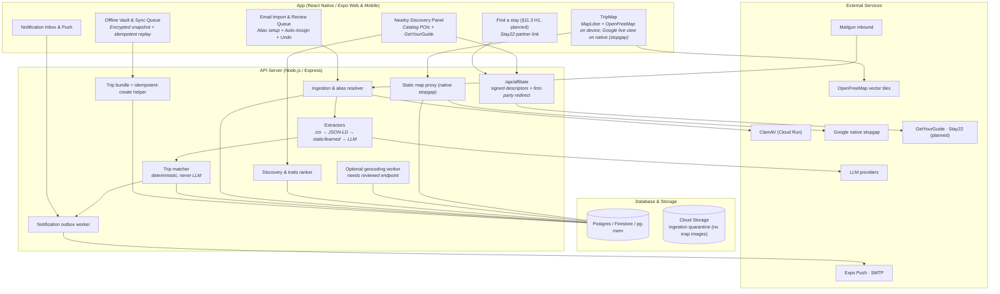

# Gap-Closing Plan: Map, Discovery, Email Import, Dark Features, Offline

**Status:** Source work for §1–§5 is built behind rollout flags. What remains is release evidence (deployment, devices, providers, usability), a few configuration decisions, and the §11 items. Production settings are unverified.
**Last updated:** 2026-11-06. Collapsed closed source work into status tables, linked the [Stay22 integration plan](stay22-integration-plan.md) for §11.3 H1, and recorded the hotel-link provider decision.
**Review:** Checked against repository code and the operations records in collaboration with Bryan Duerk. Source verified 2026-10-18 and 2026-10-19; status re-checked 2026-11-06.
**Builds on:** `implementation-plan-wanderlog-competitive-analysis.md` (§5.1–5.4), `implementation-plan-trip-day-map.md`, `server/src/ingestion/TECHNICAL_DEBT.md`

**How to read this:**
- The status table below is for everyone.
- §0.3–0.4 are standing requirements for every slice.
- §1–5 record what each area shipped and what still blocks release.
- §6–9 are the controls and gates reviewers check.
- §11 is new product work that has not started.

**Where the detail lives.** Design contracts, behavior and validation for built work are in the operations records. They take precedence over the older design text in this plan's git history:

| Record | Covers |
| --- | --- |
| [Completion audit](../operations/gap-closing-remaining.md) | Authoritative status, Firestore parity, outstanding work |
| [P0](../operations/gap-closing-p0.md) and [P1](../operations/gap-closing-p1.md) | Mail admission, offline snapshots, import setup, discovery, inbox, bundle |
| [Maps](../operations/gap-closing-maps.md) | Web/native/public maps, keepsake, optional geocoding |
| [Day order and Trips like this](../operations/gap-closing-day-order-inspiration.md) | §1.6, §2.3 |
| [Receiver auth](../operations/gap-closing-receiver-auth.md) | §3.1–3.2 sender trust, Gmail confirmation |
| [Matching and review](../operations/gap-closing-matching-review.md) | §3.4 |
| [Native storage](../operations/gap-closing-native-storage.md) | §5.2 |
| [Advance spend](../operations/gap-closing-advance-spend.md) | §6.2 spend reservations |
| [Evidence runbook](../operations/gap-closing-evidence.md) | `npm run evidence:gap`, §8–9 gates |
| [Source flag/artifact audit](gap-closing-p0-source-audit.json) | Flag readers and seed defaults |

## Status at a glance (2026-11-06)

| Area | Source | What still blocks release |
| --- | --- | --- |
| §1 Maps (web, blog, public, recap, keepsake) | Built | Production flag change, named-device checks, native print, legacy-artifact retirement after the 2027-01-21 client cutoff |
| §1.4 Optional geocoding | Built; flag seeded on (2026-11-08) | Inert until a reviewed endpoint, policy and scheduler are configured (§10.1 #1) |
| §1.5 Native map | Built, off | New EAS build and named-device evidence |
| §1.6 Day order and optimize | Built, off | Environment rollout, usability, gesture checks on physical devices |
| §2 Nearby, Add to day, Trips like this | Built, off | Rollout plus cold/warm latency measurement |
| §3.1–3.2 Mail admission, aliases, setup | Built | Deploy the trusted gateway/signer; validate real forwarding and Gmail fixtures |
| §3.3 Structured extraction | Built | Two-week cost/quality comparison; consensus-rate step-down (§10.1 #5) |
| §3.4 Automatic adding | Built, suggestion-only | Audited pilot precision (§8); real PostgreSQL contention; update `TECHNICAL_DEBT.md` when it ships |
| §4 Inbox, push, recap, cohorts, digests | Built, off | Live delivery, cohort, timing and cost evidence |
| §5 Offline (bundle, storage, expenses, web shell) | Built | Named-device encryption, lifecycle and key-loss tests; deployed web shell check |
| §6.2 Advance spend reservations | Built | LLM cap value from `usage_metering` (§10 still open); live billing reconciliation |
| §11 Pilot/Stippl gaps | Not started | Decisions in §11.6. H1 hotel links follow the [Stay22 plan](stay22-integration-plan.md) |

Every built area has Firestore emulator parity (see the [completion audit](../operations/gap-closing-remaining.md#continuation-firestore-parity-everything-that-runs-on-postgres-runs-on-firestore)). Deploy the composite indexes in `firestore.indexes.json` before enabling notification cleanup or the day-photo reminder.

## Plain-language overview

What travelers get once the switches are turned on:

1. **Forwarded booking emails become safe and simple.** Each person gets a private forwarding address. Bookings show up with a suggested trip, and confident matches can be added automatically with Undo.
2. **Saved trips stay correct offline.** A failed download never replaces a good saved copy with an empty one. Expenses added without signal sync later and are never lost.
3. **A real, movable map.** Each day's stops appear on an interactive map next to the itinerary, at no per-view cost on web.
4. **"Nearby" ideas.** Places close to where the group is staying, added to a day with one tap.
5. **An in-app notification inbox.** For example: "free cancellation ends tomorrow" and "your booking was added".
6. **Next (§11):** "Find a stay" hotel links, a free tier that matches competitors, and smaller parity items.

What stays the same: planning, manual upload and the itinerary list keep working even if any new feature is switched off. Reading saved trips offline and the map stay free.

---

## 0. Summary & Core Pillars

This plan closes the functionality gaps found in the competitive analysis against Wanderlog and Stippl. It builds on existing code wherever possible:

1. **In-App Map & Route Visualizer.** One open map engine (MapLibre + OpenFreeMap) draws maps on the device from stored coordinates. Google Static Maps survives only as a native stopgap, and stored Google images are removed.
2. **Place Discovery.** A catalog-first "Nearby" panel, one-tap "Add to day", and GetYourGuide affiliate options.
3. **Automatic Reservation Import.** Per-user secret aliases (fixing a spoofable-sender hole), structured-data-first extraction, mandatory attachment scanning, and auto-assignment with conflict-safe undo.
4. **Built-but-Dark Features.** Notification inbox, staged push, trip-planning notifications, activity recap, and a flag audit.
5. **Offline Access & Sync** (comparison gap 6). Hardened offline cache, a versioned trip bundle, and offline expense creation with idempotent replay.

Comparison gap 5 (pricing) is covered in §11.2. §11 also adds hotel booking (§11.3) and the smaller parity items from the 2026-11-05 Pilot and Stippl comparison (§11.4). Social proof and public marketing pages stay out of scope.

### Core Architectural Pillars

- **Security first:**
  - Inbound email is attributed by a secret per-user alias, never by `From`.
  - Attachments are scanned fail-closed before any parser touches them.
  - LLM output can never choose which trip an item lands in.
  - Offline data is account-scoped and wiped on logout.
- **Performance:**
  - Acknowledge mail after bounded validation and durable receipt, before scanning or parsing.
  - Bundles check authorization and a cheap version record before reading child records.
  - Map libraries load on demand.
- **Low cost per user:**
  - Use structured data first, draw maps on the device, and add no Google Places expansion.
  - Savings are measured from `usage_metering` and provider cost records, not assumed.
- **Usability:**
  - One-tap "Send a test" during setup.
  - Trip auto-assignment with readable reasons and Undo.
  - One-tap "Add to day", and offline expenses that sync themselves.
- **Maintainability:**
  - Extend current routes, repositories, notification preferences and the import state machine.
  - Share typed contracts and pure logic.
  - Every new dependency or provider needs a measured reason.

### 0.1 Baseline findings (2026-10-18): all resolved in source

The original audit found these problems. Each is fixed in code; production configuration still has to be confirmed (§9).

| Finding | Resolution |
| --- | --- |
| Static-map proxy cached Google PNGs and accepted arbitrary addresses | Cache removed, `private, no-store`; native day map derives points on the server from `tripId` + `dayDate` |
| Blog worker stored Google PNGs (`trip_blog_day_map_render` seeded on) | Seed is now off; audience-safe device maps replace it. Artifact cleanup waits on §10.1 #2 |
| Mailgun user resolved from the spoofable `From` address; personal data in logs | Per-user aliases; redacted logs; durable encrypted receipt before ACK |
| Scanner defaulted to a no-op stub | Fail-closed `clamav_http`; startup refuses the stub |
| No `.ics`/JSON-LD extraction; HTML dropped when a text part existed | Bounded ICS and JSON-LD/microdata stages; `flightParserLLM` retired |
| Assignment expense sync ran outside the transaction | Transactional/recoverable assignment with conflict-safe Undo |
| Offline cache keyed by email, saved empty lists on failure | Keyed by user id, environment and schema; complete-only snapshots; SQLCipher on native |
| Expense queue dropped entries after 5 failures | Never-drop queue, leases, `Idempotency-Key` on `POST /api/expenses` |
| `isFeatureEnabled` ignored user and role | Cohorts evaluated per caller after the cached flag (`featureCohorts.ts`) |
| `scheduledJobLease` was Postgres-only | Works on Firestore |

### 0.2 System architecture

---

## 0.3 Maintainability and implementation boundaries

These apply to every remaining slice, including §11.

- **One source of domain types.** Shared types go in `server/src/types.ts`, and the frontend uses type-only imports. Validate external and request data with server schemas and return stable error codes. Version persisted snapshots and queue payloads.
- **Reuse the current entry points.** `/api/activities` and `/api/expenses` own creates. Ingestion owns extraction and review. Notification repositories own preferences and history. `/api/affiliate` owns partner links.
- **Keep `App.tsx` integration thin.** Orchestration goes into focused hooks and services. Normal tab fetch helpers stay co-located with their tab, per project convention.
- **Separate domain logic from platform code.** Use `.web.tsx` / `.native.tsx` renderers. A native build must not import DOM or WebGL dependencies.
- **Make invariants adapter-owned.** Domain writes, version bumps, idempotency and outbox intent share a database transaction or an explicit recoverable workflow.
- **Bound dependency and operational growth.** Pin vetted packages, and configure provider endpoints on the server. Don't add a plugin framework, microservice, Redis or self-hosted tiles without a measured need.
- **Migration and retirement:**
  - Expand the schema first, then contract.
  - Document Postgres and Firebase behavior.
  - Every new flag has an owner, a defined missing-row behavior and a retirement criterion.
- **Reviewable slices.** Each PR states the user-visible behavior, platforms, adapters touched, cost impact, tests, rollback and remaining limitations.

## 0.4 Experience for non-technical users (release requirement)

Use the existing app navigation and the simplified Imports view. Advanced automation is optional and never blocks manual upload or trip planning. The UI labels below are proposed copy, not API enums.

| Task | Default path | Recovery without technical knowledge |
| --- | --- | --- |
| Import a booking | Open **Imports** → **Upload a confirmation** or **Copy my forwarding address** → see **Received**, then a booking preview and trip suggestion → **Add to Japan trip** | **Choose a trip** if the match is ambiguous; **Edit details** if dates or amount are missing; **Upload another file** if the file is unsupported. Never show a confidence percentage. |
| Set up email forwarding | Copy the address first. Optional **Set up automatic forwarding** opens provider-specific steps, progress and a test | Offer **I'll do this later** and manual upload. A test shows **Test received** and creates no booking or charge. |
| Review unfamiliar mail | If the forwarder can't be confirmed, the booking appears as a suggestion with "We couldn't confirm who forwarded this — check it before adding". Only suspicious mail shows **Check this message** → **Import once** or **Delete** | **Always allow this sender** requires verification and stays under More options. No raw HTML preview. |
| Automatic adding | After the §3.4 pilot gate, confident matches from a verified forwarder are added automatically. The first time, one screen explains it and offers **Keep on** / **Always ask me** | **Added to Japan trip** with **Undo** for seven days in import history and item details. Ambiguous matches always ask. |
| Find an activity | Open a day → **Nearby** → a card with distance, estimated duration and **Add to [day]** | Show **Added** and **Undo**, prevent double taps, and warn about an existing activity. Offer **Search another area** when there are no results. |
| Find a stay (§11.3) | A Lodging tab empty state, or a stay marked `Needs Booking` or `Proposed`, shows **Find places to stay**, labeled as a partner link | Hidden when unavailable; never a broken link. Adding the booking afterwards uses normal import |
| Use the map | The day list works first; **Show map** opens the same stops | **Map unavailable — your itinerary is still below**; **Open in Maps** |
| Save a trip | **Save for offline** → progress and size → **Saved on this device**, with the last-updated time | A failure keeps the previous copy and offers **Try again** or **Free up space**. With **Wi-Fi only** on, ask before using mobile data. |
| Add an expense offline | **Add expense** → **Saved on this device · waiting to sync** | **Sign in to finish syncing**, **Fix details**, or **You no longer have access to this trip**. Failed expenses stay visible until resolved. |
| Leave a device | **Sign out** | If unsynced work exists, offer **Sync now**, **Keep safely on this device**, or a confirmed **Discard and sign out**. |

**Common requirements:**
- Plain language, one primary action.
- Preserve form input across recoverable failures.
- Show local date, time and currency explicitly.
- Never show "HMAC", "LLM consensus", "idempotency", "ETag" or "quarantine" in user tasks.
- Paid limits show a readable allowance before work starts.
- Support screen readers, keyboard-only use, visible focus, text scaling, contrast, reduced motion and touch targets of at least 44 logical pixels.
- Don't request notification or location permission before the user invokes that feature.

**Usability gate:** test these tasks with at least five people unfamiliar with the app, including mobile and a keyboard/screen-reader pass. The target is at least 4/5 completing import, Add to day, offline save and offline-expense recovery without coaching, with zero unnoticed data loss or accidental sharing. No analytics collection outside existing consent rules.

## 0.5 Quick wins (2026-10-19): status

| # | Problem | Status |
| --- | --- | --- |
| 1 | Forwarded mail lost on retry (replay token claimed before storage) | **Closed.** Receipt, dedupe and quota share a transaction; replays of recorded deliveries succeed |
| 2 | Offline snapshot saved empty lists on fetch failure | **Closed.** Complete-only snapshots |
| 3 | Every import runs two LLM parsers (consensus default 100%) | **Open (configuration).** Spend reservation is done (§6.2); lower `parser_consensus_sample_rate_percent` in steps with audited quality (§10.1 #5) |
| 4 | Google map images stored | **Seed closed** (`trip_blog_day_map_render` now seeds off). Confirm the production value; cleanup per §10.1 #2 |
| 5 | Webhook logs contained personal data | **Closed** |
| 6 | Dead `notifications_web_push` flag seeded on | **Seed closed** (now off). Confirm the production value |

---

## 1. In-App Map & Route Visualizer

**Decision (unchanged): store coordinates, not map images.** Maps are drawn on the device with MapLibre and OpenFreeMap tiles. Google Static Maps is only a live-view stopgap in the native app until its next EAS build. Details: [maps record](../operations/gap-closing-maps.md).

| Surface | Engine | Status |
| --- | --- | --- |
| Day view, web | MapLibre GL JS + OpenFreeMap | Built (`planning_web_map`, off) |
| Blog day map, public blog, recap (web) | Same component with audience-safe server projection; follower maps are opt-in, coarse and suppressed near lodging | Built |
| Keepsake / print | Bounded browser capture; labeled-area fallback on native print | Built; native print/device checks open |
| Day view, native, during migration | Google Static Maps via authenticated proxy, points derived on the server, no stored copy | Built (`trip_day_map`, off; needs `GOOGLE_STATIC_MAPS_API_KEY`) |
| Native after release gate | MapLibre React Native 10.4.2 | Built (`planning_native_map`, off); needs EAS and named devices |
| Email digests, link previews | Deferred | — |

**Remaining for §1:**
1. **Artifact cleanup (§10.1 #2).** Inventory `blog_day_map_artifacts` and their readers, run a dry-run cleanup, then purge only what the terms rule out. Retire the render job, the flag and the table on all three adapters after the 2027-01-21 old-client cutoff.
2. **Native.** Run the EAS build and named-device compatibility, gesture, attribution and low-memory checks. Retire the Google routes and key only after old clients fall below about 5% of sessions.
3. **Geocoding (§1.4).** `planning_geocoding` now seeds on and is fail-closed on a missing row (2026-11-08). No lookup happens until a reviewed endpoint, policy and scheduler are configured. Public catalog places only; no private address is ever sent.
4. **Day order and optimize (§1.6).** Built: one ordering definition, checked `PUT /api/activities/day-order`, the optimizer, drag handles, pins, Move up/down. Remaining: environment rollout, an unfamiliar-user test and physical-device gesture checks. Directions API text stays gated by `attractions_transfer_directions_api` **and** `assertCanUseFeature`.
5. **Attribution.** Keep MapLibre's attribution visible. Exported images carry "© OpenFreeMap © OpenMapTiles © OpenStreetMap contributors". Never crop Google's logo.

---

## 2. Place Discovery & Smart Recommendations

| Item | Status |
| --- | --- |
| §2.1 Nearby panel (catalog within 2 km, deterministic trait ranking, no LLM) | Built (`planning_nearby`, off) |
| §2.2 One-tap Add to day (idempotent `POST /api/activities`) and GetYourGuide "Partner" options | Built. Ranking ignores affiliate status |
| §2.3 Trips like this, credited copying of shared catalog templates | Built (`planning_trip_inspiration`, off); private/manual activities excluded |

**Remaining:** roll out, measure cold and warm Nearby latency (target warm p95 < 300 ms, §8), and keep public SEO explore pages behind competitive-analysis §5.4.

---

## 3. Automated Reservation Import & Ingestion Security

| Item | Status |
| --- | --- |
| §3.1 Per-user aliases (`u-<token>@in.wander-bunnies.com`), trust tiers, admission budgets, fail-closed scanning, durable receipt, log hygiene | Built. All admitted mail is suggestion-only until receiver fixtures pass |
| §3.1 Extra forwarding addresses (verified by emailed code) | Built; grants no trust yet |
| §3.2 Setup: Copy, QR, vCard, rotate, Send a test, Gmail/Outlook/Apple walkthroughs, Gmail confirmation, share sheet | Built |
| §3.3 Structured-data first: ICS, JSON-LD/microdata, then static/learned, then LLM; Paste Info through ingestion | Built; `flightParserLLM` retired |
| §3.4 Matcher, suggestions, auto-add, seven-day conflict-safe Undo, batch confirm, booking-prefilled Quick Start | Built (`planning_auto_assign`, off) |

**Decisions that still hold:**
- **Automatic adding is ON by default once released** (confirmed 2026-10-18, reconfirmed 2026-10-19). It applies only to verified-forwarder imports with a unique strong match; everything else stays a one-tap suggestion.
- The release sequence is suggestion-only pilot → admin cohort → everyone, with a per-user **Always ask me** switch.
- Candidate trips are those the alias owner is an active member of (never followed trips) that ended no more than 30 days ago.

**Remaining:**
1. Deploy the trusted receiver gateway and signer; validate real Gmail, Outlook and Apple forwarding fixtures ([receiver auth](../operations/gap-closing-receiver-auth.md)).
2. Run the suggestion-only pilot to the §8 precision gate.
3. Measure LLM cost from `usage_metering` for two weeks, then step down consensus (§10.1 #5).
4. Measure real PostgreSQL contention.
5. When automatic adding ships, update the "No automatic assignment" entry in `server/src/ingestion/TECHNICAL_DEBT.md`.
6. Gmail API expansion stays deferred (§10.1 #11).

---

## 4. Activation of Built-but-Dark Features

| Feature | Flag (seed) | Status |
| --- | --- | --- |
| Day map (native stopgap) | `trip_day_map` (off) | Built; needs an API key (§1) |
| Blog day-map render (legacy) | `trip_blog_day_map_render` (off) | To retire (§1) |
| Notification inbox | `notifications_in_app` (off) | Built (`NotificationInbox`) |
| Mobile push | `notifications_push` (off) | Built; staged rollout |
| Web push | `notifications_web_push` (off) | Not built; deferred (§10.1 #11) |
| Activity recap | `activity_recap` (off) | Built (`ActivityRecapDialog`) |
| Gmail import | `feature_ingest_gmail_import` (off) | Deferred |

Production values may differ from these seeds; confirm each one before rollout.

**Built:**
- Cohort controls (Admin → Feature Flags, `GET|PUT /api/admin/features/:key/cohort`)
- the `import_result`, `cancellation_deadline`, `ai_finished` and `trip_digest` categories
- quiet hours and local digest timing
- generic lock-screen push text

**Remaining:** live delivery, cohort, timing and cost evidence; Expo receipt handling observed on real devices. Every flag the blog client reads must stay listed in `/:tripId/blog/capabilities` `featureKeys`.

---

## 5. Offline Access & Sync (comparison gap 6)

| Item | Status |
| --- | --- |
| §5.1 Versioned conditional trip bundle (`GET /api/trips/:id/bundle`, permission-aware ETag) | Built |
| §5.2 Storage: SQLCipher + SecureStore on native, IndexedDB on web with a shared-device warning, LRU eviction, Wi-Fi-only setting | Built; [runbook](../operations/gap-closing-native-storage.md) |
| §5.3 Offline expenses: never-drop queue, leases, `Idempotency-Key`, sign-out choices, repair/restore | Built; two-tab browser check done |
| §5.4 Web app shell service worker (`app/public/sw.js`) | Built; local Chromium checked |

**Remaining:**
1. Run named iOS and Android tests for encryption, restore, reinstall, kill/relaunch, key loss and suspend/resume replay.
2. Check the deployed web shell: hash-change recovery, signed-in offline flows, other browsers.
3. Run the novice recovery usability test.

Browser storage stays unencrypted by decision (§10.1 #9).

---

## 6. Security, Performance, Cost and Maintenance Controls

| Area | Security and usability | Performance and unit cost | Maintenance constraint |
| --- | --- | --- | --- |
| Map | Audience-safe points, no private CDN caches, usable list fallback | Device drawing, bounded map instances | Shared point contract; retire old routes only after client migration |
| Discovery | Server-authorized idempotent Add to day; public allowlist projection | No model call per card; bounded warm indexes | Reuse catalog loading/ranking and the activity route |
| Import | Alias/receiver trust rules; scan before parsers; clear review | Durable async work, exact-document cache, finite model budget | One ingestion state machine |
| Notifications | Authenticated history; independent channel consent; generic push text | Cursor catch-up, coalesced digests | Extend existing categories and outbox |
| Offline | Owner-scoped store/queue; no lost expenses | Conditional bundle; bounded download and replay | Versioned types, adapter-atomic writes |
| Affiliate links (§11.3) | Server-built URLs from authorized trip data; host allowlist; no personal data to partners | No provider call before a click | One shared `/api/affiliate` pipeline for every partner |

### 6.1 Measure total cost, not only provider price

`feature cost per active user = (provider + allocated compute + DB reads/writes + storage + egress + retries/background idle work) / monthly active users of that feature`

- Report it next to cost per successful import or sync.
- Report affiliate revenue separately; never subtract forecast commissions to justify spend.
- Keep email, alias, booking and user ids out of metric labels.
- Benchmark at 100, 1,000 and 10,000 monthly active users with stated assumptions.

### 6.2 Mandatory controls for every slice

Advance spend reservations are implemented ([record](../operations/gap-closing-advance-spend.md)).

- **Paid calls:** use `reserveApiUsageOrThrow` / `recordProviderRequestCost` with an absolute monthly cap, an 80% alert and an atomic hard stop. When the budget runs out, the feature degrades to review, list or manual work.
- **Flags:** every new flag for external contact, paid work or automatic writes joins `FAIL_CLOSED_FLAGS` with missing-row tests. Global off denies everyone, and cohorts never bypass global flags or authorization.
- **Input:** validate cheaply before database-backed rate-limit writes, and cap aggregate body, storage and queue sizes.
- **Adapters:** every schema or transaction change covers Postgres, Firebase and pg-mem, with Firestore emulator results. Add only the Firestore indexes queries actually need.
- **Provider data:** track data flows, permitted storage, display and export, and attribution.
- **Lifecycle:** ownership, deletion and invalidation are part of each data model.

---

## 7. Release Lanes and Rollback

Source work for these lanes is done; each lane now needs only its own evidence before its flag is turned on. Dates and staffing are not set. This table doesn't authorize deployment, deletion or provider signup.

| Lane | Evidence before enabling | Rollback / fallback |
| --- | --- | --- |
| Quick-win config (§0.5 #3, #4, #6) | Consensus agreement data; production flag values | Each change is independently revertible |
| Map artifact cleanup | Terms/config audit, exact dry run, no impact on user media | No broad bucket deletion |
| Safe mail admission | Real forwarding trials, crash/retry tests, scanner readiness | Disable admission; never revert to sender attribution |
| Import assistance | Redacted fixtures, user trial, model quality/cost diff | Manual upload/review; automatic writes stay off |
| Discovery and web map | Bundle/RN import checks, latency, keyboard fallback | Lists, catalog browse, external Maps links |
| Inbox and bundle | Room/deep-link isolation, missed-event catch-up | Inbox history; last valid snapshots |
| Native map and storage | Named real-device EAS tests, old-client support | Independent renderer/storage flags |
| Day reorder/optimize | Fixed-time, accessibility and gesture tests | Preserve the original order |
| Automatic imports | Audited precision (§8), first-time notice, Undo tests | Switch automation off; keep history and Undo |
| Offline expenses | Device lifecycle and account isolation, novice recovery | Pause replay; online creation still works |
| §11 work | See §11.5 | Per item |
| Later: browser push, public explore, Gmail expansion | Separate platform, privacy, SEO and OAuth gates | Existing features remain usable |

---

## 8. Test Matrix and Proposed Acceptance Targets

All targets below are release criteria to measure, not claims about current performance. Name the hardware, payload mix, concurrency, region and cold/warm state in each report.

| Area | Required scenarios and acceptance |
| --- | --- |
| Email security | Valid and invalid HMAC and timestamp; forged From/authentication headers; unknown, revoked or compromised alias; legacy shared address can't select an account; verified versus uncertain real forwarding; **unverified-forwarder mail becomes suggestion-only and is never auto-added**; abuse signals hold mail before scanning; a retry of a recorded delivery returns success and temporary failures never return 406; no secrets or PII in logs or push |
| Admission/retries | Aggregate multipart and hold cap, private TTL cleanup, quota charged exactly once, crash at every receipt boundary, durable worker delivery across instances |
| Scan/extraction | Clean/EICAR/MIME mismatch, scanner outage and signature age, malicious PDF/image limits; calendar dates and cancellations with no recurrence expansion; aggregate HTML/JSON limits, prompt injection, field schema validation |
| Match/undo | Overlapping and month-only trips, origin-only match, scoped return-leg continuity, DST/overnight/unknown timezone, followed or revoked trip; concurrent assignment and Undo; edited or settled financial conflicts |
| Maps/discovery | Authenticated native proxy; request/time/response bounds; no hidden precise EXIF in public payloads; unpublish invalidation; WebGL/tile/low-memory failures; accessible reorder; idempotent Add to day; export fallback and attribution |
| Bundle/storage | Permission/schema-sensitive ETag; a revoked caller never gets 304; consistent large bundle; partial fetch keeps the old snapshot; storage-full, corrupt migration, key loss, logout races |
| Expense replay | Concurrent tabs and resume, native hydration races, timeout after commit, key reuse, 401/402/403 recovery; queued financial work is never silently dropped |
| Notifications/flags | Authorized rooms, history and deep links; reconnect catch-up; independent consent; DST and deadline edits; global off overrides cohorts; capability responses match route gates |
| Affiliate links (§11.3) | Flag off, missing row or lookup failure; non-member and follower denied; tampered or expired token; host not on the allowlist; no personal data in the outbound URL; flag turned off between descriptor and redirect. Full list in the [Stay22 plan §9](stay22-integration-plan.md#9-verification-and-acceptance-criteria) |
| Non-technical use | §0.4 tasks with unfamiliar users; at least 4/5 uncoached completion; no unnoticed loss or sharing; screen-reader, keyboard and text-scaling pass |
| Maintainability | Shared types and validators, migration from the previous schema, adapter contract tests, no native DOM imports, pinned dependency/license review |

**Initial performance proposals:**
- Warm Nearby API p95 < 300 ms, with at most 20 cards per page and no browse LLM calls.
- Durable mail receipt p95 < 2 seconds.
- Plain-text import p95 < 60 seconds, with scan, OCR and cold paths reported separately.
- A small cached trip opens within 2 seconds after unlock on the named test phone.
- The initial planning bundle contains no map-library code.

**Automatic-assignment quality:**
- Target at least 99% precision across at least 200 representative audited supported items before the admin cohort, and again before general release.
- Any wrong-trip disclosure pauses automation immediately.
- Undo above 2% pauses expansion.

Run focused Jest/Supertest with the memory adapter, real Postgres for concurrency, and Firestore emulator parity. Add Playwright flows and named-device native tests. Mocks don't prove real provider headers, scanner readiness, key lifecycle or WebGL/print behavior.

---

## 9. Definition of Done and Release Evidence

The [release evidence runbook](../operations/gap-closing-evidence.md) and `npm run evidence:gap` provide a packet that starts with every check pending, plus a checker for deployment, named devices, accessibility/usability, performance and import quality. Recorded results require hashed artifacts and the exact commit and environment.

A slice is done when:
- its user task and failure recovery pass
- its adapters and platforms are verified
- its security, performance and cost targets meet the gate
- its migration, owner, rollout flag and rollback are documented

No claim of production readiness rests only on source review or seed defaults. Confirm runtime provider settings and flags separately. This planning change performs no destructive cleanup, production flip or new external contact.

---

## 10. Decisions and Deferred Questions

**Defaults:**
- Extend existing services.
- Manual import and suggestions come first; automatic adding is **on by default** for verified-forwarder unique matches once released.
- Import details stay private and push text stays generic.
- Basic offline reading and local optimization stay free.
- No new paid routing or server map renderer.
- Exact public location sharing stays off.

### 10.1 Decisions recorded (2026-10-21, Bryan Duerk)

1. **External geocoding.** Ship catalog, airport and manual coordinates. Public Nominatim is not production infrastructure, and no private address goes to any external geocoder. *Updated 2026-11-08 (Bryan Duerk):* the `planning_geocoding` flag seeds **on**, so public-catalog lookup starts once a reviewed endpoint and policy are configured; until then it does nothing. A missing database row means off.
2. **Map artifacts and retirement.**
   - Stop new legacy artifact generation (`trip_blog_day_map_render` off).
   - Publish a client-support cutoff, then run an audited cleanup after a dry-run inventory.
   - Purge only the artifacts the applicable terms rule out. No broad prefix deletes, and no removal of old routes before reader migration is confirmed.
   - Minimum native version: the old-client support cutoff is 2027-01-21. Retire the Google routes and key on or after that date only once under about 5% of sessions are on old clients; otherwise extend the cutoff.
3. **Forwarding identity.** Exact-mailbox proof stays mandatory for trusted forwarding. If ordinary forwarding can't establish it reliably, behavior stays suggestion-only.
4. **Scanner operations and retention.** Use the existing fail-closed scanner integration. Tristan Duerk is the operational owner for the scanner and for retention/cleanup.
5. **Budgets and parser consensus.**
   - Fix advance spend reservation first (done 2026-10-21).
   - Budgets come from measured workload plus a margin. Maps keeps its $15 monthly cap. The LLM cap comes from two weeks of `usage_metering` data, with an 80% alert.
   - Then lower consensus sampling step by step, with audited quality checks at each step. The percentage is never chosen for savings alone.
6. **Offline product limits.**
   - Access-based LRU eviction (never evicting unsynced work) and an optional Wi-Fi-only download setting (both done 2026-10-21).
   - Deliberate saves stay usable on cellular, with a warning before large downloads.
   - Prioritize staged downloads if real trips reach today's cap.
   - Keep the web shared-device warning.
7. **Release acceptance and cohort expansion.**
   - Gate: at least 99% precision over at least 200 audited automatic assignments, and zero wrong-trip assignments.
   - Pause expansion if Undo exceeds 2%.
   - Usability: at least 4/5 uncoached task completion, with no unnoticed loss or sharing.
   - Everything stays suggestion-only until real receiver/forwarding fixtures pass. The admin release comes only after the precision gate.
   - The unauthenticated login routes (`/api/auth/email|oauth`) had to be gone from production first. **Done:** they were removed in code, and the latest code was deployed to production (confirmed by Bryan Duerk, 2026-11-06).
8. **Operational rollout.**
   - One accountable owner per subsystem. For now Tristan Duerk owns all of them. Reassign as people are added.
   - Start with the bounded, minute-based notification worker, and alert on failures and backlog.
   - Widen cohorts only after observed delivery and cost pass.
9. **Native encrypted store and key lifecycle.** Keep the SQLCipher/SecureStore design as built and finish the named-device tests. Web storage stays unencrypted, with the shared-device warning.
10. **Public location sharing.** Public exact locations stay off. Coarse areas are opt-in only.
11. **Later scope deferred.** Offline edits, browser push, public SEO/explore and Gmail expansion are out of scope until separately justified.
12. **Adapter parity.** Postgres and Firestore must have parity for every change here. Each slice includes Firestore emulator results; a pg-mem pass alone doesn't count.

**Still open:**
- The LLM cap value, pending two weeks of `usage_metering` data.
- The §11.6 decisions.

---

## 11. Pilot and Stippl comparison (added 2026-11-05)

**Why this section exists.** Pilot (pilotplans.com) markets itself as completely free, including AI itineraries and offline use, and earns money when travelers book hotels in the app. Its comparison page claims Stippl keeps AI itineraries and offline access behind a PRO plan of about $25 a year. The Stippl column comes from Pilot's own marketing page, so treat it as a claim, not a tested fact.

### 11.1 Where WanderBunnies stands

| Area | Pilot | Stippl (per Pilot) | WanderBunnies today | Covered by |
| --- | --- | --- | --- | --- |
| Price | Free; earns from hotel bookings | Free, PRO about $25/yr | Free: 3 active trips, 6 travelers per trip, 5 AI generations a month, no uploads. Premium $5/mo | §11.2 |
| Group expense splitting | No | Yes | **Yes, the strongest of the three** (ledger, coverage, receipt scanning) | Keep and market |
| Trip blog, ratings, templates, packing lists, weather | No | Partial | **Yes** | Keep and market |
| Map, routes, reordering | Yes | Yes | Built, flags off | §1, §7 |
| Email-forward import with AI parsing | Yes, free | Yes | Built, flags off; uploads Premium only | §3, §11.2 |
| Offline on mobile | Free | PRO | Built; device acceptance outstanding | §5 |
| Group chat, real-time editing | Yes | Partial | Yes | — |
| PDF export | Yes | Yes | Yes (`app/utils/printableItinerary.ts`) | — |
| **Book hotels in the app** | Yes, 3M+ stays | No (links out) | **No.** Only GetYourGuide tour links | **§11.3**, [Stay22 plan](stay22-integration-plan.md) |
| Heart voting on ideas | Yes | No | No; ratings apply only to Completed items | §11.4 |
| View-only tripmates | Yes | No | No; roles are only `member` and `follower` | §11.4 |
| Flight-number auto-fill | Yes | No | No lookup found | §11.4 |
| Files tab, files on items | Yes | No | No | §11.4 |
| Wishlist, undo/redo, rich-text notes, keyboard shortcuts | Yes | Mostly no | Partial (Undo on some lists only) | §11.4 |
| eSIM, visa requirements, flight deals | Yes | No | No | §11.4 |

**Conclusion.** Most of the visible gap is finished work that is switched off (§1, §3, §5), plus a free tier that charges for what competitors give away. The one structural gap is hotel booking. WanderBunnies' advantage is that a group can **book together and then split the cost automatically**. Pilot has no group expense splitting, so lead with this.

### 11.2 Pricing and packaging (P0, mostly configuration)

**Problem.** The free tier withholds features that both competitors offer free:
- uploads and email import (free manual uploads are 0 per month, per `docs/tiers.md`)
- maps
- enough AI to try the product

As long as that's true, the comparison pages win on price alone.

**Fix.** These are proposed values; Bryan decides (§11.6).

1. **Free includes:**
   - unlimited planning trips
   - maps and offline reading
   - email-forward import with a monthly cap (for example 10 imports)
   - a small AI allowance

   Set this through the existing `tier_limits` and `tier_entitlements` rows and Admin > Billing; no code change is expected. Check the active-trip and traveler limits in `entitlementService.ts`, and update `docs/tiers.md`.
2. **Premium keeps:** receipt scanning, bank import (Plaid, when released), unlimited AI, Gmail backfill, blog keepsake and exports, higher import caps, and automatic adding (§3.4).
3. **Add or confirm an annual price** under the existing Stripe Product, near Stippl's (about $25–35 a year). Follow `docs/stripe-premium-subscriptions-checklist.md` §4.
4. **Treat booking commission (§11.3) as the main free-tier revenue.** Report it separately from cost, per §6.1.
5. **Order:** loosen the free tier only after the §6.2 spend reservations and per-user caps cover the features being opened up.

**Tests.** Extend the entitlement tests for the new limit values, on the Firestore emulator and pg-mem. Check that free users see readable allowances before work starts (§0.4).

### 11.3 Hotel booking (P1 links, then P2 in-app booking)

WanderBunnies does not need to become a travel agency. There are three levels:

| Level | What travelers see | Who takes payment and handles support | Effort | Our revenue |
| --- | --- | --- | --- | --- |
| **H1: affiliate links** | "Find a stay" opens a hotel site pre-filled with destination and dates | The hotel site | Small, about 2–3 weeks | Share of the site's commission via Stay22 (rate to confirm in the contract) |
| **H2: in-app booking through liteAPI (Nuitee)** | Search, choose a room and pay inside WanderBunnies | liteAPI's payment SDK takes the card; we handle first-line support | Medium, about 6–10 weeks | Our own markup (liteAPI default 10%) |
| Direct OTA APIs (Booking.com Demand, Expedia Rapid) | Same as H2 | Us, under the OTA's contract | Large, and approval is gated | Higher |

**Recommendation:** ship H1, measure it, and build H2 only if travelers actually click through. Direct OTA APIs are out of scope: Booking.com Demand needs Managed Affiliate status and a signed contract, and Expedia Rapid needs a product compliance review.

#### H1: affiliate links (P1) → [Stay22 integration plan](stay22-integration-plan.md)

**Provider: Stay22 for now** (2026-11-06; it may change later). The [Stay22 integration plan](stay22-integration-plan.md) is the detailed design and replaces the earlier sketch here. Its §0 lists where the two differed. In short:

- **The provider is isolated.** A provider-neutral "stays" feature holds placements, access checks, the server-built search context, tokens and redirects. Stay22 is one adapter (`server/src/services/stays/providers/stay22.ts`) chosen through `STAYS_LINK_PROVIDERS`. Switching providers, or moving to in-app booking (H2), is a new adapter plus config and legal updates. Client, routes, flags and data stay unchanged (Stay22 plan §2).
- **Reuse, don't duplicate.** Extract the shared parts of the GetYourGuide pipeline (signed descriptors, allowlists, first-party redirect, disclosed CTA) and mount the feature at `/api/affiliate/stays/*`.
- **Flags.** `stays_partner_links` (the feature) and `stays_provider_stay22` (the provider), both seeded off, in `FAIL_CLOSED_FLAGS` and `COHORT_FEATURES`. The client reads availability from `GET /api/trips/:id/planning-capabilities`, not `/api/auth/features`.
- **Members only.** The server builds the URL from trip data after `ensureUserInTrip`. Occupancy comes from the lodging itself, never from all trip travelers. Placement codes are fixed strings, never per-user identifiers.
- **Placements.** MVP: the Lodging tab empty state and `Needs Booking` (plus `Proposed`) lodgings, in both dialog variants. Build order: [Stay22 implementation plan](stay22-implementation-plan.md). Next: an Overview "nights without a stay" row, using a new `app/utils/lodgingGaps.ts`. Unit-test it for overlaps, same-day turnovers and month-only trips, which show no gaps.
- **Legal.** Extend the existing affiliate sections in `app/public/terms.html` §7 and `docs/legal/privacy-policy.md` rather than adding parallel ones. Settle whether the "no additional cost" wording survives.
- **Prerequisites.** A Stay22 account and affiliate ID, documented deep-link parameters, and a review of the partner terms (Stay22 plan §3) before any code beyond the dark foundation.

**Close the loop** (applies whichever provider is used):
- The confirmation email comes back through forwarding or manual upload (§3) and becomes a `Booked` lodging with `total_cost` and `refund_by`.
- Then show **Who's paying?**, pre-filled with the importer in `paid_by` and every traveler in `traveler_ids`. This uses the existing split in `app/utils/costs.ts` and `coveredBy.ts`; no new money logic is needed.
- `refund_by` feeds the existing `cancellation_deadline` reminder (§4).

**Measure:** aggregate clicks per placement, and conversions from Stay22 reports, by week. Analytics consent rules apply. These numbers are the gate for H2.

#### H2: in-app booking through liteAPI (P2, gated)

**Gate (all required before work starts):**
- H1 conversion data justifies the build.
- A written review of liteAPI's commercial terms: merchant of record, chargebacks, refunds, payout timing.
- A seller-of-travel check for California, Florida, Washington and Hawaii: confirm whether liteAPI acting as seller covers WanderBunnies.
- A named support owner and process for cancellations and missing bookings.

**Design:**
1. **Provider adapter.** Add `server/src/apis/liteApi.ts` and `liteApiCallers.ts`, in the same style as the other `apis/` modules. Search, rates and prebook calls go through `reserveApiUsageOrThrow` with an absolute monthly cap (§6.2). Store the API key with the `_FILE` convention. Cache rates only as long as the provider's terms allow; default to no persistence.
2. **Routes** (`server/src/routes/stayRoutes.ts`, mounted at `/api/stays`):
   - `GET /search`: destination and dates, pre-filled from the trip.
   - `GET /hotels/:id/rates`
   - `POST /prebook`: locks the rate and returns the payment session.
   - `POST /bookings`: requires `Idempotency-Key`, reusing the atomic idempotent-create pattern from §5.3. A double tap or a retry after a timeout cannot book twice.
   - `POST /bookings/:id/cancel`
   - Every route checks trip membership and the `stays_in_app_booking` flag (fail-closed).
3. **Payment.** Use liteAPI's payment SDK on web. Card data never touches WanderBunnies servers or logs, which keeps PCI scope off us. Native needs a compatibility spike (in-app browser or WebView, plus return-to-app handling) before it's promised. Hotel stays are real-world services, so app-store in-app purchase rules don't apply.
4. **Data.** Add a `stay_bookings` table in Postgres and Firebase (pg-mem inherits it):
   - provider booking id, `trip_id`, `lodging_id`, status, all-in price, currency, cancellation policy, `refund_by`, booker `user_id`, timestamps
   - keep raw provider payloads only as long as needed

   A confirmed booking creates or updates the `Lodging` with status `Booked` in the same transaction, or through a recoverable intent (§0.3). Status changes come from provider webhooks or polling.
5. **Experience.**
   - Show the all-in price, including taxes and fees, before payment.
   - Show the cancellation deadline in plain words.
   - After booking: "Booked. Added to *Japan 2026*", followed by **Who's paying?** (as in H1).
   - Group checkout with split payment is out of scope; one person pays, and the group splits the cost through the ledger.
   - Configure the markup in Admin > Billing, with an audit log entry.
6. **Tests:** prebook then a price change; payment failure leaves no lodging; idempotent retry; provider cancel and refund; webhook replay; membership revoked between prebook and book; Firestore emulator parity; card data absent from logs and error capture.

**Not recommended:** Pilot's negotiated group rates and paid planning for organizations ($49 per attendee per night). That's a people-run service business, not a software feature.

### 11.4 Smaller parity items (P1–P2, each its own PR)

None of these has started (checked 2026-11-06).

| # | Gap | Fix | Notes |
| --- | --- | --- | --- |
| 1 | **Heart voting on ideas** before booking | Add a separate `interest` vote on `Proposed` and `Needs Booking` transfers, lodgings, activities and car rentals. Store it as a vote kind or in its own table, so star ratings (`itemRatingService.ts`) and the thumbs-to-stars conversion are untouched. Show heart counts and sort the shortlist by them. Implement in Postgres and Firebase | Brings back a lighter form of the retired proposal voting, so it needs a decision (§11.6). `Lodging` and `Activity` still carry `netVotes`/`userVote`; reuse or remove those deliberately |
| 2 | **View-only tripmates** | Add a `viewer` role next to `member` and `follower`, chosen on invite and changeable by the owner. Every mutating trip route checks one helper (for example `ensureUserCanEditTrip`), with a test per route. Hide receipts and files from viewers | Medium effort: touches every write route |
| 3 | **Flight-number auto-fill** | Add `server/src/apis/flightLookupApi.ts` (provider such as AeroDataBox, after a terms and cost review). Look up by carrier, number and date to fill airports and times in `TransferEditingForm`. Cache per flight and date, cap the budget (§6.2), use a fail-closed flag. Manual entry always works | Also helps the import matcher with airports |
| 4 | **Files tab and files on items** | Add a `trip_files` table (both adapters) with an optional item reference. Store uploads in private Cloud Storage with signed URLs, reusing `blogStorageClient.ts`. Scan with the fail-closed scanner (§3) before anyone can open a file. Per-tier storage quota | Members only; hidden from viewers (#2) and followers |
| 5 | **Destination wishlist** | Account-level list of places without a trip. "Plan this" opens the Quick Start wizard pre-filled | `Proposed`/`Needs Booking` items already act as a trip shortlist |
| 6 | **Undo for deletes everywhere** | Soft-delete with an Undo action that persists until dismissed, using one shared component for every item list | Never for settled payments |
| 7 | **Rich-text notes** | A small Markdown subset rendered without raw HTML. Show links as text with the domain visible | Same rule as imported links (§3) |
| 8 | **Keyboard shortcuts (web)** | New item, search, next/previous day, undo. Listed in a help sheet; never override browser or screen-reader keys | Low priority |
| 9 | **eSIM and entry requirements** | eSIM: an affiliate link (for example Airalo) per destination country, through the shared `/api/affiliate` pipeline from H1. Entry requirements: link to the official government source; don't store or rephrase requirement data (liability) | Low effort once H1 exists |
| 10 | **Flight deals** | Deferred. Revisit after H1 shows whether partner links earn | — |

### 11.5 Delivery order

| Step | Scope | Depends on | Evidence before enabling |
| --- | --- | --- | --- |
| 1 | Release already-built features through their existing gates: maps (§1), email import (§3), offline (§5) | §7 lanes | §7 and §8 evidence, Firestore parity |
| 2 | Pricing and packaging (§11.2) | §6.2 spend caps for anything opened to free | Entitlement tests; readable limits in the UI |
| 3 | H1 Stay22 links plus the "Who's paying?" step (§11.3) | Stay22 account, verified parameters, legal updates ([Stay22 plan §8](stay22-integration-plan.md#8-implementation-sequence)) | Link and redirect security tests; partner reports flowing |
| 4 | Parity items 1, 3, 4 (§11.4) | Decisions in §11.6 | Per-item tests, Firestore parity |
| 5 | Parity items 2, 5–9 | #2 after a shared membership helper | Per-item tests |
| 6 | H2 in-app booking | H1 conversion data, legal and support gate | §11.3 H2 test list, named-device payment spike |

### 11.6 Decisions (Bryan Duerk)

1. **Free and Premium contents and the annual price** (§11.2). Open.
2. **Hotel-link provider:** **Stay22 for now (2026-11-06)**, behind a provider-isolated design so the provider or booking method can change later. Remaining Stay22-specific decisions are in [Stay22 plan §10](stay22-integration-plan.md#10-measurement-operations-and-open-decisions).
3. **Bring back voting** as hearts on ideas (§11.4 #1), knowing proposal voting was deliberately retired. Open.
4. **Add a `viewer` role** (§11.4 #2). Open.
5. **H2 go or no-go** after 8 weeks of H1 data. Open.

## Sources and Verification Limits

Repository evidence: paths in §0.1 plus `app/App.tsx`, `server/src/db.ts`, the ingestion repositories and the notification service/routes, reviewed on 2026-10-18. Status re-checked against the operations records and source on 2026-11-06. This is a plan review, not a deployed-system audit or proof of current pricing.

- [Nominatim usage policy](https://operations.osmfoundation.org/policies/nominatim/): application-wide limits, bulk restrictions, privacy and permitted use; checked 2026-10-18.
- [OpenFreeMap](https://openfreemap.org/): public delivery model, attribution, offline-download limits, no SLA; checked 2026-10-18.
- [Google Maps Platform Service Specific Terms](https://cloud.google.com/maps-platform/terms/maps-service-terms): consult the applicable regional/account terms; checked 2026-10-18.
- [Google Maps Platform pricing](https://developers.google.com/maps/billing-and-pricing/pricing): verify SKU/account tiers at activation; checked 2026-10-18.
- [Mailgun route actions](https://documentation.mailgun.com/docs/mailgun/user-manual/receive-forward-store/receive-http): inbound fields and retry semantics; checked 2026-10-18.
- [Pilot pricing](https://www.pilotplans.com/pricing) and [Pilot vs Stippl comparison](https://www.pilotplans.com/compare/stippl-alternative-feature-comparison): competitor marketing; the Stippl column is Pilot's claim. Checked 2026-11-05.
- [liteAPI revenue and commission](https://docs.liteapi.travel/docs/revenue-management-and-commission): margin parameter (10% default), payout after checkout; checked 2026-11-05.
- [Stay22 FAQ](https://stay22.com/faq): partner list and payout timing. The commission split (about 30%) comes from third-party reviews, not Stay22's own page. Checked 2026-11-05.
- [Stay22 Affiliate Partner Terms](https://www.stay22.com/terms) and [privacy policy](https://www.stay22.com/privacy): reviewed for the Stay22 plan; recheck at signing.
- [Booking.com Demand API prerequisites](https://developers.booking.com/demand/docs/getting-started/prerequisites): Managed Affiliate Partner contract required; checked 2026-11-05.
- [Google restricted scope verification](https://developers.google.com/identity/protocols/oauth2/production-readiness/restricted-scope-verification): annual assessment for restricted-data access; recheck before Gmail expansion.
