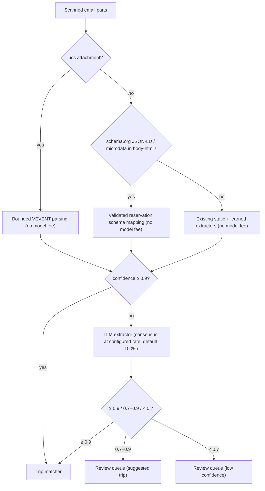

# Gap-Closing Plan: Map, Discovery, Email Import, Dark Features, Offline

**Status:** Revised proposal — source-verified 2026-10-18, re-verified 2026-10-19 (§0.5); production settings and measurements unverified
**Last updated:** 2026-10-20
**Review:** Updated against repository code and primary provider documentation, in collaboration with Bryan Duerk
**Builds on:** `implementation-plan-wanderlog-competitive-analysis.md` (§5.1–5.4), `implementation-plan-trip-day-map.md`, `server/src/ingestion/TECHNICAL_DEBT.md`

**How to read this:** the plain-language overview below is for everyone. §0.4 describes what travelers see. §0.5 lists fixes worth doing first. §1–5 are for implementers, and §6–9 are for reviewers.

**P0 code implementation (2026-10-19):** Mail aliases, transactional encrypted receipts/quota,
held-message recovery, scheduled processing, fail-closed scanner checks, complete-only
owner-scoped offline snapshots, map-cache removal, privacy redaction and seed defaults
are implemented. See [implementation and rollout evidence](../operations/gap-closing-p0.md)
and [source flag/artifact audit](gap-closing-p0-source-audit.json). Production flag changes,
consensus sampling decisions, bucket inventory/cleanup review, real forwarding/scanner
trials and device/adapter concurrency verification remain explicit release gates. The
initial mailbox bound is 256 KiB combined content (larger documents use manual upload);
all sender trust is unverified/suggestion-only until real receiver fixtures are validated.


**P1 source implementation (2026-10-19):** Import setup and bounded structured parsing,
private catalog discovery/web maps, authorized native map context, notification inbox /
scheduled work and conditional trip bundles are implemented behind rollout gates. See
[implementation, mutation inventory and rollout](../operations/gap-closing-p1.md).
Validated Gmail receiver/confirmation fixtures, real adapters/devices, performance and
user-task evidence remain release gates; forwarding remains suggestion-only.

---

**Remaining-work audit (2026-10-19):** Additional expense recovery/session fencing,
notification quiet hours, bounded snapshots, map travel estimates and automatic-import
controls are implemented. The continuation adds audited cohort controls, local digest
timing, browser IndexedDB saves and durable discard/corrupt-queue export recovery.
P0/P1/P2 are not all complete. See the
[current completion audit](../operations/gap-closing-remaining.md) for outstanding
source work separately from provider, device and release evidence.

## Remaining work — 2026-10-20

Source work still open (see the [completion audit](../operations/gap-closing-remaining.md) for evidence):

- **Maps (§1.3–1.5):** public/recap integration, bounded browser keepsake capture, native renderer source and bounded public-catalog geocoding are implemented ([details and activation](../operations/gap-closing-maps.md)). Remaining: named-device/EAS and native print checks, reviewed geocoding endpoint/scheduler activation, production evidence, and legacy-artifact retirement after old-client migration.
- **Day editing (§1.6):** web/native drag handles, persisted optimization pins, Move up/down and checked Optimize/Undo are implemented. Environment rollout, usability and physical-device gesture checks remain ([details](../operations/gap-closing-day-order-inspiration.md)).
- **Discovery (§2.3):** destination-based “Trips like this” and credited copying of explicitly shared public catalog activity templates are implemented. Manual/private activity copying is excluded; public explore/SEO remains later scope (§7). [Contract and activation](../operations/gap-closing-day-order-inspiration.md).
- **Email import (§3.1–3.2):** signed, content-bound receiver-attestation verification, provenance-gated forwarder trust and Gmail confirmation recognition/UI are implemented ([contract and rollout](../operations/gap-closing-receiver-auth.md)). Remaining: deploy the trusted gateway/signer and validate real receiver/forwarding/Gmail fixtures before enabling; synthetic contract fixtures are not production evidence.
- **Offline storage (§5.2–5.3):** encrypted transactional native storage, device-backed keys and migration/reinstall/key-loss recovery; access-based LRU snapshot eviction and optional Wi-Fi-only downloads.
- **Release evidence (§4–5 and acceptance gates):** real notification delivery/cohort/timing measurements, deployed shell/hash-change and authenticated offline recovery across browsers, provider/scanner/forwarding trials, database concurrency/index readiness, named native devices, accessibility/usability, import precision and performance evidence.

**Implemented in this continuation (§5.3):** replay selects due entries before taking a batch, preventing delayed entries from starving ready expenses. Both storage paths process at most 20 entries per drain and stop starting requests after 45 seconds; transactional replay rechecks the budget after storage awaits. Focused tests cover bounded continuation, foreground resume, stable operation keys, interrupted commits, account fencing and lease replacement. These automated checks do not establish native device/background or production recovery evidence.

## Plain-language overview

What travelers get, in the order it is planned:

1. **Forwarded booking emails become safe and simple.** Each person gets a private forwarding address. Bookings show up with a suggested trip, and confident matches can be added automatically with Undo.
2. **Saved trips stay correct offline.** A failed download never replaces a good saved copy with an empty one. Expenses added without signal sync later and are never lost.
3. **A real, movable map.** Each day's stops appear on an interactive map next to the itinerary, at no per-view cost on web.
4. **"Nearby" ideas.** Places close to where the group is staying, added to a day with one tap.
5. **An in-app notification inbox.** For example: "free cancellation ends tomorrow" and "your booking was added".

What stays the same: planning, manual upload, and the itinerary list keep working even if any new feature is switched off. Reading saved trips offline and the map stay free.

---

## 0. Summary & Core Pillars

This plan closes five functionality gaps found in the competitive analysis against Wanderlog and Stippl, building on code that already exists wherever possible:

1. **In-App Map & Route Visualizer** — one open map engine (MapLibre + OpenFreeMap) drawn on the device from stored coordinates, on every web surface: day view, blog, public pages, keepsake. Google Static Maps survives only as a live-view stopgap in the native app until its next EAS build, and stored Google images are removed.
2. **Place Discovery** — a catalog-first "Nearby" panel, one-tap "Add to day", and GetYourGuide affiliate options.
3. **Automatic Reservation Import** — per-user secret aliases (fixing a spoofable-sender hole), structured-data-first extraction, mandatory attachment scanning, and auto-assignment to the right trip with conflict-safe undo.
4. **Built-but-Dark Features** — notification inbox, staged push rollout, trip-planning notifications, activity recap, and a flag audit.
5. **Offline Access & Sync** (comparison gap 6) — harden the existing offline trip cache, add a versioned trip bundle, and support offline expense creation with idempotent replay.

*(Comparison gap 5, public pricing and social proof, is handled separately.)*

### Core Architectural Pillars

- **Security first:** inbound email is attributed by a secret per-user alias, never by `From`. Attachments are scanned fail-closed before any parser touches them. LLM output can never choose which trip an item lands in. Offline data is account-scoped and wiped on logout.
- **Performance:** acknowledge mail after bounded validation and durable receipt, before scanning/parsing. Bundles check authorization and a cheap version record before reading children. Map libraries load on demand; warm spatial lookups run in bounded memory.
- **Low cost per user:**
  - Structured data first avoids model fees where validation succeeds; CPU, scanning and storage still cost money. Reuse existing static/learned extractors before bounded model escalation.
  - Draw maps on the device from reusable coordinates; avoid a new server rendering stack. Free public tiles have no delivery fee today, but app delivery, privacy review, device resources and fallback operations still matter. Cache eligible public geocodes with expiry; isolate private locations. No Google Places expansion.
  - Savings are measured from `usage_metering` and provider cost records, not assumed.
- **Usability:** a one-tap "Send a test" during setup, Gmail auto-forward verification surfaced in-app, and trip auto-assignment with readable reasons and Undo. Also one-tap "Add to day", map–timeline sync, and offline expenses that sync themselves.
- **Maintainability:** extend current routes, repositories, notification preferences and import state machine. Share typed contracts and pure logic, keep platform rendering/storage behind small adapters, and require a measured reason for every new dependency or provider.

---

## 0.1 Repository Verification & Baseline Findings

Source inspection establishes the behavior below, not live deployment settings. Older
implementation records are context; code and current provider documentation take precedence.

| Existing implementation | Consequence & required enhancement |
| --- | --- |
| **`routes/staticMapRoutes.ts`** — authenticated Google Static Maps proxy, ≤ 12 points, provider usage limits and budget. **Keeps Google PNGs in a 24 h in-process `mapCache`.** Accepts arbitrary client-supplied addresses/coordinates. | Remove the server-side cache of Google images (§1.1). For the native stopgap, derive points **server-side** from an authorized `tripId` + `dayDate` so the endpoint can't be an open proxy on our key (§1.5). Retire the route after the native MapLibre release. |
| **`services/blogBackgroundWorker.ts` + `blogDayFactsService.ts`** — a background job downloads Google Static Maps PNGs of each blog day's photo geotags and **saves them to Cloud Storage** (`blog_day_map_artifacts`). `trip_blog_day_map_render` seeds **on**. The day-facts service returns a signed URL to the stored PNG. | Audit applicable storage terms and inventory artifacts; prepare a controlled pause/cleanup (§1.1). Add a versioned audience-safe point projection for device maps (§1.3). |
| **`ingestion/intake/mailgun.ts` + `routes/ingestionWebhookRoutes.ts`** — HMAC signature, 5-minute timestamp window, and replay tokens are implemented. **User is resolved from the spoofable `sender`/`From` address.** Info logs record sender, recipient, and subject. Body: uses `stripped-text`, and HTML only when there is no text part. | Resolve by recipient alias (§3.1), redact logs, and durably accept before processing. Preserve bounded unstripped HTML for structured extraction (§3.3). |
| **`ingestion/virusScanProviders/`** — `clamavHttpAdapter.scanBuffer` really scans; `scanBatch` is a documented no-op `PASSED`. Unknown or unset provider config **defaults to the stub**. | Production must select `clamav_http` and **fail closed**: startup check + per-file scan before normalization; unreachable scanner → hold, never pass. |
| **`ingestion/extraction/index.ts`** — extraction cache keyed by `userId + contentHash + logicVersion`; static/learned extractors; production-only dual-LLM consensus is sampled with a current default of 100%, after cache lookup. No `.ics` or JSON-LD extraction stage was found. | Extend stages/policy (§3.3); measure actual model usage and quality before promising savings. Preserve user-scoped cache isolation. |
| **`ingestion/config.ts`** — `INGESTION_CONFIDENCE_HIGH = 0.9`, `INGESTION_CONFIDENCE_REVIEW_READY = 0.7`, `INGESTION_SIGNED_URL_TTL_SECONDS = 900`. | Reuse these thresholds everywhere in this plan. Don't introduce a parallel 0.85. |
| **`ingestion/shared/repository.ts`** — `assignParsedItemToTrip` records an `assignment_transaction_id`; Postgres commits first, then calls `syncAssignedFlightExpense` **outside** that transaction. | Assignment/expense completion needs atomicity or durable recovery; undo compensates only unchanged created rows/expenses (§3.4). |
| **`app/utils/offlineTripCache.ts`, `offlineAccess.ts`, `components/OfflineUnlockScreen.tsx`** — read-only trip snapshots in `localStorage`/`AsyncStorage`, keyed by **email**, 30-day access window, biometric/device-PIN unlock; used by `App.tsx`, `tripBlog.tsx`, `tripReminderNotifications.ts`. | Re-key by `user_id`, move to encrypted storage on native, wipe on logout/account switch, feed from the versioned bundle (§5). |
| **`app/hooks/usePendingWrites.ts`** — single global key `stp.pending-writes`, drops an entry after 5 failed attempts, no cross-tab lock. `useConnectionState` (expo-network + Socket.IO) exists. | Account-scope the queue, never silently drop a user's expense, add a replay lock, and send an `Idempotency-Key` per operation (§5.3). |
| **`generation_idempotency`** exists for AI jobs; blog routes also enforce operation-specific keys. | Reuse proven reservation concepts in a narrow adapter-atomic create helper with request hash, owner/operation scope and retention; do not assume middleware or AI-specific records alone handle expenses (§5.3). |
| **`services/entitlementService.ts`** — `isFeatureEnabled(key, _userId, _role)` ignores user/role; 60 s cache per flag key; `FAIL_CLOSED_FLAGS` list. | Add cohort/allowlist evaluation **after** the cached flag lookup (cache the flag row + cohort, evaluate membership per call), preserving global kill switches (§4.1). |
| **`notificationService.ts`, `notificationRoutes.ts`, `notificationOutboxWorker.ts`** — existing per-user/category/channel preferences and PATCH API, thread mute, Expo ticket-error token pruning and email fallback. Quiet hours are now implemented; configurable digest timing remains outstanding. | Extend existing preferences and UI; add quiet hours, receipt handling and independent email consent. No replacement preference system (§4.2). |
| **`locations` / catalog services** — cached catalog records and coordinates; no PostGIS dependency. Firebase is the GCP default, but production config was not inspected. | Use adapter-compatible catalog lookups and a bounded memory index; do not add PostGIS for this feature (§2.1). |
| **`services/scheduledJobLease.ts`** — Postgres-only insert-per-window claim, catches all claim errors as false, no renewal/expiry/fencing. Its comment explicitly says the Firebase equivalent is absent. | Cannot serve as a production geocoding queue or global throttle as-is. Add a narrow durable-job contract with both adapters, explicit failure and stale-owner handling (§1.4). |
| **`app/tabs/ingestion.tsx`** — already separates simplified regular-user UI from operational admin controls; web picker currently excludes `.ics`. | Preserve that separation. Extend intake MIME validation, picker and fixtures together; map internal states to simple action labels (§0.4). |
| **`routes/activityRoutes.ts`** — mounted at `/api/activities`. | Discovery adds activities through the existing route (§2.2). |

---

## 0.2 System Architecture Overview


---

## 0.3 Maintainability and implementation boundaries

- **One source of domain types.** Add shared bundle, operation-result and coordinate-provenance types to `server/src/types.ts`; frontend uses type-only imports. Validate external/request data with server schemas and return stable error codes. Do not add another locally redefined `Trip`/`Expense` model. Version persisted snapshots and queue payloads explicitly.
- **Reuse the current entry points.** Existing `/api/activities` and `/api/expenses` own creates; ingestion owns extraction/review; notification repositories own preferences/history. Small shared idempotency helpers support adapter transactions; do not repurpose AI-generation-specific records into every operation without an expand migration and compatibility tests.
- **Keep `App.tsx` integration thin.** Move snapshot download/replay orchestration into focused hooks/services; import setup, review cards, inbox and map legend into reusable components. Keep normal tab fetch helpers co-located per project convention; avoid a repo-wide API-layer refactor.
- **Separate domain logic from platform code.** One map-point selector, public-location projection and matcher; `.web.tsx` / `.native.tsx` renderers; storage/replay adapters behind small contracts. A native build must not import DOM/WebGL dependencies. Add native dependencies only after a small compatibility spike proves Expo 54/RN 0.81 and supported device behavior.
- **Make invariants adapter-owned.** Domain writes, version bumps, idempotency and outbox intent must share a database transaction or an explicit recoverable workflow. `db.ts` delegates; adding a second facade write is not atomic. Ingestion/blog/notification repositories also mutate data outside the facade and must participate.
- **Bound dependency and operational growth.** Pin vetted parsers/map packages in lockfiles, review licenses and advisories, avoid runtime CDN script fallback, and configure provider endpoints server-side. Reuse existing budget/config/logging helpers and a small durable queue interface; no speculative plugin framework, new microservice, Redis or self-hosted tiles without measured need. Scanner isolation is justified by untrusted files.
- **Migration and retirement.** Expand schema first, deploy compatible readers/writers, backfill in resumable bounded batches, verify, then contract. Document both Postgres and Firebase behavior and required indexes; pg-mem reuses Postgres but cannot prove production concurrency. Preserve old native clients through a declared minimum-version window before removing Google routes/flags or changing blog map response shapes. Every new flag has an owner, missing-row behavior and retirement criterion.
- **Reviewable slices.** Each PR states user-visible behavior, supported platforms, touched adapters, cost impact, tests, rollback and remaining limitations. Separate necessary feature work from broad cleanup. Do not duplicate queues, preference stores, capability registries or parsers during transition.

## 0.4 Experience for non-technical users (release requirement)

Use existing app navigation and simplified Imports view. No new setup is needed to use a
trip, browse places, or read already-saved data. Advanced automation is optional and never
blocks manual upload or trip planning. UI labels below are proposed copy, not API enums.

| Task | Default path | Recovery without technical knowledge |
| --- | --- | --- |
| Import a booking | Open **Imports** → **Upload a confirmation** or **Copy my forwarding address** → see **Received**, then a booking preview and trip suggestion → **Add to Japan trip** | **Choose a trip** if ambiguous; **Edit details** if dates/amount are missing; **Upload another file** if unsupported. Never show a confidence percentage or require provider settings. |
| Set up email forwarding | Copy address first; optional **Set up automatic forwarding** opens provider-specific steps, progress and a test | Explain that mail-provider settings open outside the app; show the validated confirmation code when needed. Offer **I'll do this later** and manual upload. A test shows **Test received** and creates no booking/charge. |
| Review unfamiliar mail | Most mail needs no extra step: if the forwarder can't be confirmed, the booking still appears as a normal suggestion with "We couldn't confirm who forwarded this — check it before adding". Only suspicious mail shows **Check this message** → **Import once** or **Delete** | **Always allow this sender** requires verification, cannot change auto-add permission, and stays under More options. No raw HTML preview. |
| Automatic adding | Once released (after the pilot gate in §3.4), confident matches from a verified forwarder are added automatically. The first time, a one-screen explanation shows an example, says tripmates will see the booking, and offers **Keep on** / **Always ask me** | **Added to Japan trip** with **Undo** in import history and item details for seven days, not just a disappearing toast. Ambiguous matches always ask. The switch lives in Imports settings. |
| Find an activity | Open a day → **Nearby** → card shows distance, estimated duration and **Add to [day]** | Default trip/day from context. Ask only when context is absent; show **Added** and **Undo**, prevent double taps, warn about an existing activity. Offer **Search another area** for no results. |
| Use the map | Day list works first; **Show map** opens the same stops, with linked row/pin selection | **Map unavailable — your itinerary is still below**; **Open in Maps** for navigation. Explain straight-line connections and estimated times without technical terms. |
| Save a trip | **Save for offline** → progress/size → **Saved on this device**, last-updated time | Storage/network failure keeps the previous complete copy and shows **Try again** or **Free up space**. Say whether map imagery is included; first release guarantees trip details, not turn-by-turn navigation. |
| Add an expense offline | Normal **Add expense** form → **Saved on this device · waiting to sync**; automatic retry on reconnect | **Sign in to finish syncing**, **Fix details**, or **You no longer have access to this trip**. Never imply server save before local durability/server acknowledgement. Failed expenses stay visible until resolved/discarded. |
| Leave a device | Normal **Sign out** | If unsynced work exists, explain the count and offer **Sync now**, **Keep safely on this device** (only with protected same-account retention), or explicitly confirmed **Discard and sign out**. Never silently delete financial work. |

**Common requirements:** plain language and one primary action; preserve form input and
filters across recoverable failures; show local date/time, currency and any uncertain
timezone explicitly. Hide alias rotation, technical job states, parser diagnostics and
provider/quota controls under Advanced/Admin. Do not expose “HMAC”, “LLM consensus”,
“idempotency”, “ETag”, or “quarantine” in user tasks. Paid limits show a readable allowance
and next reset/action before work starts, never a surprise failure after entry.

Support screen readers, keyboard-only use, visible focus, text scaling, contrast, reduced
motion and touch targets of at least 44 logical pixels. Never rely on pin color or status
icons alone. Provide Move up/down alternatives to drag, persistent status instead of toast-only
feedback, labeled errors next to fields, and confirmation only for destructive/financial
conflicts. Do not request notification or location permission before the user invokes the
relevant feature; denial leaves planning usable.

**Usability gate:** test the tasks above with at least five people unfamiliar with the app,
including mobile and a keyboard/screen-reader pass. Target at least 4/5 completing import,
Add to day, offline save and offline-expense recovery without coaching; zero unnoticed data
loss or accidental sharing. Record task times, confusing labels and mistakes; fix blockers
before wider rollout. Small-sample results guide iteration, not a claim of population-wide
success. No analytics collection outside existing consent rules.

## 0.5 Verified quick wins (do first — small, independent changes)

Each item below was confirmed in code on 2026-10-19 and can ship as its own small PR or configuration change, ahead of the larger slices.

| # | Problem (verified) | Fix | Why first |
| --- | --- | --- | --- |
| 1 | **Forwarded mail can be lost on retry.** `validateMailgunWebhookSignature` claims the replay token before the message is stored or queued. If anything later fails (500), Mailgun retries with the same token, the replay check throws a 406, and Mailgun never retries a 406. The monthly quota is also consumed before payloads are built and queued. | Claim the replay token and consume quota in the same step that durably records the delivery; treat a replay of an already-recorded delivery as success. Return a permanent 406 only for truly unprocessable mail, never for temporary failures. Also confirm Mailgun accepts the current `202` as success — its docs name only `200`. Check whether its retries (up to ~8 h) carry the original signature timestamp, which the 5-minute window would reject. | Silent loss of a user's booking email is the worst import failure |
| 2 | **Offline snapshot can save empty lists.** `App.tsx` builds the snapshot with `.catch(() => [])` on each fetch, and `fetchFlightsForTrip` returns `[]` on a non-OK response. A failed request is saved as "this trip has no flights". | Save a snapshot only when every part loaded. Otherwise keep the previous complete copy and show "Couldn't update the saved copy" (§5.1 item 4). | A traveler offline at the airport sees a trip with missing flights |
| 3 | **Every production import runs two LLM parsers.** The default consensus sample rate is 100% (`DEFAULT_CONSENSUS_SAMPLE_RATE_PERCENT`). | Check consensus agreement rates in the existing admin comparison data, then lower `parser_consensus_sample_rate_percent` through the existing admin setting. No code change. | Largest immediate cost lever per import |
| 4 | **Google map images are stored.** `trip_blog_day_map_render` seeds on and saves Google PNGs (§1.1). | Pause via flag; inventory before any cleanup (§1.1). | Compliance |
| 5 | **Webhook logs contain personal data.** Info logs print sender, recipient and subject. | Log opaque ids and counts only (§3.1 item 10). | Privacy; trivial change |
| 6 | **A dead flag claims a feature exists.** `notifications_web_push` seeds on with no browser push implementation. | Turn the flag off. | Removes a misleading signal from the flag audit |

---
## 1. In-App Map & Route Visualizer

**Decision: store coordinates, not map images.** Maps are drawn on the device with MapLibre and OpenFreeMap tiles. Google Static Maps is only a live-view stopgap in the native app until its next EAS build.

This is the proposed direction; validate it on supported devices before rollout:

- **Impact:** it delivers an interactive map, which is the actual gap against Wanderlog — a stored PNG doesn't close it.
- **Cost:** avoids metered tile fees on the current public service and a new server renderer; still measure app bundle, device memory/battery, network and operational costs.
- **Provider terms:** separate coordinate provenance, attribution and export rights from renderer choice. A browser cache header is not proof of contractual storage permission.

### 1.0 Map engine by surface

| Surface | Engine | Image stored? | Cost |
| --- | --- | --- | --- |
| Day view, web | MapLibre GL JS + OpenFreeMap, drawn in the browser from stored coordinates | No app-generated map artifact | Public tile delivery currently free; measure total cost |
| Blog day map, public blog page, recap (web) | Same component with explicit audience-safe points | No app-generated map artifact | Same; defer until privacy projection passes |
| Keepsake / print export | Dedicated on-device snapshot passed to the existing pure HTML keepsake renderer (`app/utils/keepsake.ts`) | Only in the user's exported file | Device work; prototype CORS/attribution/print readiness first |
| Day view, native app during migration | Google Static Maps only where permitted, with authenticated proxy and no app-managed persistent copy | No app artifact | Validate billing account/SKU pricing and limits; free allowance is shared, not a per-user guarantee |
| Native app after compatibility/release gate | MapLibre React Native with shared point/style contract | No app-generated map artifact | Public tile delivery currently free; dependency/build/device cost remains |
| Images with no browser (email digests, link-preview images) | **Deferred.** If ever needed: a separate scale-to-zero service rendering OpenFreeMap tiles — never inside the API service, which already has a Cloud Run OOM remediation plan | Yes, OpenStreetMap-based only | Compute only |

### 1.1 Provider-storage review and cleanup (P0)

1. **Stop storing Google images.** `services/blogBackgroundWorker.ts` (render job at lines ~346–377 and ~620+) downloads Google Static Maps PNGs and saves them to Cloud Storage. Its flag, `trip_blog_day_map_render`, seeds **on**.
   - Prepare a configuration change to pause new artifacts while applicable account terms are reviewed. This document changes no flags and authorizes no deletion.
   - Inventory rows/objects, provider provenance and readers; prepare a scoped dry-run cleanup with counts and exact prefixes. Purge confirmed ineligible artifacts in a separately reviewed, resumable job with audit evidence and no impact on user photos. Adapt old readers before retiring URLs; do not blindly delete bucket prefixes.
2. **Remove the server-side Google image cache.** `routes/staticMapRoutes.ts` holds Google PNGs in a 24-hour in-process `mapCache` for both `/static` and `/trip-day`. Remove it, so responses stream straight through.
   - Do not blindly forward an upstream `public` cache directive for authenticated trip content. Default the proxy to `Cache-Control: private, no-store`; any permitted browser-only caching requires documented terms and privacy review. Never let a CDN or generic service worker cache private maps. Upstream headers do not replace contract review.
   - Verify the applicable regional/account agreement and Maps Static policy; do not generalize coordinate-specific allowances to images. Remove unsupported cache behavior before expanding traffic.
   - The existing per-caller daily caps and $15/month budget stay in place. Once web moves to MapLibre, only native live views reach Google.
3. **Keep provider provenance.** Use only coordinates/content whose terms permit the target surface; record source, fetched time and allowed use. Do not assume catalog content is unrestricted merely because it is cached. Keep Google-derived content out of the open-map/export path unless explicitly permitted; even text-only display needs review. Haversine estimates need no routing provider.
4. **Attribution.**
   - Keep MapLibre's on-screen attribution control visible (never hidden by CSS).
   - Exported or printed images carry "© OpenFreeMap © OpenMapTiles © OpenStreetMap contributors" in the image itself, as OpenFreeMap's terms require for non-interactive use.
   - Google images keep Google's logo; never crop it.
5. **Citations.** Link the live Google Maps Platform Terms in code comments and docs rather than section numbers that weren't verified against the current text.

### 1.2 Day map on web: MapLibre (P1)

- **One `TripMap` component** on MapLibre GL JS with the OpenFreeMap style. Pins are colored by kind (reusing `TripDayMap`'s legend colors) and lettered in visit order, with a straight-line route layer between stops labelled "connections, not directions".
- **Lazy-loaded** through a web-only module when the user opens/approaches the map, with measured initial JS impact. Verify Metro splitting in the production export; if it fails, use a controlled build/asset strategy rather than a runtime CDN script fallback. Pin dependencies and limit CSP origins for style, tiles, glyphs and sprites. Destroy offscreen map instances; limit simultaneously mounted WebGL contexts and test low-memory devices.
- **No new endpoint.** The day view already has the trip's items (and later the §5.1 bundle). The client builds points from item `lat`/`lng` (§1.4) and airport coordinates. Items without coordinates yet are listed under the map as "Not on the map yet".
- **Layout:** at widths ≥ 1024 px, a split view — itinerary left, map right. Selecting a card centers its pin; clicking a pin scrolls to its card. Narrower web screens get a collapsible map above the list.
- **Failure mode:** OpenFreeMap has no SLA. If tiles fail, show the list with "Map unavailable"; there is deliberately no Google fallback on web, so there's one engine to maintain.
- **Accessibility:** the list stays the primary view. Pins are keyboard-focusable with text labels, and every fact on the map is also in the list.

### 1.3 Blog, public blog page, recap, keepsake (P2)

**2026-10-20 implementation:** Public and recap maps now use fresh server projection, with public locations outside the cached document. Browser export captures a bounded map or prints labeled coarse areas. Native PDF uses area lists. [Implementation and remaining device/retirement gates](../operations/gap-closing-maps.md).

- Change the blog `dayMap` fact in `services/blogDayFactsService.ts` to return the day's points (media geotags) instead of a signed PNG URL. `tripBlog.tsx` and the public blog page render them with `TripMap`.
- **Privacy:** photo visibility is not consent to publish precise EXIF. Default public location sharing off; require an explicit approximate-location preview/consent, suppress home/private lodging points, and project only approved coarse points **on the server**. Rounding to 100 m is not anonymization. Public HTML, APIs, exports and analytics must not contain hidden exact coordinates. Recheck audience and invalidate caches on unpublish/delete.
- **Keepsake:** prototype a bounded export-only map instance, wait for tiles/fonts with a timeout, snapshot with attribution and dispose it. Avoid `preserveDrawingBuffer` on every live map; test memory/CORS and native `expo-print` compatibility. Export still succeeds with a labeled list when imagery is unavailable; never output a silently blank canvas. No server render dependency.
- **Retire** the render job, `trip_blog_day_map_render`, and `blog_day_map_artifacts` once nothing reads them (all three adapters).

### 1.4 Coordinate reuse and optional geocoding (P1)

**2026-10-20 implementation:** Durable public-catalog POI jobs/cache, cross-instance admission, fenced completion, hard fetch/body deadlines and shared merchant lookup are built on both adapters. Explicit reviewed provider permissions/attribution/retention are required; endpoint/policy changes retire cached data. Daily quota defers without spending retries, Retry-After establishes durable cooldown, and disabled workers still clean expired cache records. Redacted dead-job diagnostics and both-adapter recovery tests are implemented. External lookup defaults off; public OSM and private inputs are excluded. Current-item overlays avoid background address overwrites. [Configuration and remaining provider gates](../operations/gap-closing-maps.md).

- **Resolution order:** reuse permitted catalog/airport/item coordinates before cache or external lookup. Catalog Nearby and initial maps can ship without external geocoding; unresolved items retain their original text and remain usable.
- **Cache:** key by normalized query + country/locality/language context + provider/normalizer version; record coordinates, quality/provenance, expiry and negative-result TTL. Reuse only eligible public POIs across users, isolate private locations. A plain address hash is dictionary-searchable, not anonymization. Refresh with deduplicated jobs; recheck the item's address version before writing results.
- **Item columns:** nullable `lat`, `lng`, `geo_city` on lodgings, activities, and car rentals (pickup and dropoff), in all three adapters.
- **Worker:** durable idempotent jobs, bounded backlog, lease expiry/renewal with stale-owner fencing, retry/backoff and dead-letter visibility, implemented on both adapters. The existing `scheduledJobLease` is not this contract. Consolidate merchant-category lookup and geocoding under one provider admission policy; a lease alone does not throttle every caller or enforce one physical worker.
- **Public Nominatim is conditional, not a default production backend.** Its [usage policy](https://operations.osmfoundation.org/policies/nominatim/) requires developer responsibility, app-wide <= 1 request/second, identification, attribution and caching. Bulk use is discouraged; eligible small jobs use one thread/machine, and recurring/day-long jobs <= 4/minute. Confidential/personal queries, autocomplete and systematic POI harvesting are prohibited. No production backfill/private-address submission until permitted scope is documented. A fail-closed server flag can stop external work without app updates.
- **Provider interface:** one narrow lookup contract; choose any replacement only after reviewing storage/privacy/display rights, total fixed cost and measured volume. Missing provider never blocks item save.
- **Timezone:** lat/lng alone is not a timezone. Use existing inference or a separate vetted offline lookup, retain provenance and support correction. Use `geo_city` in day titles only when sufficiently reliable; preserve the original location fallback.

### 1.5 Native app (P1 stopgap → P2)

**2026-10-20 implementation:** Native MapLibre 10.4.2 source and Expo plugin are wired behind independent build/DB gates. Mocked lifecycle and fallback checks pass; new EAS builds and named-device compatibility evidence are still required before enabling. Google routes remain for supported old clients. [Activation and validation](../operations/gap-closing-maps.md).

1. **Stopgap — Google live view only.** Provision a server-only key restricted to the Maps Static API, set `GOOGLE_STATIC_MAPS_API_KEY`, and flip `trip_day_map` for native.
   - Change `GET /api/maps/trip-day` to take `tripId` + `dayDate`, check `ensureUserCanReadTrip`, and derive points server-side, so clients can't run arbitrary addresses through our key.
   - Stream Google's image with no server copy (§1.1). Add a `reserveMapRenderRateLimit` per user in `httpRateLimitService`.
   - Bound provider fetch duration/response bytes/content type and request dimensions; redact upstream URLs/keys. Provider timeout or budget exhaustion leaves the list usable. Add these checks before enabling the stopgap.
   - The single-address preview in `LodgingDetailsDialog` (`GET /api/maps/static`) follows the same rules; on web it switches to `TripMap`.
2. **Native compatibility spike, then staged EAS release.** Verify Expo/RN support, gestures/accessibility, attribution, style support and low-memory devices before adding the dependency. It may share a build with encrypted storage, but each feature has independent flags/rollback. Retire Google routes/key only after supported old clients migrate; avoid an unnecessary two-engine rewrite if the native spike cannot pass. Existing list/external-map fallback stays usable.

### 1.6 Route lines, travel times, day optimization (P1 / P2)

**Implementation status (2026-10-19) — items 3 and 4 (reorder + Optimize day) built; not yet released.**

- **Order is now one definition.** `packages/domain/src/dayOrder.ts` (synced to `server/src/utils/dayOrder.ts` by `scripts/sync-planning-points.cjs`) orders a day's activities: saved `day_position`, then start time (`9:30` = `09:30`), then name, then id. The day list, the map's pin letters and the server's conflict check all use it, so what the user sees, what the map letters and what the server compares are the same. The Overview day list previously ignored `day_position`.
- **`PUT /api/activities/day-order`** (`planning_day_order` flag, fail-closed, reported as `dayOrder` by `planning-capabilities`): one transaction on both adapters sets positions for all of one trip's activities on one date. The client sends the order it was looking at (`expectedIds`); if the day changed underneath it the server writes nothing and answers `409` with the current order. Other days and other trips are never touched. Moving an activity to another day clears its position. No schema change: it uses the Phase 1 `day_position` column.
- **`dayRouteOptimizer.ts`** (pure, deterministic): nearest-neighbour + 2-opt for up to 12 stops. Booked activities with a set time and stops without coordinates keep their slot; an optional lodging anchor makes the route start and end there; it never returns a longer route than it was given.
- **`DayActivitiesOrdering`** in the Overview day view: Move up / Move down (44 px targets, labelled for screen readers), **Optimize order** with a preview (straight-line distance before/after, what stays put, "not walking or driving times"), **Use this order**, **Keep my order**, and **Undo** (itself a checked save). Conflicts, offline and double taps are handled in place with a persistent notice.

2026-10-21: HTML drag handles on web and responder-based handles on native now reuse the checked day-order save; no drag dependency is added. Persisted Pin/Unpin constrains optimization, and expected-pin checks prevent stale overwrites. Move up/down remains the accessible baseline. Environment rollout, unfamiliar-user and physical-device acceptance remain open. [Implementation and checks](../operations/gap-closing-day-order-inspiration.md).

1. **Route line:** a MapLibre line layer in visit order. On the native Google stopgap, the `path` parameter, which needs `lat`/`lng` from §1.4.
2. **Travel time between stops** via the existing `transferEstimationService`: haversine with walking (~5 km/h) or driving (~30 km/h) speeds, shown as "~12 min walk".
   - The Directions API is used only when `attractions_transfer_directions_api` is on **and** `assertCanUseFeature` passes for the user's tier — a flag alone is global, not per tier.
   - Directions results appear only as text, never as geometry on the map.
3. **Stop order.** Verify existing order fields first; use stable per-day order with an authorized atomic bulk update and expected version. Global activity order must not alter other days. Provide drag plus keyboard/Move up/down actions; validate a drag library against RN Web before adoption.
4. **Optimize day (P2).** Nearest-neighbour + 2-opt on the client over ≤ 12 coordinates.
   - Fixed-time bookings and pinned stops stay put; lodging anchors are optional. Explain missing coordinates, distance estimates and unmodeled barriers/accessibility; no implied road navigation or opening-hours guarantee.
   - Preview before applying; Revert checks versions and never overwrites tripmates' intervening edits.
   - Local optimization stays free. Defer metered routing until demand, display rights and per-user budgets justify it.

---

## 2. Place Discovery & Smart Recommendations

### 2.1 "Nearby" panel (P1)

- Catalog places within 2 km of the day's lodging or first stop.
- **Spatial lookup:** reuse catalog loader/ranker with a bounded lazy per-destination index, bounding-box prefilter then haversine check. Deduplicate loads, version on catalog refresh, cap memory/TTL and return <= 20 results/page. Warm catalog queries can avoid catalog reads; authorization/limits, cold loads and refresh still cost. Measure cold and warm latency separately.
- **Ranking:** deterministic — trait match from `activityTypeInterestWeights` against the group's traits, plus a popularity signal where the catalog has one (Wikipedia pageviews), minus distance. No LLM.

### 2.2 One-tap "Add to day" & bookable options (P1)

- "Add to day" calls the existing `POST /api/activities`, prefilled with name, coordinates (so no geocode is needed), `attractionDurationEstimationService` duration, category, and description.
- It sends an `Idempotency-Key` through the shared idempotent-create helper (§5.3), so a double tap can't create two activities.
- Enforce atomic create/dedupe, membership and input validation in the existing route/repository; middleware alone cannot guarantee one create. Reuse a minimal idempotent-create primitive before Nearby ships; do not make it wait for the whole offline expense UI. Estimate duration locally/cached, not one paid call per visible card. Confirm exact trip/day only when context is missing.
- GetYourGuide options appear when `getyourguide_activity_suggestions` is on, labelled "Partner". Ranking ignores affiliate status.

### 2.3 "Trips like this" & destination pages (P2)

**2026-10-21 implementation:** Overview day details recommends opted-in public/discoverable blogs with matching destination IDs or legacy destination text. An explicit sharing preview permits only catalog-backed public templates; copies use an adapter-atomic allowlist, publication/consent rechecks, stable operation keys and source credit. Private/manual activities are excluded. [Behavior, bounds and activation](../operations/gap-closing-day-order-inspiration.md).

- Public trip blogs for the same destination. "Copy activities" clones names, categories, coordinates, and durations, and credits the source blog.
- Only content published under the public-sharing consent is eligible. Never notes, costs, bookings, flight numbers, or traveler names.
- Copy through a server-side allowlist projection, rechecking visibility and permissions at copy time; invalidate recommendations when the author unpublishes/deletes. Show affiliate disclosure clearly; do not budget against unearned commission.
- Public, crawlable explore pages stay behind the SEO spike in competitive-analysis §5.4.

---

## 3. Automated Reservation Import & Ingestion Security

Goal: forwarding produces clear receipt/progress and a suggested trip without technical
setup. Once released, confident matches are added to the right trip automatically by default, with Undo. Target
latency is measured by input class; a cold scanner or OCR can take longer than a minute.
Auto-assignment affects a shared trip, so trusted attribution and recovery ship first.

### 3.1 Critical security fix: per-user aliases (P0)

**The vulnerability (current code).** `resolveMailgunWebhookUser` takes `body.sender ?? body.from`, looks up the account with that email, and enqueues the message. The webhook HMAC proves *Mailgun* sent the request, not who wrote the email. Anyone who knows a Premium user's address can:

- inject fake reservations with phishing links into that user's queue (and, after §3.4, into a shared trip);
- burn the user's monthly import quota (it's consumed after attribution);
- trigger extraction and LLM spend on attacker content.

```
Inbound email → Mailgun MX → POST /api/ingestion/webhooks/mailgun
  1. Verify HMAC, timestamp window, replay token        (exists)
  2. Parse recipient u-<token>@in.wander-bunnies.com      (new)
  3. SHA-256(token) → ingestion_aliases (ACTIVE or within grace)
       └─ not found / revoked → 200, drop, counter only
  4. Bounded alias/account admission (caps, sizes, rate)
       └─ over a cap / abuse signal → bounded private hold (no scan, parse or LLM)
  5. Durable receipt + dedupe/quota reservation → worker
  6. Sender trust tier decides what the result may do:
       ├─ verified forwarder → suggestion, eligible for automatic add
       └─ alias only         → suggestion only (never automatic)
```

1. **Alias.** `u-<token>@in.wander-bunnies.com`, where `<token>` is 128 random bits, base32 (26 characters). It lives on a dedicated inbound subdomain with its own MX, so the main domain's mail is untouched.
2. **`ingestion_aliases`:** preserve id/owner/hash/encrypted address/status/timestamps with key version and authenticated-encryption associated data. PostgreSQL unique index; Firestore deterministic token-hash document reserved in a transaction, since an index is not a uniqueness constraint. Routine rotation may offer seven-day grace; suspected compromise revokes immediately. No alias tokens in logs, public links, analytics or notifications; deletion removes aliases/keys.
3. **Trusted sender, not claimed sender.** A secret alias is a bearer capability, not proof of message truth. Only trusted receiver-generated authentication results with documented identity alignment may influence sender trust; attacker-supplied headers and `From` alone cannot. Account/additional addresses must actually be verified with expiring single-use tokens. Avoid universal plus-tag stripping; confirm real forwarding behavior with Gmail, Outlook and Apple fixtures. SPF may fail after forwarding; DKIM/ARC handling needs explicit validation. Uncertain cases go to review. Do not promise that every new airline bypasses checks, or assume Gmail rewrites the envelope to the user's mailbox. Provider authentication does not replace extraction quality validation.
4. **Trust tiers instead of holding everything uncertain.** The 128-bit alias is the credential that admits mail; sender trust only limits what the result may do. Holding every message whose sender can't be verified would hold most auto-forwarded mail, because Gmail and Outlook forwarding keeps the airline as `From`. Non-technical users would then have to approve every booking by hand.
   - **Alias valid, forwarder verified** (a trusted receiver authentication result aligned with one of the owner's verified addresses): processed normally; the result is eligible for automatic add (§3.4).
   - **Alias valid, forwarder not verified:** processed normally — scanned, extracted, quota and caps applied — but the result is **suggestion-only**. The user confirms the trip with one tap; it is never added automatically. The review card says "We couldn't confirm who forwarded this — check it before adding".
   - **Held before any scanning or parsing** (`HELD_UNVERIFIED_SENDER`) only on abuse signals: per-alias caps exceeded, a sudden volume spike, or mail claiming to come from the owner's own address that fails authentication. The Import screen shows "Check this message — Import once · Delete". "Always allow this sender" stays under More options and sends a confirmation link to that address first.
   - **Cost bound:** unverified-but-admitted mail costs extraction, so per-alias daily caps and the monthly quota (item 5) must ship together with this tier.
   - If the alias leaks, rotate it in one tap (item 2). The worst case without rotation is unwanted suggestions, never writes to a trip.
5. **Two admission budgets.** Add global/IP transport limits, total bytes/parts/fields and deadlines before multipart buffering; 20 per-file limits do not bound total memory. After alias lookup bound held mail by account/alias (initial proposal: 20 messages or 25 MiB, seven-day TTL), with one coalesced alert. Enforce per-alias accepted rate caps and consume monthly quota once per accepted message, atomically with dedupe/admission, not once per retry/attachment. No billable extraction or scanner wakeup for unverified holds. Authenticated Import once still follows scan/quota rules; over-limit users retain manual review and readable recovery.
6. **No backscatter.** Never auto-reply to an inbound sender. Results go to the alias owner in-app, by push (§4.2), or by email to the **account** address only.
7. **Retire the shared address safely.** Immediately stop using sender lookup to select an account, including a hold queue. Drop legacy-address mail with provider-appropriate success, announce the personal address to signed-in owners/verified account channels, and offer manual upload. Any grace path needs an authenticated claim mechanism; a spoofable sender cannot determine who receives private mail.
8. **Attachment scanning, fail closed.** Store raw attachments in a private quarantine prefix. Scan each buffer with `clamav_http` before `pdf-parse`, OCR, or `.ics` parsing.
   - Production startup refuses to run forwarded-mailbox ingestion with the stub selected.
   - Scanner unreachable → keep the file held and retry with backoff (existing retry config); never pass unscanned bytes.
   - Reuse `clamav_http`; deploy a private authenticated scanner and benchmark scale-to-zero cold starts, signature updates/readiness, memory, concurrency and idle costs. Unknown provider, no-op batch, stale signatures, malformed result and timeout cannot mean clean. Scan actual bytes on each supported source; content sniffing, PDF-page/image-pixel/decompression limits and parser isolation remain necessary after antivirus.
   - Google Web Risk checks URLs, not files, so it doesn't fill this role.
9. **LLM boundaries.** Fence email text in the prompt and validate every LLM response against a Zod schema per item type. Fences reduce prompt-injection risk; they are not a security boundary. The real controls:
   - the LLM gets no tools and no links are fetched;
   - its output can't set `trip_id`, user, or status — authorized domain logic applies the deterministic matcher (§3.4);
   - imported links render as plain text with the domain visible.
10. **Log hygiene.** Log opaque alias/job ids, outcome and byte counts; omit mail metadata, filenames and payloads from errors/capture/analytics. If sender correlation is essential, use a rotating keyed HMAC, not a dictionary-searchable plain email hash.
11. **Durable receipt before ACK.** Quarantine in private durable object storage with TTL/access controls, persist delivery/jobs and enqueue intent, then acknowledge. Scanning/parsing runs off-request. Separate replay-token validation from business idempotency: current replay claiming occurs before persistence. Test a crash at every boundary so retries recover rather than reject already-claimed tokens and lose mail. Message-Id alone is attacker-controlled; scope dedupe by account/content identity. Duplicate committed deliveries return success without recharging quota; transient storage/queue errors remain retryable under Mailgun's documented contract.
12. **One state machine and deletion policy.** Extend `import_job` as the source of progress; private hold references do not become a second pipeline. Raw bytes, extracted text, model/shadow captures, aliases and derived records have documented deletion/retention with lifecycle enforcement; remove raw content after processing when no longer required. Keep only minimal audit metadata. No external URL/image fetch, payment action or booking update/cancellation from email instructions. Render normalized text and validated fields, never raw HTML.

### 3.2 Easy setup (P1)

**2026-10-20 implementation:** Authenticated, expiring Gmail code display is wired to encrypted, quota-free setup receipts. A separate content-bound receiver attestation protects author/forwarder observations; automatic-add trust uses private receipt/document provenance and current verified mailbox ownership. Unverified setup messages cannot enter booking parsing. [Receiver contract, validation and remaining deployment evidence](../operations/gap-closing-receiver-auth.md).

1. **Import screen leads with the address:** Copy, QR code, "Add to contacts" (vCard), Rotate.
2. **"Send a test":** authenticated, rate-limited synthetic message proves receipt; it cannot add a booking, consume import allowance or trigger a reply loop. Explain success and the next step; failure leaves Copy/upload available.
3. **Provider walkthroughs** for Gmail (filter → forward), Outlook (rule), and Apple Mail.
4. **Gmail forwarding confirmation.** Recognize validated provider fixtures, not a `From` string alone. Show sanitized code only to the authenticated alias owner, validate any offered HTTPS host, never auto-follow/approve, and keep codes out of push/logs. Explain that the user completes Gmail's own forwarding settings; the app cannot silently create their mail rules.
5. **Tripmates** each have their own alias; imported items show "Imported by Tristan".
6. **Share sheet:** extend the existing mobile share entry points with "Import to WanderBunnies" for PDFs and screenshots (manual-upload source, same scanning).

### 3.3 Structured-data-first extraction (P1, after security admission)



1. **Capture structured data.** Pass the unstripped `body-html` as an extraction input alongside `stripped-text`. Today HTML is used only when there is no text part, so embedded JSON-LD is thrown away.
2. **`.ics` stage.** Use a vetted maintained parser; update MIME allowlist, manual picker and all source paths. Bound bytes/events/text/time, handle `TZID`, all-day/floating dates and duplicates; **no recurrence expansion or remote attachment fetching**. Calendar updates/cancellations and unknown timezones require review rather than auto-editing existing bookings.
3. **JSON-LD stage.** Bound aggregate HTML/script bytes, script count, nesting and processing time (not just one 256 KB script). Parse JSON without executing HTML/JS or resolving remote contexts; allowlist supported reservation schemas and validate fields. Structured content is still untrusted and not automatically high-confidence.
4. **Then existing stages:** complete validated static/learned output can avoid models; bounded escalation uses one model, then consensus only if quality/cost evidence justifies it. Preserve deterministic sampled quality auditing. Very poor/adversarial documents go to review rather than unbounded escalation. Cache identical documents by user + exact content + parser/schema/model-policy version; matching an airline template does not permit reusing another booking's personal data. Reserve aggregate job cost before parallel model work, including retries, OCR/shadow calls and captures.
5. **One parser stack:** route the Transfers tab's "Paste Info" through ingestion extraction as a manual-text source and retire the separate `flightParserLLM` path.
6. **Measure:** record the per-import LLM cost from `usage_metering` for 2 weeks before the change and compare after. Report per-stage hit rates in the existing ingestion admin widgets.
7. **Defer Gmail expansion.** For public server-side processing of restricted Gmail data, plan scope verification and annual assessment unless a documented exception applies. Forwarding avoids new Gmail scopes; already-deployed OAuth usage still needs its own review.

### 3.4 Automatic adding to the right trip — on by default after quality gates (P2)

This reverses the deliberate "No automatic assignment" decision in `ingestion/TECHNICAL_DEBT.md`; update that file when it ships.

**Gate:** all §3.1 controls, transactional/recoverable assignment side effects, safe undo,
membership checks and a suggestion-only pilot pass before automatic writes. Confirmation, not score, is the safe fallback.

**Default — confirmed product decision (2026-10-18, reconfirmed 2026-10-19): automatic adding is ON by default.** When time and place align, the booking goes into the right trip without the user doing anything. No user ever has to find or enable a setting. The steps below are internal release gates, not user opt-ins:

1. **Internal pilot (before general release):** the matcher runs in suggestion-only mode so its picks can be audited against what users confirm. The release flag stays fail-closed.
2. **Admin cohort:** automatic adding on for the admin accounts once the precision gate (§8) passes.
3. **General release:** **on by default for every user**, with the first-time notice in §0.4 and a per-user switch to turn it off (**Always ask me**).

Automatic add applies only to verified-forwarder imports (§3.1 item 4) and unique, strong matches. Everything else stays a one-tap suggestion. A default-off switch would leave most non-technical users without the feature, since few find and enable opt-in automation.

#### Candidate trips

Trips from `listTrips(userId)` where the alias owner is an active group member — **not** followed trips — and the trip ended no more than 30 days ago.

#### Required gates (all must pass to auto-assign)

1. Extraction confidence ≥ 0.9, item not `DUPLICATE_FLAGGED`, and not an `ASSIGNED_MATCH` duplicate.
2. **Date fit:** the item's local dates (from `startDateTimeUtc`/`endDateTimeUtc` + `originalTimezone`) fall within `startDate − 1 day … endDate + 1 day`. If `timezoneStatus` is `UNKNOWN`, the item must not sit on a boundary day.
3. **Place fit or booking continuity** (below).
4. **Uniqueness:** exactly one candidate passes gates 2–3.

#### Signals (also used to rank suggestions)

| Signal | Computation | Strength |
| --- | --- | --- |
| Booking continuity | Exact provider + normalized reference scoped to an authorized candidate trip, compatible dates/item type; references are not globally unique. Updates/cancellations require review. | Strong supporting evidence, not an authorization shortcut |
| Place fit | Any endpoint matches the trip's places. Item: airport codes → city (airports table); hotel/activity/car address → `geo_city` (§1.4), or city-string match before §1.4. Trip: `destination`, `locationIds`, and cities of items already in it. Both legs count — the return departs from the destination. | Strong |
| Date fit | As in gate 2; month-only trips (`startMonth`/`startYear`) give a weak fit that can only suggest | Required |
| Traveler fit | `travelerNames` resolve to group members via `matchTravelerNamesToGroupMemberIds` | Tie-breaker |

`server/src/ingestion/assignment/tripMatcher.ts` is pure and deterministic: no LLM, no network. It returns `{ decision, tripId, reasons[] }` with readable reasons ("Dates Nov 9–21 fit", "Arrives HND — Tokyo is in this trip", "Same booking as your outbound flight").

#### Decision

| Decision | When | User experience |
| --- | --- | --- |
| Auto-assign | All gates pass and the user setting is on | Added to the trip; notification "Added Delta DL167 to *Japan 2026* · Undo"; an "Imported" badge with reasons; an activity-feed entry for tripmates |
| Suggest | Gates 2–3 pass for several trips, or confidence 0.7–0.9, or a month-only fit | Review queue with the top trip pre-selected and reasons shown; one-tap Confirm; "Confirm all suggestions" |
| Review | No trip passes the date gate | Review queue with "Create a trip from this" (Quick Start wizard prefilled — no automatic trip creation) |

**2026-10-21 implementation:** Shared matching context now hydrates every date-eligible candidate, resolves airport and trip-item cities, scopes booking continuity by provider/type/dates, and ranks traveler matches without breaking automatic ambiguity. Imports adds explicit batch preview/confirmation, partial-failure recovery, provenance-based forwarding copy and booking-prefilled Quick Start with return to review. [Contract and remaining acceptance](../operations/gap-closing-matching-review.md).

#### Conflict-safe Undo (7 days)

- Each auto-assignment stores `assignment_mode = 'AUTO'` and `undo_expires_at`.
- Track every created row/expense with assignment id and expected version. Assignment and source-expense sync need an atomic transaction or durable recoverable intent before automation; an expense currently created after commit cannot be assumed complete.
- Undo is an authorized idempotent compensating operation: remove only unchanged rows created by that assignment. Tripmate edits, shared references or settled payments require a conflict-specific recovery flow; never offer a generic button that silently deletes financial history. Recheck membership and keep an audit trail.
- **Setting:** "Automatically add matching bookings" — **on by default** (see Default above). A plain-language notice the first time says tripmates will see the booking. Users can switch it off. Undo stays accessible in import history/item details for seven days.

#### Data model

- `parsed_items`: add `suggested_trip_id`, `match_reasons` (JSON), `assignment_mode` (`MANUAL` | `SUGGESTED` | `AUTO`), `undo_expires_at`.
- `import_jobs`: add state `HELD_UNVERIFIED_SENDER`.
- New tables: `ingestion_aliases`, `ingestion_verified_senders` (`user_id`, `email`, `verified_at`, `verification_token_hash`).
- User preference: `ingestion_auto_assign` — nullable; `null` means "use the default", which is **on** once the release flag is on. An explicit user choice always wins, and the release flag can stop automatic writes for everyone without touching user settings.
- Implement in existing ingestion/DB repositories for Postgres, Firebase and pg-mem behavior; add query-required composite indexes only. A Firestore token-hash lookup needs a deterministic unique reservation, not a composite index.

#### Metrics

Track wrong-trip reports and audited pilot precision as well as undo/suggestion acceptance,
holds, latency by input class and cost per successful import. Confidence >= 0.9 is a score,
not a measured 90% accuracy guarantee. Require strong destination fit (origin-only city
matches, weak geocodes and month-only trips suggest), date/timezone validation and a unique
candidate. Stop expansion on any confirmed cross-trip disclosure or > 2% undo during the
pilot; investigate causes before resetting thresholds.

---

## 4. Activation of Built-but-Dark Features

| Feature | Flag (seed default) | What's missing |
| --- | --- | --- |
| Day map (native stopgap) | `trip_day_map` (off) | An API key and server-derived points (§1.5); web uses `TripMap` instead (§1.2) |
| Blog day-map render | `trip_blog_day_map_render` (**on**) | Prepare audited pause/cleanup and reader migration (§1.1, §1.3) |
| Notification inbox | `notifications_in_app` (off) | Inbox UI |
| Mobile push | `notifications_push` (off) | Staged rollout |
| Web push | `notifications_web_push` (**on**) | No browser push implementation found; propose separate config change to disable unused delivery flag |
| Activity recap | `activity_recap` (off) | UI |
| Gmail import | `feature_ingest_gmail_import` (off) | Deferred (§3.3) |

Production values may differ from these seed defaults; §4.1 checks them.

### 4.1 Flag audit & cohort rollout (P0)

- **Admin flag report:** production value, seed default, and whether any client or route reads each flag.
- **Capabilities test:** every flag the client reads through the blog capabilities endpoint (`blogRoutes.ts`, `/:tripId/blog/capabilities`) must be listed in that route's `featureKeys`. A missing key has silently hidden finished features before.
- **Cohorts:** optional explicit user cohorts evaluated after cached global configuration. Global off always denies, including admins/cohort members. Missing membership denies new rollout access. Never cache one user's eligibility by flag key alone. Keep global flag/permission rules distinct; test both the route and capability response. Owner/retirement criteria keep temporary flags from becoming permanent complexity.

### 4.2 Notification inbox & push (P1)

1. **Inbox:** bell with unread count, paginated history, mark read/all and authorized deep links; reuse current routes/repository. Socket.IO invalidates data, while cursor catch-up on reconnect/resume recovers missed events. Authenticate user rooms, bound page sizes and mark-read input, and recheck target membership. Do not rely on a live socket for delivery correctness or add frequent idle polling.
2. **New categories:**
   - `import_result` — "Added to *Japan 2026* · Undo", "2 reservations need a trip", "Held: message from an unknown sender"
   - `cancellation_deadline` — `freeCancelBy` on activities, `refund_by` on lodging, 48 hours ahead
   - `ai_finished`
   - `trip_digest` — daily summary of tripmates' changes
3. **Preferences:** extend the existing category/channel model with a simple UI, optional quiet hours and digest timing. Start with **Important updates** and **Daily summary**; advanced per-category choices stay optional. Preserve saved preferences; independent email consent must apply even to today's push-to-email fallback. Switching push off cannot silently increase email.
4. **Push:** consenting test cohort, then measured small rollout. Ticket token pruning exists; add delayed receipt processing. Use generic lock-screen text (no trip titles, travelers, locations or booking details by default); reveal specifics in authenticated inbox. Ask permission after the user enables alerts; denial leaves inbox/planning usable.
5. **Activity recap:** reuse existing category/services; one dismissible opt-in nudge, no automatic photo/note publication. Deadline/digest jobs persist due time, timezone/DST policy and dedupe key; edits/deletion cancel/recompute reminders. Workers need durable scheduled execution on Cloud Run, lease recovery and crash-after-send handling, not only process-local intervals. Channel kill switches leave recoverable intent visible without surprise fallback sends.

---

## 5. Offline Access & Sync (comparison gap 6)

### 5.1 Versioned trip bundle (P1, after snapshot correctness)

1. **Version and mutation inventory.** List all writes affecting the authorized snapshot, including ingestion/undo, payments/coverage, itinerary details, deletes and group membership outside `db.ts`. Increment `content_version` inside adapter/domain transactions, not as a separate facade call. Group changes need group/permission revision in the validator rather than unbounded fan-out to every trip. Benchmark Firestore hot-document contention and extra writes/indexes.
2. **One conditional bundle request by default.** Avoid `/version` then `/bundle` on every refresh. `GET /api/trips/:id/bundle` authenticates and checks membership, entitlements and permission/schema projection before comparing `If-None-Match`. Include content + permission/group + representation/schema revision in the ETag. Revoked users must never get `304` or private data; unchanged responses still cost auth/version reads.
3. **Bounded typed bundle.** Preserve current snapshot fields (trip, members, transfers, lodging, activities, rentals, itinerary, expenses, payments and coverage) only where authorized. Use `Cache-Control: private, no-cache`, `Vary: Authorization`, and no shared CDN cache. Bound items/bytes, allow staged large downloads, and use a transaction-consistent/version-checked read so a mixed old/new graph is never marked current. Revalidate once on resume/relevant changes, with backoff; don't download every trip on every edit.
4. **Complete snapshots only.** Current `App.tsx` prefetch converts errors to empty arrays: fix that first. Keep the last complete snapshot on timeout/partial failure; atomically replace only after validation/durable storage succeeds. Reuse already-loaded data, coalesce prefetch and expose failure. Separate ordinary screen fetching from user-requested large offline downloads.

### 5.2 Secure local storage (P0 isolation; staged native-store migration)

**Implementation continuation (2026-10-20):** Native trip snapshots and financial queues now use per-account/environment SQLCipher databases, with random keys in device-only SecureStore. Migration validates the existing owner-bound snapshot/queue and commits before removing plaintext. Email-only snapshots still require a fresh authorized download. Missing/wrong keys preserve the original: snapshots can be downloaded again, financial queues stop replay and expose encrypted recovery export instead of resetting. Corrupt readable queues have transactional backup/repair; future schema versions are refused. Snapshot logout erases its active ciphertext/key while retained financial queues keep theirs. `NATIVE_ENCRYPTED_STORAGE=0` disables native storage rather than falling back to plaintext, independently of the map renderer flag. A new native build and named-device encryption/restore/kill/relaunch acceptance remain required; see [native storage runbook](../operations/gap-closing-native-storage.md).


- **Build on `offlineTripCache.ts`:** preserve 30-day access/unlock; key by immutable user id + environment + schema version. Migrate authenticated-owner legacy email entries once, validating before commit and deleting only after success; account switching cannot relabel another user's data.
- **Native:** choose one transactional encrypted store after an Expo/device spike; hold keys in device-backed secure storage, not the snapshot. Device unlock alone does not encrypt AsyncStorage. Test restore/reinstall/key loss and provide **Download again** recovery. New builds are required; keep migration/renderer flags independent.
- **Web:** account-scoped IndexedDB, minimal fields and explicit shared-device warning on offline save. Do not claim native biometric protection or browser storage encryption against same-origin XSS; prioritize CSP and avoiding unsafe HTML. No long-lived server tokens or raw mail in snapshots.
- **Download controls:** current/active trip first, explicit pretravel save, progress/bytes/last-updated and storage-full recovery. Bound bytes/trips with LRU eviction, never evict unsynced work; optional Wi-Fi-only download. First release stores text/details and coordinates, not guaranteed offline base tiles. Tile downloads need a separate provider-limit/size/attribution design before marketing offline maps.
- **Logout/account switch:** stop and fence in-flight prefetch/replay, clear in-memory views and private snapshots/worker caches/keys; never silently delete pending financial writes. Offer sync, protected same-account retention only where technically supported, or explicit discard. Another user cannot see/replay retained work. Test signout racing with hydrate/persist; revoked membership is enforced on reconnect, not instantly while offline. Local access expiry never authorizes online writes.

### 5.3 Offline expenses with idempotent replay (P2)

**Lifecycle continuation (2026-10-20):** Bounded drains now include lease-acquisition time in the 45-second request-start budget. Foreground generations fence background/inactive transitions, batched suspend/resume and unmount; stale responses retain the original operation for idempotent retry and cannot update the current UI. Retry timers stop while offline/backgrounded, and remaining successful batches schedule continuation after yielding. A resume that arrives before the old drain releases its lock is woken again on completion. Automated hook, replay and native-adapter tests cover these paths, including abandoned-lease expiry. Actual named-device suspend/kill/relaunch acceptance remains a release gate.


**Implementation status (2026-10-19) — first slice built; not yet released.**

Built and tested:
- `POST /api/expenses` accepts an `Idempotency-Key` header. A `client_operation_id` column with a unique index (Postgres) or a deterministic document id written with `create()` (Firestore) makes the create atomic. A retry returns the original expense with `Idempotent-Replayed: true`; the same key with a different payload returns `409 IDEMPOTENCY_KEY_REUSED`. Membership and entitlement are rechecked on every replay. This is the expense-specific create helper, not a repurposed `generation_idempotency` record.
- `usePendingWrites` gained an account-scoped storage key, never-drop mode, `failed`/`pause` outcomes, backoff, a one-drain-at-a-time lock (Web Locks where available), native hydration merge, and `enqueueDurable` (resolves only after a read-back).
- `usePendingExpenseSync` (app-level) queues and drains expenses; `DailyExpensesTab` lets a new expense be added offline, shows "Saved on this device · waiting to sync", and offers **Try again** / **Discard**.

Still to do before this ships (all listed in §5.2 / the usability gate):
- **Completed:** sign-out warning with unsynced count, Sync now / Keep on this device / Discard. Retention explains device-key loss on native and unencrypted browser storage on web.
- **Completed:** Edit for definitively rejected expenses, plus per-expense Export; unknown outcomes retain the original operation key.
- **Implemented, device acceptance pending:** SQLCipher native queue and device-only keys (§5.2). Browser IndexedDB remains unencrypted.
- Firestore emulator parity run for the new server tests (they pass on the in-memory adapter), real-device checks, and the novice-recovery usability test.
- Deciding whether the entry-queue key should include the environment hash instead of the raw backend URL.

1. **Queue:** extend `usePendingWrites` with owner/environment/schema scope, cryptographically random stable operation id, trip id, validated payload, creation time, status, attempts and next retry time. Await durable enqueue before **Saved on this device**. Prevent native hydration/enqueue races and concurrent replay with a lease/lock appropriate to supported browsers (Web Locks where available, tested transactional fallback) and native app lifecycle. One in-memory mutex alone does not provide persistence/crash recovery.
2. **Never silently drop an expense.** Replace the 5-attempt drop with exponential backoff. Permanent failures (`403` membership revoked, `422` validation) go to a "Couldn't sync" list with Retry, Edit, Export, and Discard.
3. **Server:** existing `POST /api/expenses`, scoped idempotent-create helper (not a second sync route). Reserve key + canonical request hash + expense + response atomically in the adapter, or use an explicit recovery state machine. Shared middleware without transactional domain writes does not prevent duplicates. Keys bind to authenticated owner/operation; keep them at least the maximum replay age (initially 30 days), with explicit recovery for older queued operations:
   - first request → process, store status + body;
   - same key, same payload → return the stored status + body, with an `Idempotent-Replayed: true` header;
   - same key, different payload → `409`.
4. **Trigger/recovery:** reconnect/resume schedules one bounded drain; connectivity is a hint, request outcomes authoritative. `401` pauses for same-account login without consuming attempts; `402/403` shows action needed; transient errors use jittered backoff. Recheck membership, tier, currency and traveler references server-side. Retry after timeout-after-commit returns the original expense. Optimistic rows reconcile by operation id without double-counting totals; editing a definitively rejected entry creates a new operation. Updates/deletes are later scope with expected versions.
5. **Feedback:** persistent queued/syncing/needs-action status and history, plus **3 expenses synced**. Preserve input and unsynced work across restarts. Keep basic offline reading free; measure avoided reads versus refresh/version overhead rather than assuming a cost reduction.

### 5.4 App shell offline on web (P2)

**Implementation status (2026-10-19) — built and unit-tested; not yet verified in a real browser or on a deployed build.**

- `app/public/sw.js` (copied to the site root by the Expo export) caches only `index.html` and the content-hashed files under `/_expo/static/` and `/assets/`. Navigations are **network-first** (4 s timeout), so an online user always gets the newest build; the cache is only the offline fallback. It never touches `/api`, `/socket.io`, `/public/blog`, Firebase's `/__/`, other origins, non-GET, range or `Authorization` requests, or the worker script, so no trip data or session ever enters its caches. Static pages such as `/privacy.html` are left to the network. Old `wb-` caches are deleted on activate; stored files are capped at 150.
- `utils/registerServiceWorker.ts` registers it after page load, in production builds over HTTPS/localhost only, from `AppEntry.js`, and never affects startup if it fails. **Rollback:** build with `EXPO_PUBLIC_DISABLE_OFFLINE_SHELL=1` and the app unregisters the worker and deletes its caches on next load (or ship a `sw.js` that unregisters itself).
- `/sw.js` is served `Cache-Control: no-cache` with `Service-Worker-Allowed: /` from Firebase Hosting (`firebase.json`) and from the Express static server.
- The offline banner now matches reality: signed-out visitors are told to connect to sign in; signed-in users offline are told they can still add expenses (§5.3) and everything else is read-only. It previously claimed changes would not be saved.

Not done: a real-browser check (install, offline reload, update after a deploy, old-build recovery) against an actual `expo export` build; confirming the Firebase Hosting header ordering for `/sw.js` after deploy; a web snapshot of trip data (the shell opens offline, but web still has no offline trip data, §5.2); and web push, which remains separate.

Versioned same-origin shell/build assets, network-first navigation with offline fallback,
atomic build updates and recovery from stale clients. Exclude auth/API/provider URLs from
generic cache rules; private bundles live in the account store. Verify Expo export, CSP,
worker scope, logout cleanup and old-build behavior. Web push is a separate later feature,
not an automatic dependency or outcome of shell caching.

---

## 6. Security, Performance, Cost and Maintenance Controls

| Area | Security and usability | Performance and unit cost | Maintenance constraint |
| --- | --- | --- | --- |
| Map | Audience-safe points, no private CDN caches, usable list/navigation fallback | Device drawing, bounded map instances; track tile/app egress and native fallback paid misses | Shared point/provenance contract; platform renderers; retire old routes only after client migration |
| Discovery | Server-authorized idempotent Add to day; public allowlist projection and consent recheck | No model call per browse/card; bounded warm indexes, pagination and lazy images | Reuse catalog loading/ranking, existing activity route and duration cache |
| Import | Alias/trusted receiver rules; bounded private hold, scan before parsers, constrained output, clear receipt/review | Durable async work, exact-document cache, finite model/token/attachment budget and retry cap | Extend one ingestion state machine, schemas and parser policy; fixtures per supported source |
| Notifications | Authenticated history/rooms; independent channel consent and generic push text | Cursor catch-up, coalesced digests, durable due-work scheduling; measure idle outbox reads | Extend existing categories/preferences/outbox; no replacement notification subsystem |
| Offline | Owner-scoped store/queue, encryption where promised, no lost expenses or account crossover | Reuse last complete snapshot, conditional bundle before child reads; bounded download and replay | Versioned types/migrations, adapter-atomic writes; one storage backend per platform |

### 6.1 Measure total cost, not only provider price

`feature cost per active user = (provider + allocated compute + DB reads/writes + storage
+ egress + retries/background idle work) / monthly active users of that feature`.

Also report total cost/all active users and cost/successful import or sync. Held/rejected
abuse, OCR, shadow parsing/captures, ClamAV signature refresh/cold-start cost, Socket.IO
connections, outbox polling and cache warmups remain in the numerator. Affiliate revenue
is reported separately; do not subtract forecast commissions to justify spend.

Use existing usage/provider records plus access-controlled aggregates; do not put email,
alias, booking or user ids in high-cardinality metric labels. Reconcile estimates against
billing exports. Benchmark representative cold/warm workloads at 100, 1,000 and 10,000
monthly active users, stating assumptions about trips/imports per user and attachment sizes.
No provider price, free allowance or p95 figure is a production guarantee.

The current Google pricing page lists a Static Maps free usage cap and paid tiers; verify
applicable billing-account/region/contract pricing before enabling, including other features
sharing the allowance. Free OpenFreeMap delivery does not make all map operations free.
Do not self-host tiles, add shared caching infrastructure, or enable paid route refinement
until measured cost/reliability requirements justify the fixed maintenance burden.

### 6.2 Mandatory controls for every slice

- Paid calls use `reserveApiUsageOrThrow` / `recordProviderRequestCost`, with an operator-chosen absolute monthly cap and per-active-user target, 80% alert, and a tested atomic hard stop across instances. Include retries and parallel model reservations. Budget exhaustion degrades to review/list/manual work, not silent failure.
- New external-contact/paid/automatic-write flags explicitly join `FAIL_CLOSED_FLAGS` with missing-row tests; preserve unrelated fail-open legacy entitlements. Global off denies everyone; cohorts never bypass global flags or authorization.
- Validate cheaply before database-backed rate-limit writes; cap aggregate body/storage/queue sizes. Edge rejection reduces both memory pressure and DB metering cost under abuse.
- Every schema/transaction change covers Postgres, Firebase, pg-mem behavior and ingestion/blog/notification repositories where relevant. Add only query-required Firestore indexes and document write amplification; test hot-document contention. Keep migrations resumable and backwards compatible.
- Track provider data flows, permitted storage/display/export and attribution. Do not automatically classify every provider as a processor. Review applicable terms/privacy obligations and approved inputs; no new geocoding/private-location flow based solely on a hash or an absent API key.
- Ownership/deletion/invalidation is part of each data model: account deletion, membership loss, unpublish, alias revocation and stale offline access have explicit behavior. Keep only minimal audit metadata and bounded retention.

---

## 7. Dependency-Based Delivery and Rollback

Dates and staffing are not established. Release small slices after their own checks; do not
leave security, device tests or usability evaluation until a final project phase. The lanes
below describe sequencing, not authorization for deployment, deletion or provider signup.

| Slice | Scope and prerequisites | Evidence before enabling | Rollback / fallback |
| --- | --- | --- | --- |
| P0: verified quick wins (§0.5) | Mail-retry/quota ordering, complete-only offline snapshots, consensus sample-rate review, map-render pause, log redaction, dead web-push flag | Crash/retry tests for the webhook, partial-fetch snapshot test, consensus agreement data before lowering the rate | Each is independent and individually revertible |
| P0: source/config/storage audit | Inventory map artifacts and readers; pause unsupported artifact generation via separate config change; import logs/attribution, scan config, queue isolation | Applicable terms/config audit, exact cleanup dry run, no impact on user media, adapter failure cases | Stop new provider work; keep trip list/manual paths and recoverable data; no broad bucket deletion |
| P0: safe mail admission | Alias/trust checks, bounded hold, durable receipt/dedupe/quota, fail-closed scanning and lifecycle cleanup | Signed/forged sender fixtures, real forwarding trials, crash/retry tests and scanner readiness | Disable mailbox admission with documented provider retry/hold response; never revert to sender attribution or unscanned parsing |
| P0: native snapshot reliability | Complete-only snapshot writes, visible storage failure, owner isolation and logout races | Interrupted/partial fetch, storage-full, account switch and pending-work recovery tests | Keep last complete readable snapshot; stop unsafe new writes |
| P1: import assistance | Easy setup/test/confirmation; structured parsers behind schema/quality gates; suggestion-only matcher | Redacted representative fixtures, task-based user trial, measured model quality/cost diff | Manual upload/review and existing validated extractor fallback; automatic writes stay off |
| P1: catalog discovery and web map | Catalog/airport coordinate reuse, shared points/provenance, minimal idempotent-create helper; no external geocoder prerequisite | Production bundle/RN import checks, memory/latency, keyboard/list failure fallback and double-tap tests | Keep lists, catalog browse and external Maps links; stop loading map library |
| P1: inbox and bundle contract | Existing notification preference API; cursor catch-up; typed authorized conditional bundle and mutation inventory | Room/deep-link isolation, missed-event catch-up, version/permission/consistent-read tests | Inbox history/manual refresh; retain existing screen fetches and last valid snapshots |
| P2: native migration and public map/export | Compatibility spike, encrypted storage migration, audience-safe projection/export prototype | Named real-device EAS tests, old-client support, print readiness and privacy review | Independent renderer/storage flags, original list/keepsake without map; keep old routes during support window |
| P2: optional geocoding, reorder/optimize | Permitted inputs/provider decision, durable queue both adapters, global throttle; expected-version reorder | Queue crash/fencing and provider throttling, stale address results, fixed-time/accessibility tests | No external lookup; preserve original location/order and manual adjustments |
| P2: automatic imports (on by default) | All security gates, assignment + expense workflow, conflict-safe undo, suggestion pilot, then admin cohort | Audited supported-item precision and wrong-trip review, first-time notice/switch and undo tests | Switch automation off, preserve review/history/undo; do not delete prior items blindly |
| P2: offline expense create | Durable encrypted/scoped queue, shared atomic idempotent create, bundle/storage maturity | Concurrent retries, timeout after commit, native hydration, lifecycle/account isolation and novice recovery tasks | Pause replay/new enqueue as needed, retain same-account work for recovery; online creation still available |
| Later: browser shell/push, public explore, Gmail expansion | Separate platform/privacy/SEO/OAuth gates; not required for core planning | Feature-specific tests and total-cost case | Existing inbox, authenticated planning and manual import remain usable |

One cross-cutting idempotent-create primitive is a dependency of Add to day and expenses;
shipping Nearby does not require the entire offline-sync subsystem. A useful map can use
catalog coordinates before geocoding. Native encryption does not wait for native MapLibre,
and browser push does not block the inbox. These boundaries reduce critical-path risk.

---

## 8. Test Matrix and Proposed Acceptance Targets

All targets below are release criteria to measure, not claims about current performance.
Name hardware, payload mix, concurrency, region and cold/warm state in each report.

| Area | Required scenarios and acceptance |
| --- | --- |
| Email security | Valid/invalid HMAC and timestamp; forged From/authentication headers; unknown/revoked/compromised alias; legacy shared address cannot select an account; verified versus uncertain real forwarding; **unverified-forwarder mail becomes suggestion-only and is never auto-added**; abuse signals hold before scanning; a retry of an already-recorded delivery returns success and temporary failures never return 406; no secrets/PII in logs or push |
| Admission/retries | Aggregate multipart and hold cap, private TTL cleanup, quota exactly once on duplicated/retried message, crash before/after replay claim/persistence/enqueue, durable worker delivery across instances; no success ACK before recoverable receipt |
| Scan/extraction | Clean/EICAR/MIME mismatch, scanner outage/signature age/no-op/invalid config, malicious PDF/image limits; supported calendar dates/cancellations/no recurrence expansion; aggregate HTML/JSON limits, no JS/remote-context fetch, prompt injection and field schema validation |
| Match/undo | Overlapping/month-only trips, origin-only match, return leg scoped continuity, same reference at another provider, DST/overnight/unknown timezone, followed/revoked trip; concurrent assignment/undo, partial expense sync and edited/settled financial conflicts; no duplicate rows or blind rollback |
| Maps/discovery | Authenticated native proxy; request/time/response bounds; public payload contains no hidden precise EXIF; unpublish invalidation; WebGL/tile/offscreen/low-memory failures; accessible list/keyboard reorder; idempotent Add to day and changed visibility at copy time; export fallback/attribution |
| Bundle/storage | Permission/schema-sensitive ETag; revoked caller never receives 304; no child scan for unchanged response; inventory-driven version updates; consistent large bundle, partial fetch keeps old snapshot; storage-full/corrupt migration/key loss/logout races and account switch |
| Expense replay | Concurrent tabs/resume, native hydration/enqueue race, offline restart, timeout after server commit, same key/different request, same key/different owner, expiry and 401/402/403 recovery; queued financial work is never silently dropped; optimistic totals reconcile once |
| Notifications/flags | Authorized rooms/history/deep links, reconnect catch-up, independent category/channel consent, no unwanted email fallback, DST/deadline edit/cancel, receipt token cleanup, duplicate schedule/crash handling; global-off overrides cohorts and capabilities match route gates |
| Non-technical use | Tasks and recovery in §0.4 tested with unfamiliar users; >= 4/5 uncoached completion for core tasks; no unnoticed loss/sharing; screen-reader/keyboard/text-scaling pass; clear first-run, empty, loading, disabled and error states |
| Maintainability | Shared types/validator compatibility, migration from previous schema and old supported client payloads, adapter contract tests, no native DOM imports, pinned dependency/license/advisory review; remove obsolete branches only after support window |

**Initial performance proposals:** warm Nearby API p95 < 300 ms at declared concurrency,
<= 20 cards/page and no browse LLM calls; durable mail receipt p95 < 2 seconds for bounded
benchmark payloads; plain-text import processing p95 < 60 seconds, reporting scan/OCR/cold
paths separately. Small complete cached trip opens within 2 seconds after unlock on the
named supported test phone. Initial planning bundle contains no map-library code unless a
measured build limitation is explicitly accepted. Measure bundle auth/version and child
reads separately; do not promise a universal one-read or < 50 ms response.

**Automatic-assignment quality:** suggestion-only pilot and manually audited/redacted
supported fixtures; target >= 99% precision across at least 200 representative supported
items before the admin-cohort rollout, and again before general release. This is a gate, not statistical proof of production
safety. Wrong-trip disclosure pauses automation immediately; track undo (> 2% pauses
expansion), complaints and unnoticed errors rather than using undo alone as accuracy.

Run focused Jest/Supertest and existing frontend tests with memory adapter, real Postgres
for concurrency/transaction semantics, and Firestore emulator parity. Add representative
Playwright flows and named-device native tests; mocks do not prove actual provider mail
headers, scanner readiness, encryption/key lifecycle or WebGL/print behavior. Test files in
implementation PRs may extend existing suites; do not build tests that merely mirror helpers.

---

## 9. Definition of Done and Release Evidence

The [release evidence runbook](../operations/gap-closing-evidence.md) and
`npm run evidence:gap` provide a pending-first packet and an executable checker for
deployment, named devices, accessibility/usability, performance and import quality.
Recorded results require hashed artifacts and exact commit/environment identity;
source tests do not substitute for external execution.

A slice is done when its user task and failure recovery pass, its supported adapters/platforms
are verified, measured security/performance/cost targets meet the declared gate, and its
migration, owner, rollout flag and rollback are documented. Include exact test commands,
redacted fixtures, supported-client window and cost/latency/task-completion results in the PR.

No claim of production readiness based only on source review or seed defaults. Confirm
runtime provider settings and flags separately. No destructive cleanup, production flip or
new external contact is performed by this planning change.

Review total cost/user, task completion, false holds, data-loss/duplicate reports, privacy
incidents, queue age and notification opt-outs after each cohort; widen only when the same
experience remains understandable and recoverable. Scheduled-job failures must be visible
to operators without requiring ordinary users to interpret logs.

---

## 10. Decisions and Deferred Questions

Defaults: extend existing services; simple manual import/suggestions first; automatic adding
**on by default** for verified-forwarder unique matches once released (§3.4, confirmed product decision); private import details and generic push; basic offline reading and local
optimization free; no new paid routing or server map renderer. Keep exact public location
sharing off. Manual upload, list view and saved trip details remain usable independently.

Resolve only before the affected slice ships:

1. Approved map/geocoder inputs, applicable account terms, export/storage rights, optional public-location consent and scoped artifact cleanup inventory. Public Nominatim is not unconditional production infrastructure.
2. Absolute feature budgets, per-active-user target, named billing owner and measured load assumptions.
3. One vetted encrypted native store/key lifecycle and explicit web shared-device policy; protected pending-work retention behavior at logout.
4. Real forwarding/authentication fixtures, durable retry semantics, scanner readiness/deployment and retention/cleanup owner.
5. Supported minimum native versions before Google retirement; MapLibre/Expo and keepsake compatibility results. Avoid tying encryption release to map readiness.
6. Later offline edits (activities/notes), browser push, public SEO and Gmail expansion each require their own use/cost case; no automatic scope expansion.

## Sources and Verification Limits

Repository evidence: paths in §0.1 plus `app/App.tsx`, `server/src/db.ts`, ingestion intake,
assignment and extraction repositories, and notification service/routes were reviewed on
2026-10-18. This is a plan review, not a deployed-system audit or proof of current pricing.

- [Nominatim usage policy](https://operations.osmfoundation.org/policies/nominatim/) — application-wide limits, bulk restrictions, privacy and permitted use; checked 2026-10-18.
- [OpenFreeMap](https://openfreemap.org/) — current public delivery model, attribution, offline-download limits and absence of SLA; checked 2026-10-18. Follow linked current terms before implementation.
- [Google Maps Platform Service Specific Terms](https://cloud.google.com/maps-platform/terms/maps-service-terms) — consult the applicable regional/account terms and product rules; checked 2026-10-18. Upstream headers alone do not establish storage rights.
- [Google Maps Platform pricing](https://developers.google.com/maps/billing-and-pricing/pricing) — verify applicable SKU/account tiers at activation; checked 2026-10-18. This plan does not guarantee a free native allowance.
- [Mailgun route actions](https://documentation.mailgun.com/docs/mailgun/user-manual/receive-forward-store/receive-http) — inbound fields and provider acknowledgement/retry semantics; checked 2026-10-18.
- [Google restricted scope verification](https://developers.google.com/identity/protocols/oauth2/production-readiness/restricted-scope-verification) — annual assessment for applicable restricted-data access, with documented exceptions; recheck before Gmail expansion.
